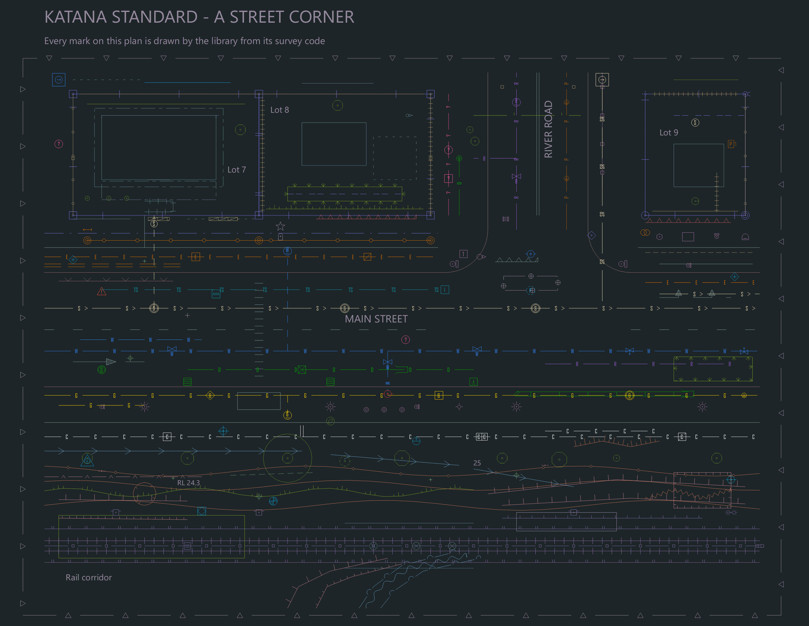
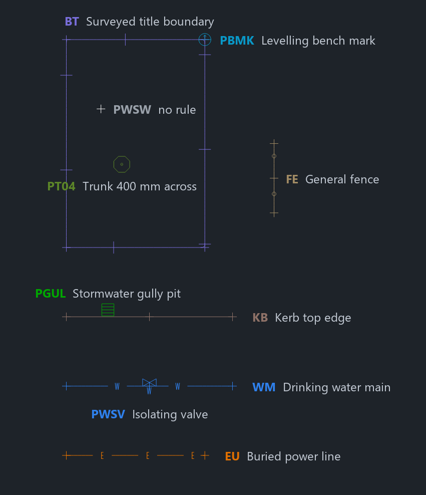
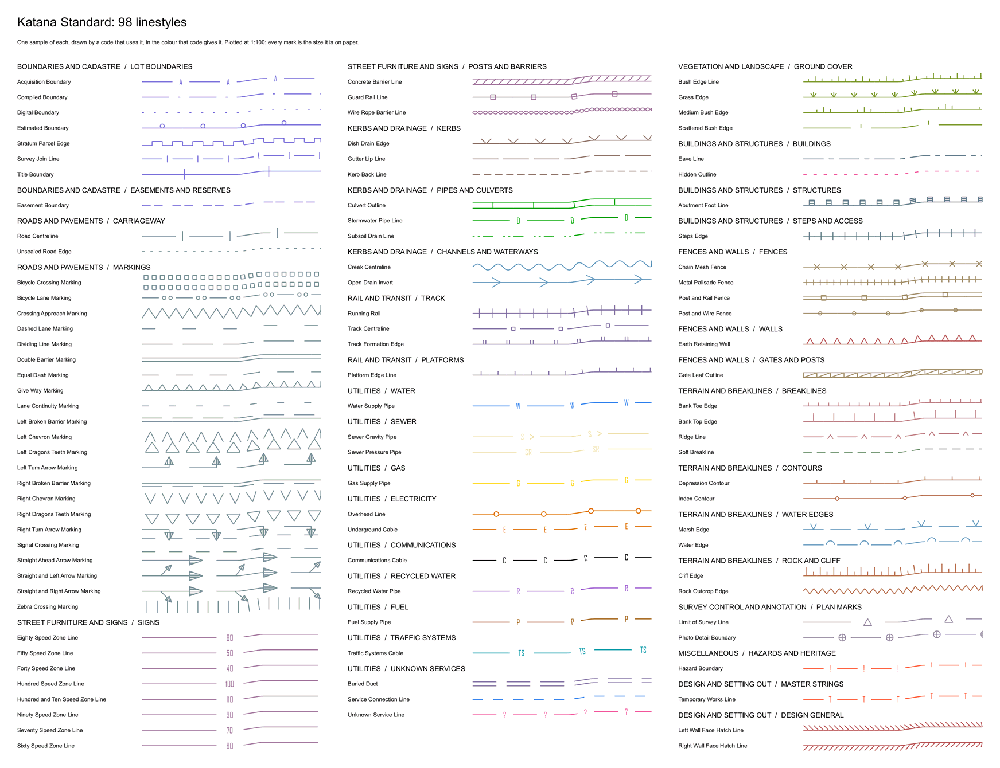
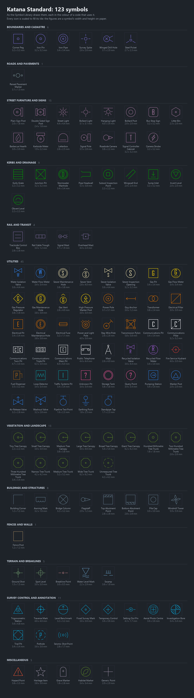

# Katana Standard

Katana Standard is a survey feature library written for Katana: one Katana customisation file, `resources/customisation/katana-standard.customisation.json`, with 98 linestyles, 123 symbols and 632 survey codes (1103 rules), a palette of 28 colours and 160 layers. Its survey code **keys** are the NSW customisation's, byte for byte, and each key stands for the same thing and has the same kinds of rule there as here, so a field file coded for one is read by the other and makes the same kinds of entity in both. That is the owner's decision. What the library names, draws and words is Katana's own: every linestyle and symbol, every layer path, colour, pen weight, text style and legend label was designed and written for it ("What is shared and what is not", below, says exactly what comes from the other library). This document is its catalogue: how to load it, how to read a code, every definition and every code, and what Katana does and does not yet do with what the file says.

Everything below that is a table, a count or a description is generated from the data by `tools/katana_standard/make_katana_standard.py --docs`, so it cannot disagree with the file; the prose around it is written by hand in `tools/katana_standard/catalogue.py`. "How it is made and held" says what keeps the two true.

*An invented street corner, drawn in Katana's plan view with nothing but the library: 192 of its 632 codes are in it, kerbs and lots, houses, fences, trees, the services under and over the road, a stretch of rail on a bridge, contours and a creek, control marks and the labels. Every mark is the size it is on paper and sits where its code put it (`tools/katana_standard/showcase.py`). Katana does not yet apply a code's pen weight, so every line is drawn at one width here and the weight ladder of "Pen weights" is not shown.*

**Contents.** [At a glance](#at-a-glance) · [Using it](#using-it) · [Reading a code](#reading-a-code) · [What is shared and what is not](#what-is-shared-and-what-is-not) · [The palette](#the-palette) · [Linestyles](#linestyles) · [Symbols](#symbols) · [The codes](#the-codes) · [Index by key](#the-codes-in-alphabetical-order) · [Index by label](#the-codes-by-label) · [Decisions](#decisions-and-what-was-rejected) · [How it is made and held](#how-it-is-made-and-held) · [Not done](#not-done)

## At a glance

|  |  |
|---|---|
| Name | `Katana Standard`, edition 1, Katana customisation format version 1 |
| Definitions | 221: 98 linestyles and 123 symbols, in 51 groups, all in paper units, so a mark keeps its size at any zoom and plot scale |
| Survey codes | 632 keys: 422 prefix keys that end in `*`, 209 exact keys and the bare `*`; in 13 classes and 57 groups; 1103 rules |
| The keys | the other built-in's, byte for byte; what each key stands for (with the size or the model zone the other gives it) and its rule kinds, draw mode, text and pipe rules and surface flag follow the other built-in's too ("What is shared and what is not") |
| Layers | 160, always three levels (`class/group/family`), lower case |
| Palette | 28 named colours, each at least 3:1 against the plan view's ground and against white paper as it prints (yellow gas and cream sewer, which are AS 5488's, print light); the service colours are AS 5488's and `UTILITY DRAW`'s |
| Says nothing of | linework control words and import automation: loading it never resets a colleague's spellings or switches |
| Notice | Katana Standard was made for Katana: its linestyles, symbols, layers, colours and words are Katana's own. Its survey code keys, what each key stands for and the kinds of rule each key has are those of the other built-in library, kept so that the same field data works with either, on the owner's decision. Its licence is that of the Katana repository, whose LICENSING.md says what that leaves open for the keys. |

## Using it

What is true now. Katana Standard **is** the built-in (the owner's ruling, 2026-10-08): a program starts with it, and the NSW customisation is compiled in beside it as an alternate that Settings (Built-in library, then Use) and `CUSTOMISE BUILTIN NSW` choose. It also loads like any customisation file (`docs/customisation.md`, "Using the customisation").

1. **Load it alone.** `CUSTOMISE REPLACE resources/customisation/katana-standard.customisation.json` in the window's command line, in `katana_cli` or through `katana_mcp`; or File > Settings > Import with "Replace instead of merging" ticked. Its definitions become the whole library and its rules the whole of the codes. It brings no linework spellings and no import switches, so the session keeps its own.
2. **Merging works, with one caution.** `CUSTOMISE <file>`, or Import without the tick, merges by name. The most specific rule wins field by field, so a broader prefix rule already in the session can still supply a field these rules leave unsaid (a symbol, a text). Merged onto the NSW customisation, which has the same keys and the same kinds of rule for each, every rule of that one is replaced by this library's, so the codes become Katana Standard's while the other's definitions and colours stay loaded beside these, named by no code: load it alone when you want its library and nothing else.
3. **Start with it, or go back to it.** It is what a program starts with when nothing else is said. After another built-in was chosen, `CUSTOMISE BUILTIN "Katana Standard"` or Settings > Built-in library > Use puts it back, and `CUSTOMISE RESET` does too unless the run was started with another built-in as its own: `KATANA_BUILTIN_CUSTOMISATION=NSW` starts with the other, and RESET then gives that one (`docs/headless.md`, "The customisation a run starts with"). `KATANA_BUILTIN_CUSTOMISATION=none` starts with no built-in.
4. **Compiled in**: `-DKATANA_BUILTIN_CUSTOMISATION=<file>` at configure time embeds a different default, and `-DKATANA_ALTERNATE_CUSTOMISATIONS=<files>` further built-ins (`docs/building.md`, "The built-in customisation and the reference folder"). A build directory configured before this became the default that still has the earlier default is moved to this one by its next configure, once, with a line saying so.
5. **Then work as usual.** `SURVEY IMPORT <file>` or Survey > Import Survey Points codes and strings the points by these rules in one undo step; `CODE`, `LINEWORK`, `CODE EXPLAIN <code>`, `CODE LIST` and `CODE CHECK` read them. `CODE CHECK` reports no problems on the file: 1103 rules checked, no error and no warning (`cli.katana_standard_code_check_finds_no_problem`).

A worked example, run for this document and held by `cli.katana_standard_imports_a_field_file_and_reports_the_mistyped_code`. The invented field file `tests/data/katana_standard/street_corner.fld` has twenty entered coordinates: a lot boundary coded `BT` in string 1 and closed by opcode 20, a kerb `KB`, a fence `FE`, a water main `WM` and a buried power line `EU`, four single points (an isolating valve `PWSV`, a tree trunk `PT04`, a gully pit `PGUL` and a bench mark `PBMK`) and one mistyped code, `PWSW`. With the library loaded by `CUSTOMISE REPLACE`, `SURVEY IMPORT` draws 20 points and 5 lines: 19 points are coded onto 9 layers in 9 styles, and the 20th, `PWSW`, is reported as a code no rule answers, since only the bare `*` fits it and that rule names no layer, no linestyle and no symbol. The lot boundary is a closed line of 100 m round, 600 square metres; the kerb and the water main are 24 m, the fence 10 m and the power line 20 m. Worked out by hand from the codes below before it was run.

*After the import, from the top: the closed lot boundary with its bench mark and its tree trunk; the fence beside it, drawn as posts on a wire; the kerb with a gully pit; the water main with its valve; the buried power line. The plain cross inside the lot is `PWSW`, the point no rule answers. Pen weights are not yet applied, so the boundary is no heavier than the fence. The words beside each feature are laid on the screenshot afterwards, from the library's own legend labels.*

## Reading a code

A code is a **key**, and the keys are the NSW customisation's: `AC*` is a bollard, `PT04` a tree trunk 400 mm across, `WM*` a water main. In the field a point's code is the key and a string number, then control words: `WM1 ST`, `WM1`, `WM1 END` is one water main. The grammar, in full:

1. THE KEYS ARE ANOTHER LIBRARY'S, AND SO IS WHAT EACH KEY STANDS FOR. Katana has two built-in customisations, this one and the NSW one (resources/customisation/nsw.customisation.json). By the owner's decision they use the SAME survey code keys, byte for byte, so that a field file coded for either draws in both. With a key comes what it is: the thing it codes, read from the other library's label for it (with the size or the model zone that library gives it), and the kinds of rule it has (rule 6). Nothing the other library NAMES, DRAWS or WORDS is taken: every layer, colour, weight, linestyle, symbol, attribute name, text style, group and legend label, and every sentence of the meanings and of this document, is Katana's own. No key is ours: the keys are the other library's identifiers, reused for field-data compatibility, and the licence notes say so (LICENSING.md).
2. A key is an exact code or a prefix. `PBMK` matches the code PBMK and no other; `AC*` matches every code that begins AC (AC, AC1, AC01, ACE); the bare `*` matches every code. A code meets every key that fits it, and for each field the most specific rule that says anything about it wins: an exact key before a prefix, a longer prefix before a shorter, `*` last (`SurveyMap::lookup`). So the keys `PT04` and `PT04*` are two parts of one code: the first gives a trunk its symbol and the second keeps it out of the ground surface; and `Z0*` is more specific than `Z*`. A key is matched as written, in capitals: `ac1` matches no rule (`CODE EXPLAIN ac1` says the key `AC*` differs only in letter case), so set the data collector to send capitals.
3. Keys are capital letters and digits. A digit that is part of a key belongs to it: `U1*` is a 225 mm stormwater pipe and `PT04` a 400 mm trunk. The STRING NUMBER follows the key, and the linework reads it: `WM1` and `WM2` are two water mains, both answered by `WM*`. The keys `1`, `2`, `3`, `4`, `5`, `7` and `8` are text sizes (1.5, 2.5, 3.5, 5, 7 and 10 mm of paper, and the parcel label's 2.5), and `1*` to `8*` give that text its layer.
4. Control words follow the code, after a space: `ST` first point, `END` last point, `CL` last point and close, `BC` and `EC` begin and end a curve (three points fix an arc), `JPN n` also join to point number n, `RECT` the third point of a rectangle. These are Katana's default spellings; the library says nothing about them, so loading it never resets a colleague's own. The first token of a point's code is always the key, and a control word is read only after it. So a control word typed ALONE is a code, and six of the seven are answered: four keys are spelled like one (`BC*`, `CL*`, `EC*` and `ST*`: a point coded `CL` is a string called CL) and two more answer one by prefix (`EN*` answers `END`, `RE*` answers `RECT`); only `JPN` is answered by no key.
5. There is no left or right suffix: the rule engine matches a key exactly or by prefix and has nothing else. A handed pair is two keys (`CV*` and `CY*` chevrons, `DA*` and `DC*` dragons teeth, `LH*` and `LR*` broken barrier lines, `HE*` and `HR*` wall hatching). Otherwise handedness is by walking direction: ticks, barbs, triangles, scallops and chevrons fall to the LEFT of travel. Symbols are drawn upright and are not turned to a bearing (Katana reads a rule's rotation and does not yet apply it), so a symbol's position is its message.
6. The STRUCTURE of every key is the other library's: the same ordered kinds of rule (feature, symbol, text, pipe, vertexPipe, segmentPipe, attributes, vertexAttributes, surface), the same draw mode (line or point), the same hide and surface flags, text rules where it has text rules and pipe rules where it has pipe rules, so that one field file makes the same kinds of entity (points, lines, text, pipes, surface members) in either library. `tools/katana_standard/parity.py` compares the two files and the tests hold it. What a key LOOKS like is Katana's.
7. One clean rule set per key. The other library repeats rules and shadows them, names pen colours that resolve to nothing, draws a symbol through a linestyle slot, and hangs on the pipe rules of its bare `*` attributes that a lookup applies to every code; this one writes one rule of each kind per key, resolves every name, says a symbol in a symbol rule and puts no attribute on a pipe rule. Where the two differ for that reason the key is listed in `parity_exceptions.json` with the reason, and `parity.py` fails the day an entry explains nothing.
8. What a code sets, in this order. `feature`: layer, colour, draw (line or point, none for a layer-only key), linestyle (lines only), weight, group and comment. `symbol` for points and for lines that carry a symbol at every vertex. `text` for the text keys. `pipe`, `vertexPipe` and `segmentPipe` for the bare `*`. `attributes` and `vertexAttributes`. `surface`, written where the other library writes it, and false there every time: it keeps what is not the ground (a mark, a trunk, a design string, a pipe) out of a ground surface, and no key says it belongs in one. Layers are three levels, lower case (`class/group/family`), and a family is what one switches on and off together.
9. Attributes. An attribute with an EMPTY value is a PROMPT: the code asks for it. One with a value is applied. Names carry their unit (`Depth (m)`, `Diameter (mm)`). The other library's attribute rules are kept as they are (a model zone to check, a point code), and one more is added to a code that stands for a buried or strung service, last: `utility.type` set to the service word, then the prompts Owner, Depth (m) (Height (m) for a line strung overhead) and Condition; a pipe also Material and Diameter (mm), a box culvert Width (mm) and Height (mm). Where the key stands for a size (a 300 mm pipe, a culvert 1200 mm high: the other library's label for the key gives it, the key itself states none) the size is applied. Those are the words Katana's utility tools read, so a coded string is already typed for UTILITY DRAW. Stormwater pits and pipes are services too, though they are catalogued with drainage. The prompts use the library's own names, not `utility.owner`, so an empty prompt never reads as "recorded". The added rule makes no entity and `parity.py` counts it apart.
10. `comment` is the LEGEND LABEL: a noun phrase in sentence case, 1 to 36 characters, which the plot legend prints in capitals. When several codes share one linestyle the legend takes the linestyle's name instead, unless every coded entity agrees on the label. The longer text is `meaning`.
11. Weights, in millimetres of pen: 0.13 hairline, 0.18 fine, 0.25 light, 0.35 medium, 0.50 strong (0.70 is reserved). The hairline is for hatching, joints, hidden detail, tree outlines, text and design strings; nothing in the planting or ground classes is lighter than 0.18, since those colours are the faintest on paper. Katana stores `weight` and does not yet apply it; the scale is still the documented intent.
12. What Katana applies today and what it only stores. `CODE` applies layer, colour, linestyle, symbol name and size, and the string attributes (a value starting with `$` is deferred, not written), and the legend prints the comment. It stores, lists and lints, and does not yet apply: weight, group, hide, surface, text rules, pipe rules (justify, shape, sizes taken from the attributes), rotation, offset and raise. The rules are written for the day it does.
13. Load the library alone, or with Replace. Merged onto another customisation, a broader prefix rule there can supply a field these rules leave unsaid (a symbol, a text), because the most specific rule wins field by field. Merged onto the other library, which has the same keys and the same kinds of rule for each, every rule of it is replaced by this library's (a merge replaces the rules of a key of one kind), so the codes become this library's; the other's definitions and colours stay loaded beside these, and no code names them.
14. The classes. The 13 classes and their groups are this library's own way of arranging the keys for a reader and for the layer tree: a class letter is a label in the catalogue and is not part of any key. The keys that the other library labels as design strings (road, lane, earthworks, kerb, bridge, drainage and barrier design, master strings) are class D, Design and Setting Out; the bare `*` belongs to no class.

### The thirteen classes

The classes and groups arrange the keys for a reader and fix the first two levels of a layer. A class letter is a label for this table and for the picture scripts, and no key is built from one.

| Letter | Class | Codes | Groups | What it holds |
|---|---|---|---|---|
| `C` | Boundaries and Cadastre | 30 | Lot Boundaries, Easements and Reserves, Boundary Marks | Where one owner's land ends and the next begins, and the marks that prove it. |
| `R` | Roads and Pavements | 36 | Carriageway, Markings, Paths and Access | The made surface: its edges, its paint and the paths beside it. |
| `S` | Street Furniture and Signs | 36 | Signs, Lighting, Posts and Barriers, Amenities, Traffic Control | What people read, sit on, light their way by or steer round. |
| `K` | Kerbs and Drainage | 82 | Kerbs, Pits and Structures, Pipes and Culverts, Channels and Waterways | Where the street meets the water: kerbs, pits, pipes and channels. |
| `T` | Rail and Transit | 13 | Track, Overhead and Signals, Platforms | Track, the lineside fittings and the platforms beside it. |
| `U` | Utilities | 118 | Water, Sewer, Gas, Electricity, Communications, Recycled Water, Fire Service, Fuel, Traffic Systems, Unknown Services | Everything buried or strung that carries a service, one family per service. |
| `V` | Vegetation and Landscape | 58 | Trees, Ground Cover | Trees and the edges of planted and natural ground cover. |
| `B` | Buildings and Structures | 35 | Buildings, Structures, Steps and Access | What stands on the ground: buildings, bridges, masts, tanks and steps. |
| `F` | Fences and Walls | 8 | Fences, Walls, Gates and Posts | What divides land: fences, walls, and the posts and gates between. |
| `G` | Terrain and Breaklines | 25 | Ground Points, Breaklines, Contours, Water Edges, Rock and Cliff | The shape of the ground: shots, breaklines, contours, water edges and rock. |
| `M` | Survey Control and Annotation | 54 | Control Marks, Investigation Points, Text and Notes, Plan Marks | The survey's own marks, its investigations and the words on the plan. |
| `X` | Miscellaneous | 21 | Hazards and Heritage, General, Land Use Areas | Hazards, heritage, land use and the catch-alls. |
| `D` | Design and Setting Out | 115 | Road Design Strings, Lane Marking Design, Earthworks Design, Kerb and Carriageway Design, Bridge Design, Drainage Design, Barrier and Fence Design, Master Strings, Design General | Strings that carry a design, not a survey: set out from them, do not read the ground from them. |

The bare `*` belongs to no class. What each kind of code draws, by count:

| Kind | Codes | Meaning |
|---|---|---|
| line | 359 | a line, joined from the points |
| point | 205 | a point, with a symbol (all but `POCP`, `PRTR` and `PLIG*`, which name none and draw as a plain point) |
| both | 1 | a line with a symbol at every vertex |
| text | 7 | text of a size |
| layer | 7 | the layer of the text codes |
| surface | 52 | a surface flag and nothing else |
| pipe | 1 | the round pipe section of any string that carries a diameter |

### Pen weights

Every code names one of five weights, in millimetres of pen; a sixth is reserved. Katana stores a rule's `weight` and does not yet apply it to what it draws, so the scale is the documented intent, for the day it does.

| Weight | Role | For |
|---|---|---|
| 0.13 | hairline | hatching, joints, hidden detail, tree outlines, design strings, text |
| 0.18 | fine | vegetation, ground shots and levels, intermediate contours, markings, minor services |
| 0.25 | light | everyday detail: fences, paths, branches, structures |
| 0.35 | medium | primary detail: kerbs, building walls, service mains, index contours |
| 0.50 | strong | title boundary, bridge decks, limit of survey |
| 0.70 | bold | reserved; not used by a code in edition 1 |

**What Katana applies today.** `CODE` and a survey import apply layer, colour, linestyle, symbol name and the string attributes, and the plot legend prints the comment. Katana stores, lists and lints, and does not yet apply: `weight`, `group`, `hide`, `surface`, text rules, pipe rules, and a symbol's rotation, offset and raise. So the four hidden symbols still draw, the seven text codes draw a plus until text rules are applied, and the plain continuous lines of one colour on one layer, such as the kerb top `KB*` and the kerb edge of a median `TM*`, look the same on the plan until the weight is applied. The rules are written for the day it does.

## What is shared and what is not

**Shared, by the owner's decision: the survey code keys, what each key stands for, and what it does.** Three things come from the NSW customisation, and each is a fact about a key and not a name, a drawing or a sentence:

1. **The keys.** The same 632 keys, byte for byte, including every prefix rule ending in `*`, the numbered families and the bare `*`.
2. **What each key stands for.** A key says nothing by itself: that `AC*` is a bollard and `U3*` a 375 mm pipe is read from the other library's label for the key, and so is every size and number a code here states. 28 keys apply a pipe diameter and 18 a culvert height that the other library's label gives and the key does not; 12 keys apply the model zone of the other library's attributes rule; the 7 text keys have its text sizes. The reading is this library's, worded in its own sentences ("Not done" says where a label left the purpose open).
3. **What each key does.** The same kinds of rule in the same order, the same draw mode (line or point), the same hide and surface flags, a text rule of the same units, size and justification where the other has one, and pipe rules of the same justification and shape where the other has them. A field file therefore makes the same kinds of entity in either.

These are the other library's identifiers and its facts about them, reused for field-data compatibility (`LICENSING.md` says what that leaves open). `tools/katana_standard/parity.py` compares the two files and the tests hold the result.

**Katana's own: everything the library names, draws and words.** Linestyles and symbols (every one drawn here, from a written brief and looked at in Katana's own renderer) and their names, group paths, layer paths, colours and the colour table, pen weights, attribute names, text styles, legend labels, and every sentence of every meaning and of this document. `tools/katana_standard/originality.py` scans the two files for what a person could copy and the test `KatanaStandard.NothingButTheKeysIsSharedWithTheNswFileTrackedBesideIt` holds the result: no definition name, group path, layer path, legend label, colour name, attribute name or text style is the same in both, and no stroke list is, exactly, moved or scaled, beyond the dash, the plus and the square that any library draws. A name is the same when its letters and digits are, whatever its case, blanks and punctuation; and a definition name is compared with everything the other library calls a thing: its definition names, those names without the capitals it puts in front of them, and its legend labels, since a symbol named after the other library's label would be its name for the thing all the same. None is. Of colour values one is in both: pure white, `#FFFFFF`, which AS 5488 names for communications and which every drawing system has. The script and the tests excuse that one white, the communications colour of `utilityTypeColour`, and no other value: a second white would fail them.

**What two libraries cannot help sharing** is the trade's own names for real things, and the sizes above. A give way line, a sewage pumping station and a culvert by its height are called that by anyone, so some legend labels here are near the other library's label for the same key without being it: `originality.py` counts them (28 at 0.85 alike or more) and prints this library's side, as a figure to read. No definition name and no legend label is that near (0.9) to a name or a label of the other library under another key. The meanings are sentences written for this document, and where one uses a term of the trade or of the law (a permanent survey mark, an endangered ecological community) it is because that is the thing's name.

**One field file, the same kinds of entity.** A code is answered by several keys at once, the exact key and every prefix key that fits it, and each field comes from the most specific rule that says it; so beside comparing key with key, `parity.py` looks up 2292 codes in both files as the program does (every key's own code, alone and followed by a string number, a padded one and a letter) and compares what comes out: the draw mode, the surface flag, whether a symbol is drawn and whether it is hidden, the text and the pipe rules. They are the same for every one.

**Where the other library is not clean, this one is.** The NSW customisation holds 1624 rules over 632 keys. 446 of the rules repeat an earlier rule of their key exactly and 257 add nothing to an earlier one, in 465 of the keys; 5 more say something the first rule of their kind leaves unsaid, which a lookup then takes (in 4 keys a `hide`, so the symbol is hidden); 3 keys name a pen colour that resolves to nothing; 1 draws its symbol through the linestyle slot, which `CODE CHECK` reports as a linestyle that is a symbol; and the pipe rules of the bare `*`, written for a system in which a rule can be for one case of an attribute, carry those cases as attributes, which a lookup here applies to every code (4 of them). Katana Standard keeps one clean rule set per key: one rule of each kind, every name resolved, the symbol said in a symbol rule, `hide` said where the lookup makes it true, and no attribute on a pipe rule. Those 669 differences are listed in `tools/katana_standard/parity_exceptions.json`, one entry for each key and reason, and `parity.py` fails on an entry that explains nothing or a difference that has none.

| Reason | Keys | What the other library does and this one does not |
|---|---|---|
| nsw-duplicate-collapsed | 445 | repeats a rule of the key field for field |
| nsw-shadowed-collapsed | 214 | has a later rule of a kind that says nothing the earlier one of the key did not |
| nsw-fields-merged | 5 | has a later rule that says a field, or names an attribute, that the first leaves unsaid; here the one rule says the field |
| nsw-unknown-colour-replaced | 3 | names a pen colour that resolves to nothing |
| nsw-linestyle-symbol-resolved | 1 | names a symbol as a linestyle; here a symbol rule follows the feature rule |
| nsw-pipe-attributes-left-out | 1 | carries attributes on its pipe rules, which a lookup applies to every code the key answers; here a pipe rule carries none |

**What this library adds.** 186 keys carry one more attributes rule than the other library has for them, last: the service word `utility.type` and the prompts Owner, Depth (m) and Condition (grammar rule 9). The rule makes no entity, so the same field file still makes the same kinds of entity; it is why a coded string is typed for `UTILITY DRAW`. `parity.py` counts these apart (186 rules) and `--no-extra-attributes` makes them differences. So the kinds of entity are the same in the two libraries and the properties on them are not: a service coded here carries its service word and its prompts, and nothing coded here carries the attributes the other's `*` rules apply.

## The palette

Twenty-eight colours, each named `katana <role>` so a rule reads as the thing it colours, and none can fold onto one of the 27 standard names Katana already knows. Each is at least 3:1 against the plan view's ground (`#1E2329`, a blue-grey that is almost black) and against white paper, since one library is plotted and read on the screen (two AS 5488 colours are excused on paper, below); and no two are closer than 0.05 in OKLab, about where two thin lines of different colour stop being told apart. That leaves only a narrow band of lightness, so the six warm classes (kerb, wall, contour, fuel, fence, breakline) were placed by a search, each at least 0.06 from every other colour, and the six classes drawn with the thinnest pens (tree, planting, ground, building, wall, communications) keep at least 3.25 : 1 on both grounds, as they print. Colour does not carry a class alone: for a reader who confuses red with green some warm pairs stay close whatever their values, so every pipe has its letter and every line class its own pattern.

**The service colours are AS 5488's.** AS 5488.1 has a primary code and line colour table (its Appendix B) that names a colour for each service: water blue, electricity orange, communications white (black when drawn on a white ground), gas yellow, sewer cream, stormwater and drainage green, recycled water purple, fire service red and unidentified services pink; published guides add petroleum brown. The standard names the colours and gives no sRGB, and it leaves the colours of plans to whoever draws them (clause 1.2.2 of the 2013 edition), so each value here is Katana's rendering of the name. The sources, the names and the values are in `docs/subsurface_utilities.md`, "Colours". Traffic systems have no AS 5488 colour and are Katana's choice. The US convention (electricity red, communications orange, sewer green), which this library first used, is not Australian, so it is rejected: the library follows AS 5488.

**The two utility conventions agree.** `UTILITY DRAW` draws its layers in these same values (`utilityTypeColour`), and `KatanaStandard.EveryServiceColourIsTheColourUtilityDrawUses` holds the library and that table equal, service by service, and holds every utility code to its service's colour. A drawing that mixes coded survey strings and `UTILITY DRAW` output has one convention in it. Hazard is the one other colour that moved: AS 5488's electricity orange left the old hazard orange 0.043 away, under the 0.05 floor, so hazard is a red-orange (`#FF5A37`) 0.077 from electricity.

**Yellow and cream print light.** On white paper yellow gas (1.42 : 1) and cream sewer (1.30 : 1) cannot reach 3:1 and still be yellow and cream. The colours are the standard's, so they are not darkened: they keep their 3:1 against the plan ground and print light, and the tests name them as the only two excused. Communications is white, which the plot prints black (`cad::paperColour`: every channel at 230 or more), so it is held to the floor as printed (21.00 : 1). A plot that must show gas and sewer firmly plots monochrome, which prints every pen black, or recolours those layers.

**Buried services**

| Colour | Value | Used for | AS 5488 | On the ground | On white |
|---|---|---|---|---|---|
| `katana water` | `#2F80ED` | potable water | blue | 4.09 : 1 | 3.87 : 1 |
| `katana sewer` | `#F0E2B0` | sewer | cream | 12.21 : 1 | 1.30 : 1 (prints light) |
| `katana gas` | `#FFD500` | gas | yellow | 11.12 : 1 | 1.42 : 1 (prints light) |
| `katana electricity` | `#E07000` | electricity | orange | 4.89 : 1 | 3.24 : 1 |
| `katana telecom` | `#FFFFFF` | communications | white | 15.82 : 1 | 21.00 : 1 (prints black) |
| `katana recycled` | `#9B59D0` | recycled water | purple | 3.57 : 1 | 4.44 : 1 |
| `katana fire` | `#E53935` | fire service | red | 3.74 : 1 | 4.23 : 1 |
| `katana fuel` | `#A36215` | fuel and petroleum | brown | 3.25 : 1 | 4.87 : 1 |
| `katana its` | `#0B9BA8` | traffic systems | Katana's choice | 4.72 : 1 | 3.35 : 1 |
| `katana unknown` | `#F2559B` | unidentified service | pink | 4.93 : 1 | 3.21 : 1 |

**Water and drainage**

| Colour | Value | Used for | AS 5488 | On the ground | On white |
|---|---|---|---|---|---|
| `katana stormwater` | `#00A800` | stormwater pipes and pits | green | 4.97 : 1 | 3.18 : 1 |
| `katana waterway` | `#6399BE` | creeks, open drains and water edges |  | 5.14 : 1 | 3.07 : 1 |

**Roads, street and rail**

| Colour | Value | Used for | AS 5488 | On the ground | On white |
|---|---|---|---|---|---|
| `katana pavement` | `#789295` | road edges, markings and paths |  | 4.78 : 1 | 3.31 : 1 |
| `katana kerb` | `#907368` | kerbs |  | 3.64 : 1 | 4.34 : 1 |
| `katana street` | `#A2759D` | street furniture and signs |  | 4.19 : 1 | 3.77 : 1 |
| `katana rail` | `#816FA3` | track, overhead wire and platforms |  | 3.57 : 1 | 4.43 : 1 |

**Land, ground and boundaries**

| Colour | Value | Used for | AS 5488 | On the ground | On white |
|---|---|---|---|---|---|
| `katana boundary` | `#796EDA` | lot boundaries, easements and boundary marks |  | 3.81 : 1 | 4.15 : 1 |
| `katana contour` | `#B9704F` | contours, rock and cliff |  | 4.14 : 1 | 3.82 : 1 |
| `katana breakline` | `#BE7D83` | breaklines |  | 4.86 : 1 | 3.26 : 1 |
| `katana ground` | `#688F68` | ground shots and levels |  | 4.31 : 1 | 3.67 : 1 |

**Vegetation**

| Colour | Value | Used for | AS 5488 | On the ground | On white |
|---|---|---|---|---|---|
| `katana tree` | `#5C8627` | trees |  | 3.69 : 1 | 4.29 : 1 |
| `katana planting` | `#779624` | the edges of timber, scrub, grass and crops |  | 4.65 : 1 | 3.40 : 1 |

**Built form**

| Colour | Value | Used for | AS 5488 | On the ground | On white |
|---|---|---|---|---|---|
| `katana building` | `#627B8C` | buildings and structures |  | 3.56 : 1 | 4.44 : 1 |
| `katana fence` | `#A18C65` | fences and gates |  | 4.86 : 1 | 3.25 : 1 |
| `katana wall` | `#BA5556` | walls |  | 3.41 : 1 | 4.64 : 1 |

**Control, notes and hazards**

| Colour | Value | Used for | AS 5488 | On the ground | On white |
|---|---|---|---|---|---|
| `katana control` | `#0999C9` | survey control and investigation points |  | 4.83 : 1 | 3.28 : 1 |
| `katana note` | `#9A8EA4` | text and plan marks |  | 5.11 : 1 | 3.10 : 1 |
| `katana hazard` | `#FF5A37` | hazards |  | 5.10 : 1 | 3.10 : 1 |

## Linestyles

98 linestyles, each a repeating cell. A linestyle named by a rule replaces the line, so the gaps are the library's job; every one is drawn so that it reads at plan scale on screen and on a plotted sheet.

*One sample of each, drawn by a code that uses it. Pen weights are not yet applied, so every line is the same width here. This is a plot on white paper: the communications cable prints black, and the sewer and gas pipes print light, since AS 5488's cream and yellow are under 3:1 on white (see the palette).*

**How they are drawn.** The rules the data's own check enforces:

- Units are paper millimetres, so a pattern keeps its size at any plan scale.  +x runs along the line and +y is to its LEFT.  Instance k starts at k times `length`; every stroke lies inside 0..length in x and inside plus or minus 3.4 mm in y, so a pattern closes on itself and nothing overshoots a join.
- A cell is laid out from x = 0.  A dash starts it, so a line opens with a full dash, and every dash is one stroke inside its cell: nothing abuts across the join, which would show as a faint seam where two antialiased ends meet.  Marks stand at the exact middle of a gap or of the cell.  Waves start on the line.
- The repeating pattern is mirror-symmetric along the line, about the middle of one of its dashes or marks, so read from either end it has the same marks in the same places: only where a mark stands to one side (a tick, a hump) does the digitising direction show, always as the LEFT.  The few patterns with a direction of their own (the flow chevrons, the dot-dot-dash drain) or an irregular tuft are named in SYMMETRY with "none", and the barrier hatch, which leans, with "point"; the check proves the symmetry of the rest.
- Katana lays a definition by giving every stroke POINT its own distance along the line, so a long straight stroke is a chord and cuts a corner.  Every straight run along the line is drawn in chords of at most one millimetre (`_Pen.run`), which keeps a dash or a baseline within about 0.35 mm of a right-angle corner.
- A dot is a 0.6 mm dash.  Katana draws the `dot` stroke as one point the width of the pen: a speck a third of the line's weight on a plot and a single pixel on the screen, so that a dash-dot line reads as dashes.
- Posts stand ON the line, which runs through them: guard rails, fence posts, chain mesh.  Beads are THREADED on it, the line stopping at each side of the bead and the inside left open: the contour diamond and the insulator ring.  The two kinds of mark are then told apart at a glance even where their outlines match.
- Letters are 2.4 mm and `middle-centre`, in a gap of 5 mm or more.  Numbers carry at most three decimals. No stroke names a pen: the code's rule gives the colour.
- Paint is drawn as lines, so a "solid" shape (an arrowhead, a block) is a closed outline ruled with fine lines parallel to its axis, 0.4 to 0.5 mm apart, which reads as ink at plan scale.  A road arrow lies along the line and points the way you shot; a turn or a branch stands to the LEFT or RIGHT of the line, as its name says.  A mark that leans (an arrow, a hatch tick) is named in SYMMETRY with "none".

Reading a table: *Period* is the length of one cell in millimetres of paper; *Used by* lists the codes that name it. A linestyle shared by several codes is the same line in each: the layer and the colour tell them apart.

### Boundaries and Cadastre/Lot Boundaries

| Linestyle | Period (mm) | What it looks like and when to use it | Used by |
|---|---|---|---|
| `Surveyed Boundary` | 25 | Unbroken line crossed by a short tick every 25 mm: the registered title boundary, the firmest line in the cadastre. | `BT*` |
| `Compiled Boundary` | 14 | Long dash, then one dot: a boundary compiled from plans and not measured in the field. | `BC*` |
| `Estimated Boundary` | 12 | Unbroken line with a small ring standing against it on the left every 12 mm: a boundary known only to about half a metre. | `BN*` |
| `Digital Boundary` | 3.5 | A sparse dotted line, one dot every 3.5 mm: a boundary read from the digital cadastre, the least certain of the boundary lines. | `BM*` |
| `Acquisition Boundary` | 14 | Long dashes with the letter A standing in each gap: the proposed boundary of land to be acquired, not yet on title. | `BY*` |
| `Stratum Parcel Edge` | 6 | A square wave 1.2 mm high with 3 mm steps and no baseline, like levels stacked one above the next: the limit of a stratum parcel. | `BZ*` |
| `Survey Join Line` | 9 | Fine dashes with a short bar across the line in each gap: a line that joins two points of a plan and is not itself a boundary. | `JL*` |

### Boundaries and Cadastre/Easements and Reserves

| Linestyle | Period (mm) | What it looks like and when to use it | Used by |
|---|---|---|---|
| `Easement Boundary` | 9 | Paired short dashes, 2.6 on, 0.9 off, 2.6 on, then 2.9 off: the edge of an easement or covenant area; the code says what it carries. | `BE*` |

### Roads and Pavements/Carriageway

| Linestyle | Period (mm) | What it looks like and when to use it | Used by |
|---|---|---|---|
| `Unsealed Road Edge` | 2.5 | A fine stipple of short specks, like gravel thrown on the edge: the edge of an unsealed road. | `EK*` `UR*` `VT*` |
| `Road Centreline` | 14 | Long dashes with a cross tick standing in each gap: the centre of the carriageway, shot at the crown. | `OF*` `RC*` `NL*` |

### Roads and Pavements/Markings

| Linestyle | Period (mm) | What it looks like and when to use it | Used by |
|---|---|---|---|
| `Dashed Lane Marking` | 12 | Short painted dashes with long gaps, 4 on and 8 off: the dashed line between traffic lanes. | `LL*` `L3*` `L4*` `L6*` `LN*` |
| `Double Barrier Marking` | 10 | Two close unbroken lines, 1 mm apart: the double continuous barrier line painted on a road. | `DB*` `LD*` |
| `Zebra Crossing Marking` | 3 | A row of bars across the line with no baseline, like the stripes of a zebra crossing; shoot it along the crossing's width. | `CZ*` `TL*` `LZ*` |
| `Lane Continuity Marking` | 8 | Short paint dashes, 2 on and 6 off: the broken line that carries a lane, a turn or a give-way line through a junction. | `CC*` `LA*` `LF*` `LJ*` `LT*` `LW*` |
| `Equal Dash Marking` | 10 | Paint dashes and gaps of equal length, 5 on and 5 off: the broken line of separation and clearway marking. | `CN*` `CW*` |
| `Give Way Marking` | 4 | Unbroken line with a row of small triangles standing on it to the left, one every 4 mm: the give-way line across a turning lane. | `CG*` |
| `Left Chevron Marking` | 5 | A row of open chevrons 3 mm wide centred on the line, each with its point to the left of travel: painted hatching on an island or gore. | `CV*` |
| `Right Chevron Marking` | 5 | A row of open chevrons 3 mm wide centred on the line, each with its point to the right of travel: painted hatching on an island or gore. | `CY*` |
| `Crossing Approach Marking` | 8 | A sharp zigzag 3 mm high and 8 mm long with no baseline: the zigzag painted along the approach to a pedestrian crossing. | `CA*` |
| `Signal Crossing Marking` | 8 | Two parallel rows of dashes 4 mm apart, 4 on and 4 off: the lines that bound a pedestrian crossing controlled by signals. | `CX*` |
| `Left Broken Barrier Marking` | 9 | An unbroken line with a broken line 1 mm to its left, 6 on and 3 off: a barrier line on one side and a separation line on the other. | `BS*` `LH*` |
| `Right Broken Barrier Marking` | 9 | An unbroken line with a broken line 1 mm to its right, 6 on and 3 off: the mirror of the left broken barrier marking. | `SB*` `LR*` |
| `Left Dragons Teeth Marking` | 6 | A row of painted triangles 4 mm along the line and 3 mm deep, standing to its left, one every 6 mm, with no baseline: dragons teeth. | `DA*` |
| `Right Dragons Teeth Marking` | 6 | A row of painted triangles 4 mm along the line and 3 mm deep, standing to its right, one every 6 mm, with no baseline: dragons teeth. | `DC*` |
| `Straight Ahead Arrow Marking` | 22 | A painted lane arrow along the line, a shaft ending in a ruled arrowhead, one every 22 mm and pointing the way you shot. | `AS*` |
| `Left Turn Arrow Marking` | 14 | A painted lane arrow along the line: a shaft that turns 90 degrees to the left into a ruled arrowhead, one every 14 mm. | `AL*` |
| `Right Turn Arrow Marking` | 14 | A painted lane arrow along the line: a shaft that turns 90 degrees to the right into a ruled arrowhead, one every 14 mm. | `AR*` |
| `Straight and Left Arrow Marking` | 22 | A painted lane arrow along the line: a straight arrow with a second, smaller arrow branching to the left, one every 22 mm. | `AE*` |
| `Straight and Right Arrow Marking` | 22 | A painted lane arrow along the line: a straight arrow with a second, smaller arrow branching to the right, one every 22 mm. | `AI*` |

### Street Furniture and Signs/Signs

| Linestyle | Period (mm) | What it looks like and when to use it | Used by |
|---|---|---|---|
| `Hundred Speed Zone Line` | 30 | Unbroken line broken every 30 mm by the number 100: a stretch of road signed with a speed limit of 100 km/h. | `S1*` |
| `Hundred and Ten Speed Zone Line` | 30 | Unbroken line broken every 30 mm by the number 110: a stretch of road signed with a speed limit of 110 km/h. | `S2*` |
| `Forty Speed Zone Line` | 30 | Unbroken line broken every 30 mm by the number 40: a stretch of road signed with a speed limit of 40 km/h. | `S4*` |
| `Fifty Speed Zone Line` | 30 | Unbroken line broken every 30 mm by the number 50: a stretch of road signed with a speed limit of 50 km/h. | `S5*` |
| `Sixty Speed Zone Line` | 30 | Unbroken line broken every 30 mm by the number 60: a stretch of road signed with a speed limit of 60 km/h. | `S6*` |
| `Seventy Speed Zone Line` | 30 | Unbroken line broken every 30 mm by the number 70: a stretch of road signed with a speed limit of 70 km/h. | `S7*` |
| `Eighty Speed Zone Line` | 30 | Unbroken line broken every 30 mm by the number 80: a stretch of road signed with a speed limit of 80 km/h. | `S8*` |
| `Ninety Speed Zone Line` | 30 | Unbroken line broken every 30 mm by the number 90: a stretch of road signed with a speed limit of 90 km/h. | `S9*` |

### Street Furniture and Signs/Posts and Barriers

| Linestyle | Period (mm) | What it looks like and when to use it | Used by |
|---|---|---|---|
| `Guard Rail Line` | 12 | Unbroken line with a small square post every 12 mm, the rail running through it: a roadside guard rail or crash barrier. | `FG*` `TG*` `BF*` `BG*` `MS*` |
| `Wire Rope Barrier Line` | 3 | Two fine waves in opposite phase that cross every 1.5 mm like a twisted rope, with no posts: a safety barrier of tensioned cable. | `FW*` |
| `Concrete Barrier Line` | 2.4 | Two parallel lines 1.6 mm apart ruled with a close diagonal hatch, like concrete in section: a solid safety barrier, shot along its base. | `KJ*` |

### Kerbs and Drainage/Kerbs

| Linestyle | Period (mm) | What it looks like and when to use it | Used by |
|---|---|---|---|
| `Gutter Lip Line` | 9 | Long dashes with a narrow gap, 7.6 on and 1.4 off, like the joints of a concrete gutter: the flow line at the foot of a kerb face. | `FI*` `LP*` |
| `Kerb Back Line` | 3.3 | Fine short dashes, 2.2 on and 1.1 off, stitched along the line: the back edge of a kerb, where it meets the verge or the path. | `BK*` |
| `Dish Drain Edge` | 8 | Unbroken line with a shallow V standing to its left every 8 mm: a V-shaped concrete dish drain. | `DD*` `ID*` |

### Kerbs and Drainage/Pipes and Culverts

| Linestyle | Period (mm) | What it looks like and when to use it | Used by |
|---|---|---|---|
| `Stormwater Pipe Line` | 16 | A line broken by the letter D every 16 mm: a stormwater pipe, shot at the surface or inside the pits. | `U1*` `U2*` `U3*` `U4*` `U5*` `U6*` `U7*` `U9*` `UU*` `UX*` `UZ*` `V1*` `V2*` `V3*` `V5*` `V6*` `V8*` `DI*` |
| `Culvert Outline` | 12 | Two parallel lines 1.8 mm apart joined by a tie every 12 mm, like a ladder: a rectangular culvert. | `B0*` `B1*` `B2*` `B3*` `B4*` `B6*` `B7*` `B9*` `BX*` `D0*` `D1*` `D2*` `D3*` `D4*` `D5*` `D6*` `D7*` `D8*` `D9*` `DZ*` `UB*` `DV*` |

### Kerbs and Drainage/Channels and Waterways

| Linestyle | Period (mm) | What it looks like and when to use it | Used by |
|---|---|---|---|
| `Open Drain Invert` | 14 | Unbroken line with an open chevron that points the way you shot, downstream: an open drain, a swale or a flow path. | `DF*` `DT*` `DL*` `DU*` |
| `Creek Centreline` | 12 | A smooth continuous wave 1.8 mm high and 6 mm long: the centre of a creek or river bed. | `WC*` |

### Rail and Transit/Track

| Linestyle | Period (mm) | What it looks like and when to use it | Used by |
|---|---|---|---|
| `Running Rail` | 4 | Unbroken line crossed by a tie every 4 mm, like a ladder: the head of a running rail. | `RA*` |
| `Track Centreline` | 14 | Long dashes with a small square standing in each gap: the centre of the track between the rails. | `RT*` |
| `Track Formation Edge` | 7 | Unbroken line with a pair of close short ticks to the left every 7 mm: the edge of the formation that carries the ballast. | `RF*` |

### Rail and Transit/Platforms

| Linestyle | Period (mm) | What it looks like and when to use it | Used by |
|---|---|---|---|
| `Platform Edge Line` | 5 | Unbroken line with a short tick to the left every 5 mm: the edge of a platform. | `RP*` `LB*` |

### Utilities/Water

| Linestyle | Period (mm) | What it looks like and when to use it | Used by |
|---|---|---|---|
| `Water Supply Pipe` | 16 | A line broken by the letter W every 16 mm: a pressure main that carries drinking water. | `UO*` `WI*` `WM*` `WZ*` |

### Utilities/Sewer

| Linestyle | Period (mm) | What it looks like and when to use it | Used by |
|---|---|---|---|
| `Sewer Gravity Pipe` | 20 | A line broken by the letter S and a small flow chevron: a gravity sewer. The chevron points the way you shot, so shoot downhill. | `SM*` `SZ*` |
| `Sewer Pressure Pipe` | 20 | A line broken by the letters SR every 20 mm: a pressure sewer that carries flow uphill. | `SR*` |

### Utilities/Gas

| Linestyle | Period (mm) | What it looks like and when to use it | Used by |
|---|---|---|---|
| `Gas Supply Pipe` | 16 | A line broken by the letter G every 16 mm: a pipe that carries natural gas. | `HA*` `HG*` `LG*` `NG*` `YG*` `ZG*` |

### Utilities/Electricity

| Linestyle | Period (mm) | What it looks like and when to use it | Used by |
|---|---|---|---|
| `Underground Cable` | 12 | A line broken by the letter E every 12 mm: a buried electricity cable. | `EA*` `EU*` `EZ*` |
| `Overhead Line` | 14 | Unbroken line with a small ring, an insulator, threaded on it every 14 mm: an overhead power or communications line. | `SC*` `UE*` `UL*` `OA*` |

### Utilities/Communications

| Linestyle | Period (mm) | What it looks like and when to use it | Used by |
|---|---|---|---|
| `Communications Cable` | 12 | A line broken by the letter C every 12 mm: a buried telephone, data or fibre cable. | `OU*` `OZ*` `TN*` `TZ*` |

### Utilities/Recycled Water

| Linestyle | Period (mm) | What it looks like and when to use it | Used by |
|---|---|---|---|
| `Recycled Water Pipe` | 16 | A line broken by the letter R every 16 mm: a main that carries recycled water. | `RM*` |

### Utilities/Fuel

| Linestyle | Period (mm) | What it looks like and when to use it | Used by |
|---|---|---|---|
| `Fuel Supply Pipe` | 16 | A line broken by the letter P every 16 mm: a pipeline for fuel or oil. | `FU*` `FZ*` `HO*` `HZ*` |

### Utilities/Traffic Systems

| Linestyle | Period (mm) | What it looks like and when to use it | Used by |
|---|---|---|---|
| `Traffic Systems Cable` | 18 | A line broken by the letters TS every 18 mm: a buried cable of the traffic systems service, which serves signals and cameras. | `IT*` `SD*` |

### Utilities/Unknown Services

| Linestyle | Period (mm) | What it looks like and when to use it | Used by |
|---|---|---|---|
| `Unknown Service Line` | 12 | A line broken by a question mark every 12 mm: a buried line whose service is not yet known. | `UP*` |

### Utilities/All Services

| Linestyle | Period (mm) | What it looks like and when to use it | Used by |
|---|---|---|---|
| `Buried Duct` | 10 | Two close parallel dashed lines, 1.2 mm apart: a duct or conduit that carries cable, whatever the service. | `RS*` `ED*` `OD*` `TD*` |
| `Service Connection Line` | 6 | Fine even dashes, 3 on and 3 off: the small property connection between a main and a lot. | `WY*` `SY*` `DG*` `EY*` `TY*` |

### Vegetation and Landscape/Ground Cover

| Linestyle | Period (mm) | What it looks like and when to use it | Used by |
|---|---|---|---|
| `Bush Edge Line` | 7 | Unbroken line with three uneven ticks to the left, like a tuft: the edge of scrub or bush. | `JD*` |
| `Medium Bush Edge` | 12 | Unbroken line with one tuft of three uneven ticks to its left every 12 mm: the edge of medium-density timber or scrub. | `JM*` |
| `Scattered Bush Edge` | 20 | Dashes with one short tick to the left in each gap: the edge of scattered timber or scrub, the sparsest of the three bush edges. | `JS*` |
| `Grass Edge` | 6 | Unbroken line with a small fan of three blades to the left every 6 mm: the edge of mown grass. | `JG*` `OG*` `OP*` |

### Buildings and Structures/Buildings

| Linestyle | Period (mm) | What it looks like and when to use it | Used by |
|---|---|---|---|
| `Eave Line` | 10.5 | A long dash and a short dash in turn, 1.5 mm apart: the edge of a roof overhang, a verandah or an awning. | `AW*` `BV*` |
| `Hidden Outline` | 3 | Fine short dashes, 1 on and 2 off: a building edge seen only on a plan, or a building not yet finished. | `CB*` `BW*` `OR*` `UC*` `UT*` `SL*` `XB*` |

### Buildings and Structures/Structures

| Linestyle | Period (mm) | What it looks like and when to use it | Used by |
|---|---|---|---|
| `Abutment Foot Line` | 5 | Unbroken line with a small ruled block against it on the left every 5 mm, like the toe of a footing: the foot of a bridge abutment. | `AB*` |

### Buildings and Structures/Steps and Access

| Linestyle | Period (mm) | What it looks like and when to use it | Used by |
|---|---|---|---|
| `Steps Edge` | 3.5 | Unbroken line crossed by a row of treads 2.4 mm long, one every 3.5 mm: the nosing of a flight of steps. | `SO*` |

### Fences and Walls/Fences

| Linestyle | Period (mm) | What it looks like and when to use it | Used by |
|---|---|---|---|
| `Post and Wire Fence` | 10 | Unbroken line with a small ring for a post every 10 mm: a rural fence of plain wire on posts. | `FE*` |
| `Metal Palisade Fence` | 2 | Unbroken line crossed by a close row of short bars, one every 2 mm: a steel palisade or pool fence. | `FM*` `SF*` |

### Fences and Walls/Walls

| Linestyle | Period (mm) | What it looks like and when to use it | Used by |
|---|---|---|---|
| `Earth Retaining Wall` | 4 | Unbroken line with a small triangle to the left every 4 mm: a wall that holds back earth; the barbs point to the lower side. | `RW*` `MW*` |

### Fences and Walls/Gates and Posts

| Linestyle | Period (mm) | What it looks like and when to use it | Used by |
|---|---|---|---|
| `Gate Leaf Outline` | 4 | Two close rails joined by a rung and a sloping brace, like the frame of a field gate: a gate leaf shot from its hinge to its latch. | `AG*` |

### Terrain and Breaklines/Breaklines

| Linestyle | Period (mm) | What it looks like and when to use it | Used by |
|---|---|---|---|
| `Bank Top Edge` | 6 | Unbroken line with a long tick to the left every 6 mm: the top edge of a slope, the ticks pointing downhill. | `CU*` `TC*` `VL*` `IB*` |
| `Bank Toe Edge` | 3 | Unbroken line with a short tick to the left every 3 mm: the bottom edge of a slope, the ticks standing away from the slope. | `BB*` `OH*` `IA*` |
| `Ridge Line` | 10 | Dashes with a small caret pointing to the left in each gap: a line along a crest. | `NB*` |
| `Soft Breakline` | 4 | Fine short dashes, 2.5 on and 1.5 off: a gentle change in grade that a surface should still follow. | `NS*` |

### Terrain and Breaklines/Contours

| Linestyle | Period (mm) | What it looks like and when to use it | Used by |
|---|---|---|---|
| `Index Contour` | 20 | Unbroken line with a small diamond bead threaded on it every 20 mm: every fifth contour, marked so it can be followed. | `Z*` `Z0*` |
| `Depression Contour` | 8 | Unbroken line with a short tick to the left every 8 mm: a contour round a hollow, the ticks pointing downhill. | `XQ*` `ZQ*` |

### Terrain and Breaklines/Water Edges

| Linestyle | Period (mm) | What it looks like and when to use it | Used by |
|---|---|---|---|
| `Water Edge` | 10 | Dashes with a small ripple arc to the left in each gap: the edge of water, or the line of the highest recent water. | `WE*` `WL*` `WR*` |
| `Marsh Edge` | 16 | Dashes with a two-stroke reed tuft standing to the left on every second dash: the edge of a swamp or marsh. | `JW*` |

### Terrain and Breaklines/Rock and Cliff

| Linestyle | Period (mm) | What it looks like and when to use it | Used by |
|---|---|---|---|
| `Rock Outcrop Edge` | 5 | A sharp zigzag 1.6 mm high with no baseline: the edge of exposed rock. | `JR*` |
| `Cliff Edge` | 4 | Unbroken line with ticks to the left, a long one and a short one in turn: the top edge of a cliff, pointing downhill. | `VC*` |

### Survey Control and Annotation/Plan Marks

| Linestyle | Period (mm) | What it looks like and when to use it | Used by |
|---|---|---|---|
| `Limit of Survey Line` | 24 | Long dashes with an open triangle in each gap: the edge of the surveyed area; nothing beyond it was measured. | `FS*` `NF*` |
| `Photo Detail Boundary` | 14 | Long dashes with a small target, a ring crossed by a plus, in each gap: the limit of detail taken from photography, not the field. | `DE*` |

### Design and Setting Out/Lane Marking Design

| Linestyle | Period (mm) | What it looks like and when to use it | Used by |
|---|---|---|---|
| `Dividing Line Marking` | 12 | Long paint dashes, 9 on and 3 off: the broken line that divides opposing traffic, told from the lane line by its long dash. | `L2*` `L8*` `L9*` |
| `Bicycle Lane Marking` | 10 | Dashes with a pair of small rings, like bicycle wheels, in each gap: the broken line beside a bicycle lane or along a bicycle path. | `L0*` `L7*` |
| `Bicycle Crossing Marking` | 2.4 | Two rows of small squares 3 mm apart with no baseline, the line running between them: a bicycle crossing painted across the carriageway. | `LY*` |

### Design and Setting Out/Drainage Design

| Linestyle | Period (mm) | What it looks like and when to use it | Used by |
|---|---|---|---|
| `Subsoil Drain Line` | 9 | Two dots and a dash in turn, written in the digitising direction: a perforated subsoil drain. | `SH*` |

### Design and Setting Out/Barrier and Fence Design

| Linestyle | Period (mm) | What it looks like and when to use it | Used by |
|---|---|---|---|
| `Chain Mesh Fence` | 8 | Unbroken line with a small cross every 8 mm: a wire mesh fence on steel posts. | `FN*` |
| `Post and Rail Fence` | 12 | Two parallel rails 1 mm apart with a square post every 12 mm: a timber or steel post and rail fence. | `SA*` |

### Design and Setting Out/Master Strings

| Linestyle | Period (mm) | What it looks like and when to use it | Used by |
|---|---|---|---|
| `Temporary Works Line` | 10 | Dashes with the letter T in each gap: temporary works, such as a hoarding or the edge of a work zone, that the finished road does not keep. | `MX*` |

### Design and Setting Out/Design General

| Linestyle | Period (mm) | What it looks like and when to use it | Used by |
|---|---|---|---|
| `Hazard Boundary` | 10 | Dashes with an exclamation mark in each gap: the boundary of a hazardous area. | `HL*` |
| `Left Wall Face Hatch Line` | 1.5 | Unbroken line with close slanting ticks to its left, leaning back along the line: shows which side is the face of a designed wall. | `HE*` |
| `Right Wall Face Hatch Line` | 1.5 | Unbroken line with close slanting ticks to its right, leaning back along the line: shows which side is the face of a designed wall. | `HR*` |

## Symbols

123 symbols, every one drawn at its vertex, unrotated, in paper millimetres, with its origin at the centre of its box unless its description says where else.

**The house style**, which makes each symbol learnt once:

- **Cell.** Three size classes by larger extent: S about 3 mm (small furniture, posts, marks), M about 4.4 mm (most objects), L about 6 mm (canopies, tanks, stations, primary control).  The origin is the centre of the bounding box, so a symbol sits on its vertex without a rule offsetting it.  Where the surveyed point is NOT the box centre (a drill hole beside its wing, a picket's stem, a pole under its stay, a pump beside its hose, a building corner, the point of a water level mark) the origin is within 0.6 mm of the box centre and the description says where it is; the check holds both.
- **Weight.** One weight: every symbol is outline.  The renderer applies the entity's own pen, so a symbol never carries a colour or a width.  Gaps are fixed: 0.4 mm between the rings of a double ring, 0.3 mm between a ring and a ray or tick, and a letter is always 2.4 mm high.
- **Fill.** There are no fills.  A solid centre mark (a very small ring with a dot in it, because Katana draws a `dot` as one pen-width point whatever its radius) means "a physical mark or stem is here and this is its exact point": pegs, pins, pipes, stations, poles, trunks.  A shape WITHOUT one is a cover, a sign or an observation.  Hatching (at most four strokes) means "solid": a borehole's quadrants. A dashed ring means a temporary or former state: a pothole, or a trunk whose width was not taken.  Rays mean a light (street light, bollard light, signal lamp).
- **Services.** One grammar for every service, learnt once; the service colour comes from the rule and the letter names the service (W water, S sewer, G gas, E electricity, C communications, R recycled, F fire, P fuel, I traffic systems, ? unknown).  Square = pit or box; single ring = round cover or pole; double ring = maintenance hole; bow-tie = valve; diamond = regulator or marker; ring with a bar = meter.  A letter is inside a pit, a ring or a hole, and BELOW a valve.  A fitting that several services share (air release valve, washout valve, test point, earthing point, tap) carries no letter: the rule's colour and layer name the service.  A fitting with a lettered family keeps its letter (a vent, a flow meter, a maintenance hole, a pit with two or three lids).
- **Trees.** A tree is shot by its canopy or by its trunk, and both are drawn as plain shapes with a centre dot.  A measured crown is a plain ring with a trunk dot and a radius line, in six sizes; a measured trunk is an eight-sided outline round a trunk dot, in six sizes, dashed when no width was taken.  The sizes step by about 0.8 mm so each is told from the next at screen size, and they are not to scale: a symbol keeps its paper size.
- **Control.** Distinguished by class: triangle with ring and dot = primary station; ring with long cross-hairs and dot = secondary mark; ring with a bar and arrow = benchmark; diamond with dot = fixed mark; open diamond with a plus = temporary; ring and square frame with a plus = the centre of an aerial photograph.
- **Direction.** A symbol is not rotated, so a symbol that points (an anchor's arrow, a camera's lens, a pennant) points along x or y; the rule and the line it sits on say the rest.

Reading a table: *Size* is the symbol's width and height in millimetres of paper, measured from its strokes.

### Boundaries and Cadastre/Boundary Marks

| Symbol | Size (mm) | What it looks like and when to use it | Used by |
|---|---|---|---|
| `Corner Peg` | 3.2 x 3.2 | Square with a centre dot. A peg or stake set at a boundary corner. | `PBPG` `PRMB` |
| `Iron Pin` | 3.2 x 3.2 | Ring with a centre dot. A round iron pin or rod set at a corner. | `PBDY` |
| `Iron Pipe` | 3.4 x 3.4 | Double ring with a centre dot. An iron pipe: the inner ring is its bore. | `PGPI` |
| `Survey Spike` | 2.6 x 2.6 | Small ring held by four ticks. A spike or nail driven into a hard surface; no dot, the ring is the head. | `PGIN` `PNAL` `PSKI` `PBLT` `PSSE` |
| `Winged Drill Hole` | 3.1 x 2.0 | Ring with a cross, a drilled hole, and an open wedge running out to +x: the wing cut beside it to lead the eye to the hole. The origin is the hole. | `PDHL` |
| `Steel Picket` | 2.7 x 2.3 | Three arms at 120 degrees round a centre dot: the section of a steel picket driven in as a mark. The origin is its centre dot. | `PSTA` |

### Roads and Pavements/Markings

| Symbol | Size (mm) | What it looks like and when to use it | Used by |
|---|---|---|---|
| `Raised Pavement Marker` | 3.1 x 1.3 | Ring with a small solid mark each side. A domed marker fixed to the road, the dome between its two reflectors. | `PTMX` |

### Street Furniture and Signs/Signs

| Symbol | Size (mm) | What it looks like and when to use it | Used by |
|---|---|---|---|
| `Plain Sign Post` | 2.0 x 1.8 | Ring with a centre dot and a plate touching its right side. The post of a sign whose face is not classified. | `PSIN` |
| `Double Sided Sign Post` | 2.4 x 1.8 | Ring with a centre dot and a plate touching each side. A post carrying a sign face on both of its sides. | `PSDS` |

### Street Furniture and Signs/Lighting

| Symbol | Size (mm) | What it looks like and when to use it | Used by |
|---|---|---|---|
| `Street Light` | 4.4 x 4.4 | Ring with a centre dot and eight rays. A street light pole and its lantern. | `PLPL` |
| `Bollard Light` | 3.1 x 3.1 | Small ring with four short rays. A light built into a bollard. | `PLGN` |
| `Hanging Light` | 4.0 x 3.4 | Ring hung from a wire by a short hanger, with five rays shining down. A light hung from an overhead wire; the origin is the ring centre. | `PLSU` |

### Street Furniture and Signs/Posts and Barriers

| Symbol | Size (mm) | What it looks like and when to use it | Used by |
|---|---|---|---|
| `Bollard Post` | 2.0 x 2.0 | Ring inside a ring. A fixed bollard. | `AC*` `AD*` |

### Street Furniture and Signs/Amenities

| Symbol | Size (mm) | What it looks like and when to use it | Used by |
|---|---|---|---|
| `Bus Stop Sign` | 3.2 x 3.2 | Round-cornered square holding B. A bus stop sign face; the origin is its middle, a little off the post it stands on. | `PBUS` |
| `Litter Bin` | 2.3 x 2.6 | Hexagon with a centre dot. A litter or waste bin. | `BI*` `PBIN` |
| `Barbecue Hearth` | 3.0 x 3.0 | Square hearth holding a flame with a tongue inside it. A built fireplace or barbecue hearth. | `PFPL` |
| `Kerbside Meter` | 1.9 x 2.2 | Ring with a centre dot carrying a flat head on its top. A kerbside parking meter; the origin is the pole, the ring centre. | `PKME` |
| `Letterbox` | 2.8 x 2.5 | Wide box with a half-round lid and a slot across its face. A letterbox at a property frontage. | `PMBX` |

### Street Furniture and Signs/Traffic Control

| Symbol | Size (mm) | What it looks like and when to use it | Used by |
|---|---|---|---|
| `Signal Pole` | 3.5 x 2.8 | Ring with a dot beside a tall box holding three lamp dots. A traffic signal pole and its signal head. | `PSGL` |
| `Roadside Camera` | 3.8 x 2.2 | Ring with a triangular lens pointing +x. A speed, red-light or traffic camera; the origin is its pole, the ring's centre. | `PCAM` `PCTV` |
| `Signal Controller Cabinet` | 3.2 x 3.2 | Square holding the letter T. The traffic signal controller cabinet. | `PSCL` |
| `Camera Strobe` | 3.2 x 3.2 | Ring holding a lightning bolt. The flash unit of an enforcement camera, shot at its pole. | `PCFU` |

### Kerbs and Drainage/Pits and Structures

| Symbol | Size (mm) | What it looks like and when to use it | Used by |
|---|---|---|---|
| `Gully Grate` | 3.2 x 3.2 | Square with three grate bars. A stormwater gully pit with its grating. | `PGUL` |
| `Junction Pit` | 3.2 x 3.2 | Square with both diagonals. A stormwater junction pit. | `PJBX` |
| `Stormwater Manhole` | 3.4 x 3.4 | Double ring holding the letter D. A stormwater maintenance hole (D for drainage). | `PDJM` |
| `Pipe Headwall` | 5.3 x 3.8 | Three sides of a box, open to -x, with wings flaring outward. A pipe headwall; the pipe arrives from the open side. | `PHWB` `PHWT` |
| `Subsoil Inspection Point` | 2.2 x 2.2 | Small ring holding a smaller square, the cap of the riser. An inspection point on a subsoil drain. | `PSFP` |
| `Wingwall End` | 2.4 x 2.4 | Short wall stub at 45 degrees, two lines apart and closed at the outer end. The free end of a wing wall; the origin is the middle of the stub. | `PEWW` |
| `Sump Inlet` | 3.2 x 3.2 | Square holding a downward arrow that lands on a bar. Drainage dropping into a sump. | `PILT` |

### Kerbs and Drainage/Pipes and Culverts

| Symbol | Size (mm) | What it looks like and when to use it | Used by |
|---|---|---|---|
| `Invert Level` | 2.0 x 2.0 | Ring holding a downward triangle. The invert of a pipe or channel. | `PSDO` `PI01` `PI02` `PI03` `PI04` `PI05` `PI06` `PI07` `PI09` `PI10` `PI12` `PI13` `PI15` `PI16` `PI18` `PINV` |
| `Obvert Level` | 2.2 x 2.2 | Ring holding an arch over a bar. The obvert of a pipe, its highest inside point; the pair of Invert Level. | `POBV` |

### Rail and Transit/Track

| Symbol | Size (mm) | What it looks like and when to use it | Used by |
|---|---|---|---|
| `Trackside Control Box` | 2.8 x 2.8 | Square holding two parallel bars, the rails. A control or relay box beside the track. | `PRBX` |
| `Rail Cable Trough` | 3.4 x 1.2 | Long narrow box cut into three lid slabs by two cross lines. A lineside trough carrying signalling cables. | `PRCC` |

### Rail and Transit/Overhead and Signals

| Symbol | Size (mm) | What it looks like and when to use it | Used by |
|---|---|---|---|
| `Signal Mast` | 4.7 x 1.9 | Pole ring with a dot, joined to a lamp ring with rays. A railway signal on its mast. | `PRSG` |
| `Overhead Mast` | 4.4 x 2.4 | Square with a centre dot and two arms. A mast carrying overhead wires. | `PSTR` |

### Utilities/Water

| Symbol | Size (mm) | What it looks like and when to use it | Used by |
|---|---|---|---|
| `Water Isolation Valve` | 3.6 x 4.4 | Bow-tie with the letter W below. A water main valve; the origin is between valve and letter. | `PWSV` |
| `Water Flow Meter` | 3.4 x 3.4 | Ring holding W above a bar. A water meter on the line. | `PWMR` |

### Utilities/Sewer

| Symbol | Size (mm) | What it looks like and when to use it | Used by |
|---|---|---|---|
| `Sewer Maintenance Hole` | 3.8 x 3.8 | Double ring holding S. A sewer maintenance hole. | `PSMH` |
| `Sewer Vent` | 2.8 x 4.0 | Ring holding S with a chevron above. A sewer vent shaft. | `PSVP` |
| `Sewer Isolation Valve` | 3.6 x 4.4 | Bow-tie with the letter S below. A sewer stop valve; the origin is between valve and letter. | `PSSV` |
| `Sewer Inspection Opening` | 3.2 x 3.2 | Single ring holding S. A small round cover giving a lamp a view along a sewer; the double ring is the man-entry hole. | `PSLH` |

### Utilities/Gas

| Symbol | Size (mm) | What it looks like and when to use it | Used by |
|---|---|---|---|
| `Gas Pit` | 3.4 x 3.4 | Square holding G. A gas valve or meter pit. | `PGAS` |
| `Gas Flow Meter` | 3.4 x 3.4 | Ring holding G above a bar. A gas meter. | `PGMR` |
| `Gas Pressure Regulator` | 3.8 x 3.8 | Diamond holding G. A gas pressure regulating set. | `PGRB` |
| `Gas Maintenance Hole` | 3.8 x 3.8 | Double ring holding the letter G. A gas maintenance hole. | `PGHL` |
| `Gas Vent` | 2.8 x 4.0 | Ring holding G with a chevron above. A vent riser on a gas main or casing. | `PGVP` |
| `High Pressure Marker Post` | 3.0 x 3.0 | Marker Post ring holding two stacked triangles. A pipeline marker for a high pressure gas main. | `PGHM` |

### Utilities/Electricity

| Symbol | Size (mm) | What it looks like and when to use it | Used by |
|---|---|---|---|
| `Power Pole` | 3.1 x 3.1 | Ring, inner ring and centre dot. A power pole: the rings are the pole and its footing. | `PPPL` `PTPL` |
| `Guy Anchor` | 3.6 x 1.2 | Line with an arrowhead at -x and an anchor bar at +x. A pole's stay wire running to its ground anchor. | `PSAP` |
| `Transformer` | 3.8 x 2.4 | Two overlapping rings. A pole or pad transformer. | `PETC` `PPTR` |
| `Electrical Pillar` | 3.0 x 3.0 | Square with one diagonal. A pillar, kiosk or service cabinet; the slash marks a pillar, as on the communications one. | `PEUP` |
| `Electrical Pit` | 3.4 x 3.4 | Square holding E. An electrical pit. | `PEJB` |
| `Electrical Maintenance Hole` | 3.8 x 3.8 | Double ring holding the letter E. A maintenance hole giving access to underground cables. | `PEMH` |
| `Electrical Fuse` | 3.2 x 1.1 | Narrow box with a line through its length that runs past both ends. A fuse on a distribution cable, in a pole or a cabinet. | `PEFP` |
| `Power and Light Pole` | 4.0 x 3.6 | Power Pole with two short sprays of rays at its upper left and right. A pole carrying both power lines and a lantern. | `PPLP` |
| `Stay Wire Pole` | 2.6 x 2.6 | Small ring with a centre dot and a brace running to the upper right, ending in a cross tick. A short pole carrying a stay wire; the origin is the ring centre. | `PSPL` |
| `Transmission Pylon` | 5.8 x 5.8 | Four leg squares at the corners joined by sides and diagonals round a small ring. The footprint of a lattice tower on high voltage lines. | `PHTT` |

### Utilities/Communications

| Symbol | Size (mm) | What it looks like and when to use it | Used by |
|---|---|---|---|
| `Communications Pit` | 3.4 x 3.4 | Square holding C. A communications pit. | `POFP` `PTSP` |
| `Communications Pillar` | 3.2 x 3.2 | Square holding C with a broken diagonal. A communications pillar or cabinet. | `POFJ` `PTDP` |
| `Communications Twin Pit` | 4.7 x 3.0 | Box of two square cells, each holding C. A communications pit with two lids side by side. | `PTTP` |
| `Communications Triple Pit` | 6.3 x 3.0 | Box of three square cells, each holding C. A communications pit with three lids in a row. | `PT3P` |
| `Communications Main Pit` | 6.0 x 6.0 | Large square holding a smaller square lid with C. A main pit at a major cable junction, twice the size of the ordinary pit. | `PTMP` |
| `Public Telephone` | 4.4 x 4.4 | Square holding a telephone handset, an arch with a ring at each end. A public call box on the footpath. | `PTBX` |
| `Mast` | 2.6 x 4.0 | A-frame with a crossbar and a small ring on its apex. A communications or lighting mast. | `PMPT` |

### Utilities/Recycled Water

| Symbol | Size (mm) | What it looks like and when to use it | Used by |
|---|---|---|---|
| `Recycled Isolation Valve` | 3.6 x 4.4 | Bow-tie with the letter R below. A recycled water valve; the origin is between valve and letter. | `PRSV` |
| `Recycled Flow Meter` | 3.4 x 3.4 | Ring holding R above a bar. A recycled water meter. | `PRMR` |

### Utilities/Fire Service

| Symbol | Size (mm) | What it looks like and when to use it | Used by |
|---|---|---|---|
| `Fire Service Hydrant` | 4.6 x 3.0 | Ring with a plus and a nozzle tick each side. A fire hydrant. | `PWHY` `PRHY` `PWFB` |

### Utilities/Fuel

| Symbol | Size (mm) | What it looks like and when to use it | Used by |
|---|---|---|---|
| `Fuel Dispenser` | 3.5 x 3.2 | Tall box holding P, with a hose running out of its side to a nozzle tick. A fuel dispenser; the origin is the middle of its body. | `PPET` |

### Utilities/Traffic Systems

| Symbol | Size (mm) | What it looks like and when to use it | Used by |
|---|---|---|---|
| `Loop Detector` | 3.4 x 3.4 | Square holding a three-peak zigzag. A traffic detector loop. | `PSDR` |
| `Traffic Systems Pit` | 3.4 x 3.4 | Square holding I. A traffic systems or ITS pit. | `PSJX` |

### Utilities/Unknown Services

| Symbol | Size (mm) | What it looks like and when to use it | Used by |
|---|---|---|---|
| `Unknown Pit` | 3.4 x 3.4 | Square holding a question mark. A pit whose service is not known. | `PGAT` |
| `Storage Tank` | 5.8 x 5.8 | Ring inside a ring. A storage tank or silo seen from above. | `PUTP` |
| `Query Point` | 3.4 x 3.4 | Ring holding a question mark. A point whose identity is in doubt and must be checked in the field. | `PPOL` `PUSR` |

### Utilities/All Services

| Symbol | Size (mm) | What it looks like and when to use it | Used by |
|---|---|---|---|
| `Pumping Station` | 5.4 x 5.4 | Square holding a ring with a flow arrow. A pumping station of any service. | `PWEP` `PSPS` |
| `Marker Post` | 2.0 x 2.0 | Ring holding an upward triangle. A route marker post for any service. | `PWMM` `PSMM` `PGPM` `PECM` `POFM` `PTCM` `PTJP` `PRMM` `PFPM` `POHM` |
| `Air Release Valve` | 3.2 x 2.8 | Bow-tie with a stem and an arrowhead rising from it. A valve that lets air out at a high point of a pressure main. | `PWAV` `PRAV` |
| `Washout Valve` | 3.2 x 2.8 | Bow-tie with a stem and an arrowhead falling from it. A valve that empties a main at a low point. | `PWSR` |
| `Pipeline Test Point` | 1.6 x 2.3 | Small ring with a stem and a cross bar rising from it. A fitting on a pipeline where pressure or protection is tested; the origin is the ring centre. | `PWCP` `PGTP` |
| `Earthing Point` | 1.8 x 2.5 | Small ring on a stem that ends in three bars of falling length. The point where a pipe is bonded to earth; the origin is the middle of the sign. | `PWET` `PRET` |
| `Standpipe Tap` | 1.7 x 2.3 | Small ring with a spout that rises and turns down. A tap, outlet or standpipe; the origin is the ring centre. | `PWTP` `PRTP` |

### Vegetation and Landscape/Trees

| Symbol | Size (mm) | What it looks like and when to use it | Used by |
|---|---|---|---|
| `Tiny Tree Canopy` | 2.2 x 2.2 | Plain ring 2.2 mm across with a trunk dot and a radius line. A tree with a measured spread of one or two metres; not to scale. | `PF01` `PF02` |
| `Small Tree Canopy` | 3.0 x 3.0 | Plain ring 3.0 mm across with a trunk dot and a radius line. A tree with a measured spread of three or four metres; not to scale. | `PF03` `PF04` |
| `Medium Tree Canopy` | 3.8 x 3.8 | Plain ring 3.8 mm across with a trunk dot and a radius line. A tree with a measured spread of five or six metres; not to scale. | `PF05` `PF06` |
| `Large Tree Canopy` | 4.6 x 4.6 | Plain ring 4.6 mm across with a trunk dot and a radius line. A tree with a measured spread of seven or eight metres; not to scale. | `PF07` `PF08` |
| `Broad Tree Canopy` | 5.4 x 5.4 | Plain ring 5.4 mm across with a trunk dot and a radius line. A tree with a measured spread of nine or ten metres; not to scale. | `PF09` `PF10` |
| `Giant Tree Canopy` | 6.2 x 6.2 | Plain ring 6.2 mm across with a trunk dot and a radius line. A tree with a measured spread of twelve metres or more; not to scale. | `PF12` `PF15` |
| `Hundred Millimetre Tree Trunk` | 1.8 x 1.8 | Eight-sided outline 1.8 mm across round a centre dot. A tree trunk about 100 mm across, shot at its middle. | `PT01` |
| `Two Hundred Millimetre Tree Trunk` | 2.6 x 2.6 | Eight-sided outline 2.6 mm across round a centre dot. A tree trunk about 200 mm across, shot at its middle. | `PT02` |
| `Three Hundred Millimetre Tree Trunk` | 3.4 x 3.4 | Eight-sided outline 3.4 mm across round a centre dot. A tree trunk about 300 mm across, shot at its middle. | `PT03` |
| `Narrow Tree Trunk` | 4.2 x 4.2 | Eight-sided outline 4.2 mm across round a centre dot. A tree trunk from 400 to 600 mm across, shot at its middle. | `PT04` `PT05` `PT06` |
| `Medium Tree Trunk` | 5.2 x 5.2 | Eight-sided outline 5.2 mm across round a centre dot. A tree trunk from 700 to 900 mm across, shot at its middle. | `PT07` `PT08` `PT09` |
| `Wide Tree Trunk` | 6.2 x 6.2 | Eight-sided outline 6.2 mm across round a centre dot. A tree trunk of 1000 mm or more across, shot at its middle. | `PT10` `PT12` `PT15` |
| `Unmeasured Tree Trunk` | 4.2 x 4.2 | Dashed eight-sided outline 4.2 mm across round a centre dot. A tree trunk whose width was not measured. | `PTRE` |

### Buildings and Structures/Buildings

| Symbol | Size (mm) | What it looks like and when to use it | Used by |
|---|---|---|---|
| `Building Corner` | 1.2 x 1.2 | Right-angle bracket with its corner at the origin. A building corner; it opens to +x and -y. | `PCBU` |
| `Awning Mark` | 3.2 x 1.6 | Box whose lower edge is a row of four scallops. A point on an awning or canopy over a footpath. | `PAWN` |

### Buildings and Structures/Structures

| Symbol | Size (mm) | What it looks like and when to use it | Used by |
|---|---|---|---|
| `Bridge Column` | 3.2 x 3.2 | Ring crossed by an X. A bridge pier or column. | `PBPI` |
| `Flagstaff` | 2.9 x 1.2 | Ring with a pennant flying to +x. A flagpole. | `PFLG` |
| `Top Abutment Point` | 2.8 x 2.8 | Square with a hatched band along its upper edge. A point on the top of a bridge abutment. | `PABT` |
| `Bottom Abutment Point` | 2.8 x 2.8 | Square with a hatched band along its lower edge. A point at the foot of a bridge abutment. | `PABB` |
| `Pile Cap` | 3.0 x 3.0 | Square holding a ring. A bridge pile standing in its cap, seen from above. | `PBCP` |
| `Windmill Tower` | 5.9 x 5.9 | Four leaning kite-shaped vanes round a hub ring. A windmill, shot at the middle of its tower. | `PWML` |

### Fences and Walls/Gates and Posts

| Symbol | Size (mm) | What it looks like and when to use it | Used by |
|---|---|---|---|
| `Fence Post` | 1.2 x 1.2 | Small square. A fence post at every vertex of a fence line. | `POST` |

### Terrain and Breaklines/Ground Points

| Symbol | Size (mm) | What it looks like and when to use it | Used by |
|---|---|---|---|
| `Ground Shot` | 1.5 x 1.5 | Dot with a small plus. A surveyed ground point. | `PNSS` |
| `Spot Level` | 3.0 x 3.0 | Plus through a ring a millimetre and a half across. A spot level on the ground or a structure. | `PRAL` `PFLR` `PSHT` |

### Terrain and Breaklines/Breaklines

| Symbol | Size (mm) | What it looks like and when to use it | Used by |
|---|---|---|---|
| `Breakline Point` | 3.0 x 0.5 | Dot between two bars, a dash-dot-dash. A ground point that lies on a breakline. | `PBRK` |

### Terrain and Breaklines/Water Edges

| Symbol | Size (mm) | What it looks like and when to use it | Used by |
|---|---|---|---|
| `Water Level Mark` | 2.2 x 2.9 | Downward triangle standing on two wavy lines. The level of a water surface, or of a flood; the origin is the triangle's point. | `PFHT` `PWLP` |
| `Swamp` | 3.6 x 1.9 | Two broken dashes with three reed ticks standing on the upper one. A swamp or marsh marked by a point. | `PSWA` |

### Survey Control and Annotation/Control Marks

| Symbol | Size (mm) | What it looks like and when to use it | Used by |
|---|---|---|---|
| `Trigonometric Station` | 5.6 x 4.8 | Large triangle holding a ring and a dot. A primary control station; the origin is its dot. | `PSSF` `PTSS` |
| `Traverse Mark` | 4.6 x 4.6 | Ring with long cross-hairs and a dot. A secondary or traverse control mark. | `PCMK` `PHCP` `PMCP` `PSSA` `PSSG` `PSSM` |
| `Level Benchmark` | 3.2 x 3.2 | Ring with a bar across it and an upward arrow above the bar. A levelling benchmark. | `PBMK` `PBMZ` `PSSB` `PVCP` |
| `Fixed Survey Mark` | 3.6 x 3.6 | Diamond with a centre dot. A permanent survey mark. | `PCRM` `PMSM` `PPMK` `PRTM` `PDSM` `PPSM` `PSSD` |
| `Temporary Control` | 3.6 x 3.6 | Open diamond with a plus and no dot. A temporary control point. | `PDPY` `PSSC` |
| `Setting Out Pin` | 4.3 x 1.7 | Ring with a centre dot between two bars that run along the alignment. A pin set on a design alignment for setting out. | `PAPN` |
| `Aerial Photo Centre` | 3.6 x 3.6 | Ring holding a square frame with a small plus at its middle. The centre of an aerial photograph. | `PPCN` |

### Survey Control and Annotation/Investigation Points

| Symbol | Size (mm) | What it looks like and when to use it | Used by |
|---|---|---|---|
| `Investigation Bore` | 3.4 x 3.4 | Ring split into quadrants, two opposite ones evenly hatched. A borehole. | `PBHX` |
| `Trial Pit` | 3.4 x 3.4 | Square with a diamond joining the middles of its sides. A test pit or trench. | `PGEO` |
| `Pothole` | 3.6 x 3.6 | Ring of eight dashes holding P. A pothole dug to expose a service. | `PHNL` `PHRL` |
| `Seismic Shot Point` | 2.8 x 1.7 | Dot with two arcs on each side, the pulse leaving it. A seismic test shot. | `PSTS` |

### Miscellaneous/Hazards and Heritage

| Symbol | Size (mm) | What it looks like and when to use it | Used by |
|---|---|---|---|
| `Hazard Point` | 3.8 x 3.3 | Warning triangle holding an exclamation mark. Any hazard the crew flags: unstable ground, asbestos, a live line. | `PHAZ` |
| `Heritage Item` | 3.8 x 3.6 | Five-point star outline. A protected heritage item such as a marker stone, a post or a plaque. | `PHIA` `PHIS` `PHNI` |
| `Grave Marker` | 1.8 x 2.8 | Upright slab with an arched top and a small cross cut on its face. A grave headstone, shot at the middle of its base. | `PHST` |
| `Habitat Marker` | 3.4 x 3.4 | Ring holding a leaf. A habitat or protected-species marker. | `PHEC` `PHEE` |

### Miscellaneous/General

| Symbol | Size (mm) | What it looks like and when to use it | Used by |
|---|---|---|---|
| `Generic Point` | 2.0 x 2.0 | Plus. A point that no other symbol describes; the code and notes say what it is. | `PVID` |

## The codes

632 codes by class and group. *Label* is the code's legend label, the name a plot legend prints in capitals and `CODE LIST` shows as the rule's comment; a key that draws nothing of its own (a surface flag, a text size, the bare `*`) has none. *Draws* is the linestyle or symbol, the colour and the pen weight; *Also* is what the code does besides drawing: whether its points join a surface, and the attributes it applies (in backticks) or asks the surveyor for. Where a code draws the plain continuous line, Katana's own word `continuous` is its linestyle. A field-book code is a key and a string number, `WM1 ST, WM1, WM1 END`. To find a code from what it is called, use [the index by label](#the-codes-by-label); from its key, [the index by key](#the-codes-in-alphabetical-order).

### Every code: the bare `*`

The bare `*` matches every code, so it holds only what applies to any string.

| Code | Label | Draws | Layer | Also | What it is |
|---|---|---|---|---|---|
| `*` |  | a round pipe from `Diameter (mm)` |  |  | Any string that carries a Diameter attribute is also drawn as a round pipe section, measured down from its top (the obvert). |

### Class C: Boundaries and Cadastre

Where one owner's land ends and the next begins, and the marks that prove it.

#### Lot Boundaries

Title, compiled, digital, proposed and stratum boundaries, and the lines that join them. (8 codes)

| Code | Label | Draws | Layer | Also | What it is |
|---|---|---|---|---|---|
| `BC*` | Compiled boundary | line `Compiled Boundary`; `katana boundary` (#796EDA); 0.25 mm | `cadastre/lots/compiled` |  | A cadastral boundary compiled from plans and positioned to about one metre. |
| `BM*` | Digital boundary | line `Digital Boundary`; `katana boundary` (#796EDA); 0.18 mm | `cadastre/lots/compiled` |  | A boundary taken from the digital cadastral map, whose position can be anywhere from one to twenty metres out. |
| `BN*` | Boundary good to 0.5 m | line `Estimated Boundary`; `katana boundary` (#796EDA); 0.25 mm | `cadastre/lots/compiled` |  | A cadastral boundary whose position is good to about half a metre. |
| `BO*` | Boundary good to 0.1 m | line `continuous`; `katana boundary` (#796EDA); 0.35 mm | `cadastre/lots/title` |  | A cadastral boundary whose position is good to about a tenth of a metre. |
| `BT*` | Surveyed title boundary | line `Surveyed Boundary`; `katana boundary` (#796EDA); 0.50 mm | `cadastre/lots/title` |  | A title boundary measured on the ground and good to about two centimetres. |
| `BY*` | Boundary to be acquired | line `Acquisition Boundary`; `katana boundary` (#796EDA); 0.35 mm | `cadastre/lots/special` |  | A proposed boundary that marks land to be acquired. |
| `BZ*` | Parcel stratum limit | line `Stratum Parcel Edge`; `katana boundary` (#796EDA); 0.25 mm | `cadastre/lots/special` |  | The limit of a stratum parcel, which is fixed by a height or depth and not only by a line on the ground. |
| `JL*` | Boundary join line | line `Survey Join Line`; `katana boundary` (#796EDA); 0.13 mm | `cadastre/lots/join` |  | A join line between two boundary points, giving a bearing and distance; it is not itself a boundary. |

#### Easements and Reserves

Land that carries another party's right or a public purpose. (1 code)

| Code | Label | Draws | Layer | Also | What it is |
|---|---|---|---|---|---|
| `BE*` | Easement boundary | line `Easement Boundary`; `katana boundary` (#796EDA); 0.25 mm | `cadastre/easements/general` |  | The limit of an easement, land that carries another party's right of use. |

#### Boundary Marks

Pegs, pins, nails and the other marks found or placed at corners, and the marks that witness them. (21 codes)

| Code | Label | Draws | Layer | Also | What it is |
|---|---|---|---|---|---|
| `PBDY` | Cadastral corner mark | point, symbol `Iron Pin` (hidden); `katana boundary` (#796EDA); 0.25 mm | `cadastre/marks/found` |  | A boundary mark of any kind, shot as a point. |
| `PBPG` | Peg at a boundary corner | point, symbol `Corner Peg`; `katana boundary` (#796EDA); 0.25 mm | `cadastre/marks/found` |  | A peg set at a boundary corner, shot at its top. |
| `PBPG*` |  | nothing |  | kept out of surfaces | Keeps boundary pegs out of the ground surface. |
| `PCRM` | Survey reference mark | point, symbol `Fixed Survey Mark` (hidden); `katana boundary` (#796EDA); 0.25 mm | `cadastre/marks/found` |  | A mark set to reference cadastral corners, so that the corners can be re-established if their own marks are lost. |
| `PDHL` | Winged drill hole | point, symbol `Winged Drill Hole`; `katana boundary` (#796EDA); 0.25 mm | `cadastre/marks/found` |  | A hole drilled in rock or concrete, with a chiselled wing cut beside it to make it easy to find. |
| `PDHL*` |  | nothing |  | kept out of surfaces | Keeps winged drill holes out of the ground surface. |
| `PGIN` | Galvanised iron nail | point, symbol `Survey Spike`; `katana boundary` (#796EDA); 0.25 mm | `cadastre/marks/found` |  | A galvanised iron nail driven into a hard surface as a survey mark. |
| `PGIN*` |  | nothing |  | kept out of surfaces | Keeps galvanised nails out of the ground surface. |
| `PGPI` | Galvanised iron pipe | point, symbol `Iron Pipe`; `katana boundary` (#796EDA); 0.25 mm | `cadastre/marks/found` |  | A galvanised iron pipe driven in as a survey mark. |
| `PGPI*` |  | nothing |  | kept out of surfaces | Keeps galvanised pipes out of the ground surface. |
| `PMSM` | Other survey mark | point, symbol `Fixed Survey Mark`; `katana boundary` (#796EDA); 0.25 mm | `cadastre/marks/found` |  | A survey mark of a kind no other code covers, shot at its centre. |
| `PMSM*` |  | nothing |  | kept out of surfaces | Keeps miscellaneous survey marks out of the ground surface. |
| `PNAL` | Survey nail | point, symbol `Survey Spike`; `katana boundary` (#796EDA); 0.25 mm | `cadastre/marks/found` | each point `Point Code=PNAL` | A nail driven into a hard surface as a survey mark; each shot also records its code. |
| `POCP` | Fence corner post | point; `katana boundary` (#796EDA); 0.25 mm | `cadastre/marks/found` |  | A post standing at a boundary corner, taken as the corner mark. |
| `PPMK` | Permanent ground mark | point, symbol `Fixed Survey Mark`; `katana boundary` (#796EDA); 0.25 mm | `cadastre/marks/found` |  | A permanent mark set in the ground to last, which later surveys can rely on to find a position. |
| `PRMB` | Concrete reference block | point, symbol `Corner Peg`; `katana boundary` (#796EDA); 0.25 mm | `cadastre/marks/reference` |  | A reference mark set in a concrete block, used to re-establish a survey mark if it is lost. |
| `PRMB*` |  | nothing |  | kept out of surfaces | Keeps concrete reference blocks out of the ground surface, since they fix a position and not the ground. |
| `PRTR` | Witness tree | point; `katana boundary` (#796EDA); 0.25 mm | `cadastre/marks/reference` |  | A tree used as a witness to a survey mark or a boundary corner, shown as a plain point. |
| `PSKI` | Survey spike | point, symbol `Survey Spike`; `katana boundary` (#796EDA); 0.25 mm | `cadastre/marks/found` |  | A spike or nail driven into a hard surface and used as a survey mark. |
| `PSTA` | Star picket mark | point, symbol `Steel Picket`; `katana boundary` (#796EDA); 0.25 mm | `cadastre/marks/found` |  | A star picket, a steel picket with a star-shaped section, driven in as a survey mark. |
| `PSTA*` |  | nothing |  | kept out of surfaces | Keeps star pickets out of the ground surface, since they mark a position and not the ground. |

### Class R: Roads and Pavements

The made surface: its edges, its paint and the paths beside it.

#### Carriageway

The centre, the edges and the offsets of the road itself, sealed or not. (9 codes)

| Code | Label | Draws | Layer | Also | What it is |
|---|---|---|---|---|---|
| `EJ*` | Formation edge | line `continuous`; `katana pavement` (#789295); 0.25 mm | `roads/carriageway/edge` |  | Outer edge of the graded formation that carries a road or track, before any pavement is laid. |
| `EK*` | Track edge | line `Unsealed Road Edge`; `katana pavement` (#789295); 0.18 mm | `roads/carriageway/edge` |  | Edge of a vehicle track, worn or cut into the ground and not made up as a road. |
| `EM*` | Edge of a median strip | line `continuous`; `katana pavement` (#789295); 0.35 mm | `roads/carriageway/edge` | sets `Check Zone=1` | Edge of the central median that separates opposing lanes of traffic. |
| `EP*` | Pavement edge | line `continuous`; `katana pavement` (#789295); 0.35 mm | `roads/carriageway/edge` |  | Outer edge of the sealed road surface, shot where the seal meets the shoulder or kerb. |
| `OF*` | Surveyed offset crown | line `Road Centreline`; `katana pavement` (#789295); 0.25 mm | `roads/carriageway/centreline` | sets `Check Zone=1` | Crown of a carriageway shot where it is offset from the road centreline, checked in model zone 1. |
| `RC*` | Carriageway centre | line `Road Centreline`; `katana pavement` (#789295); 0.18 mm | `roads/carriageway/centreline` |  | Centre of the road, shot along the middle of the carriageway. |
| `SG*` | Cattle grid outline | line `continuous`; `katana pavement` (#789295); 0.25 mm | `roads/carriageway/grid` |  | Grid of bars across a road or gateway that stops stock but lets vehicles through. |
| `UR*` | Gravel road edge | line `Unsealed Road Edge`; `katana pavement` (#789295); 0.25 mm | `roads/carriageway/edge` |  | Edge of the formed surface of an unsealed road. |
| `VT*` | Vehicle track edge | line `Unsealed Road Edge`; `katana pavement` (#789295); 0.18 mm | `roads/carriageway/track` |  | Edge of a track that vehicles use, formed by wheels and not built. |

#### Markings

Painted lines, arrows, crossings and chevrons, and the raised markers set in the road. (24 codes)

| Code | Label | Draws | Layer | Also | What it is |
|---|---|---|---|---|---|
| `AE*` | Straight-and-left arrow | line `Straight and Left Arrow Marking`; `katana pavement` (#789295); 0.18 mm | `roads/markings/arrow` | kept out of surfaces | A painted pavement arrow for a lane that goes straight on or turns left, shot along its axis. |
| `AI*` | Straight-and-right arrow | line `Straight and Right Arrow Marking`; `katana pavement` (#789295); 0.18 mm | `roads/markings/arrow` | kept out of surfaces | A painted pavement arrow for a lane that goes straight on or turns right, shot along its axis. |
| `AL*` | Left-turn arrow | line `Left Turn Arrow Marking`; `katana pavement` (#789295); 0.18 mm | `roads/markings/arrow` | kept out of surfaces | A painted pavement arrow for traffic that turns left, shot along its axis. |
| `AR*` | Right-turn arrow | line `Right Turn Arrow Marking`; `katana pavement` (#789295); 0.18 mm | `roads/markings/arrow` | kept out of surfaces | A painted pavement arrow for traffic that turns right, shot along its axis. |
| `AS*` | Straight-ahead arrow | line `Straight Ahead Arrow Marking`; `katana pavement` (#789295); 0.18 mm | `roads/markings/arrow` | kept out of surfaces | A painted pavement arrow for traffic that goes straight on, shot along its axis. |
| `BS*` | Barrier beside broken line | line `Left Broken Barrier Marking`; `katana pavement` (#789295); 0.18 mm | `roads/markings/line` |  | A painted double line with an unbroken barrier line on one side and a broken separation line on the other. |
| `CA*` | Zigzag approach marking | line `Crossing Approach Marking`; `katana pavement` (#789295); 0.18 mm | `roads/markings/crossing` | kept out of surfaces | The zigzag line painted along the approach to a pedestrian crossing. |
| `CC*` | Lane continuity line | line `Lane Continuity Marking`; `katana pavement` (#789295); 0.18 mm | `roads/markings/line` | sets `Check Zone=1` | A short-dash line that carries a lane through a junction, checked in check zone 1 (roads, bridges and drainage). |
| `CD*` | Solid painted line | line `continuous`; `katana pavement` (#789295); 0.18 mm | `roads/markings/line` |  | An unbroken painted line on the pavement. |
| `CG*` | Give-way line | line `Give Way Marking`; `katana pavement` (#789295); 0.18 mm | `roads/markings/line` |  | The give-way line painted across a turning lane. |
| `CN*` | Lane separation line | line `Equal Dash Marking`; `katana pavement` (#789295); 0.18 mm | `roads/markings/line` | sets `Check Zone=1` | A lane separation line with dashes and gaps of equal length, checked in check zone 1 (roads, bridges and drainage). |
| `CV*` | Left-hand chevrons | line `Left Chevron Marking`; `katana pavement` (#789295); 0.18 mm | `roads/markings/line` |  | A row of painted chevrons that point to the left of travel, used to fill a painted island. |
| `CW*` | Clearway edge line | line `Equal Dash Marking`; `katana pavement` (#789295); 0.18 mm | `roads/markings/line` |  | The painted edge of a clearway, drawn as dashes and gaps of equal length. |
| `CX*` | Signalised crossing | line `Signal Crossing Marking`; `katana pavement` (#789295); 0.18 mm | `roads/markings/crossing` |  | The painted lines that bound a pedestrian crossing controlled by traffic signals. |
| `CY*` | Right-hand chevrons | line `Right Chevron Marking`; `katana pavement` (#789295); 0.18 mm | `roads/markings/line` |  | A row of painted chevrons that point to the right of travel, used to fill a painted island. |
| `CZ*` | Zebra crossing | line `Zebra Crossing Marking`; `katana pavement` (#789295); 0.18 mm | `roads/markings/line` | kept out of surfaces | Painted zebra stripes where pedestrians have right of way across the carriageway. |
| `DA*` | Teeth, points left | line `Left Dragons Teeth Marking`; `katana pavement` (#789295); 0.18 mm | `roads/markings/line` |  | Row of painted dragon's teeth with the points standing to the left of the way the line is shot. |
| `DB*` | Double barrier line | line `Double Barrier Marking`; `katana pavement` (#789295); 0.18 mm | `roads/markings/line` | sets `Check Zone=1` | Pair of unbroken painted lines down a road that forbids crossing in either direction. |
| `DC*` | Teeth, points right | line `Right Dragons Teeth Marking`; `katana pavement` (#789295); 0.18 mm | `roads/markings/line` |  | Row of painted dragon's teeth with the points standing to the right of the way the line is shot. |
| `LL*` | Lane line, long gap | line `Dashed Lane Marking`; `katana pavement` (#789295); 0.18 mm | `roads/markings/line` |  | Lane line painted in 3 metre dashes with 9 metre gaps, shot as built. |
| `PTMX` | Domed pavement marker | point, symbol `Raised Pavement Marker`; `katana pavement` (#789295); 0.25 mm | `roads/markings/stud` |  | Raised domed marker fixed to the road, called a silent cop, that guides traffic. |
| `PTMX*` |  | nothing |  | kept out of surfaces | Keeps silent-cop road markers out of the ground surface. |
| `SB*` | Separation and barrier lines | line `Right Broken Barrier Marking`; `katana pavement` (#789295); 0.18 mm | `roads/markings/line` |  | A painted double line with a broken separation line on one side and an unbroken barrier line on the other, the barrier on the right. |
| `TL*` | Rumble strip line | line `Zebra Crossing Marking`; `katana pavement` (#789295); 0.18 mm | `roads/markings/tactile` |  | Raised bars painted across the edge of a lane that rattle a tyre and warn a driver who drifts. |

#### Paths and Access

Footpath and driveway edges, and the ramps beside them. (3 codes)

| Code | Label | Draws | Layer | Also | What it is |
|---|---|---|---|---|---|
| `DW*` | Driveway edge | line `continuous`; `katana pavement` (#789295); 0.25 mm | `roads/paths/edge` |  | Edge of a driveway that gives a lot access across the footpath to the road. |
| `FP*` | Footpath edge | line `continuous`; `katana pavement` (#789295); 0.25 mm | `roads/paths/edge` | sets `Check Zone=3` | Edge of a footpath for pedestrians beside the road. |
| `KR*` | Pedestrian ramp outline | line `continuous`; `katana pavement` (#789295); 0.25 mm | `roads/paths/ramp` |  | A pedestrian kerb ramp, or pram ramp, shot as a line along its edge. |

### Class S: Street Furniture and Signs

What people read, sit on, light their way by or steer round.

#### Signs

Sign posts and sign outlines, and the lines that carry a speed limit. (12 codes)

| Code | Label | Draws | Layer | Also | What it is |
|---|---|---|---|---|---|
| `PSDS` | Double-faced sign post | point, symbol `Double Sided Sign Post`; `katana street` (#A2759D); 0.25 mm | `street/signs/sign` |  | A post that carries a sign face on each of its two sides. |
| `PSIN` | Single-faced sign post | point, symbol `Plain Sign Post`; `katana street` (#A2759D); 0.25 mm | `street/signs/sign` |  | A post that carries a single sign face. |
| `S1*` | Speed limit 100 km/h | line `Hundred Speed Zone Line`; `katana street` (#A2759D); 0.25 mm | `street/signs/speed-zone` | kept out of surfaces | Stretch of road signed with a speed limit of 100 km/h; the string runs along the zone. |
| `S2*` | Speed limit 110 km/h | line `Hundred and Ten Speed Zone Line`; `katana street` (#A2759D); 0.25 mm | `street/signs/speed-zone` | kept out of surfaces | Stretch of road signed with a speed limit of 110 km/h; the string runs along the zone. |
| `S4*` | Speed limit 40 km/h | line `Forty Speed Zone Line`; `katana street` (#A2759D); 0.25 mm | `street/signs/speed-zone` | kept out of surfaces | Stretch of road signed with a speed limit of 40 km/h; the string runs along the zone. |
| `S5*` | Speed limit 50 km/h | line `Fifty Speed Zone Line`; `katana street` (#A2759D); 0.25 mm | `street/signs/speed-zone` | kept out of surfaces | Stretch of road signed with a speed limit of 50 km/h; the string runs along the zone. |
| `S6*` | Speed limit 60 km/h | line `Sixty Speed Zone Line`; `katana street` (#A2759D); 0.25 mm | `street/signs/speed-zone` | kept out of surfaces | Stretch of road signed with a speed limit of 60 km/h; the string runs along the zone. |
| `S7*` | Speed limit 70 km/h | line `Seventy Speed Zone Line`; `katana street` (#A2759D); 0.25 mm | `street/signs/speed-zone` | kept out of surfaces | Stretch of road signed with a speed limit of 70 km/h; the string runs along the zone. |
| `S8*` | Speed limit 80 km/h | line `Eighty Speed Zone Line`; `katana street` (#A2759D); 0.25 mm | `street/signs/speed-zone` | kept out of surfaces | Stretch of road signed with a speed limit of 80 km/h; the string runs along the zone. |
| `S9*` | Speed limit 90 km/h | line `Ninety Speed Zone Line`; `katana street` (#A2759D); 0.25 mm | `street/signs/speed-zone` | kept out of surfaces | Stretch of road signed with a speed limit of 90 km/h; the string runs along the zone. |
| `SI*` | Large sign outline | line `continuous`; `katana street` (#A2759D); 0.25 mm | `street/signs/sign` |  | Plan outline of a large sign face, such as a gantry or hoarding. |
| `SX*` | Cantilever sign outline | line `continuous`; `katana street` (#A2759D); 0.25 mm | `street/signs/sign` | kept out of surfaces | Plan outline of a sign carried on an arm that reaches out over the road. |

#### Lighting

Street, garden and hanging lights, and the arms that reach out to them. (4 codes)

| Code | Label | Draws | Layer | Also | What it is |
|---|---|---|---|---|---|
| `LI*` | Light outreach arm | line `continuous`; `katana street` (#A2759D); 0.18 mm | `street/lighting/light` | kept out of surfaces | Outreach arm of a street light, shot from the pole to the lantern; it is kept out of the ground surface. |
| `PLGN` | Low garden light | point, symbol `Bollard Light`; `katana street` (#A2759D); 0.25 mm | `street/lighting/light` |  | A low light standing in a garden bed or on a lawn, shot at its base. |
| `PLPL` | Light pole | point, symbol `Street Light`; `katana street` (#A2759D); 0.25 mm | `street/lighting/light` |  | A pole that carries a light, shot at the centre of the pole at ground level. |
| `PLSU` | Hanging light | point, symbol `Hanging Light`; `katana street` (#A2759D); 0.25 mm | `street/lighting/light` |  | A light hung from an overhead wire or bracket, shot on the ground directly below it. |

#### Posts and Barriers

Bollards, guard rails, and cable and concrete barriers. (5 codes)

| Code | Label | Draws | Layer | Also | What it is |
|---|---|---|---|---|---|
| `AC*` | Fixed bollard | point, symbol `Bollard Post`; `katana street` (#A2759D); 0.25 mm | `street/barriers/post` |  | A fixed bollard, shot as a single point and drawn with the bollard symbol. |
| `FG*` | Roadside guard fence | line `Guard Rail Line`; `katana street` (#A2759D); 0.35 mm | `street/barriers/guard-rail` |  | Steel beam barrier on posts that guards the edge of a road. |
| `FW*` | Cable safety barrier | line `Wire Rope Barrier Line`; `katana street` (#A2759D); 0.35 mm | `street/barriers/guard-rail` |  | Safety barrier of tensioned steel cables on posts beside or between traffic lanes. |
| `KJ*` | Concrete safety barrier | line `Concrete Barrier Line`; `katana street` (#A2759D); 0.35 mm | `street/barriers/guard-rail` |  | A concrete safety barrier of the F-shaped profile, shot as a line along its base. |
| `TG*` | Guard rail crest | line `Guard Rail Line`; `katana street` (#A2759D); 0.25 mm | `street/barriers/guard-rail` |  | Line along the top of a guard rail. |

#### Amenities

Bins, seats, tables, shelters, letterboxes, parking meters and fireplaces. (9 codes)

| Code | Label | Draws | Layer | Also | What it is |
|---|---|---|---|---|---|
| `BH*` | Bus shelter roof | line `continuous`; `katana street` (#A2759D); 0.25 mm | `street/amenities/furniture` | kept out of surfaces | The roof outline of a bus shelter, shot round its edge. |
| `BI*` | Bulk bin | line `continuous`; symbol `Litter Bin` at every vertex; `katana street` (#A2759D); 0.25 mm | `street/amenities/furniture` |  | A large waste bin such as a skip, shot round its outline and marked with the bin symbol. |
| `PBIN` | Litter bin | point, symbol `Litter Bin`; `katana street` (#A2759D); 0.25 mm | `street/amenities/furniture` |  | A rubbish bin, shot at its centre. |
| `PBUS` | Bus stop position | point, symbol `Bus Stop Sign`; `katana street` (#A2759D); 0.25 mm | `street/amenities/furniture` |  | The position of a bus stop, shot at the foot of its sign post. |
| `PFPL` | Outdoor fireplace | point, symbol `Barbecue Hearth`; `katana street` (#A2759D); 0.25 mm | `street/amenities/furniture` |  | A built fireplace, such as a barbecue hearth, in a park, camp or picnic area. |
| `PKME` | Kerbside meter | point, symbol `Kerbside Meter`; `katana street` (#A2759D); 0.25 mm | `street/amenities/furniture` |  | A kerbside meter that collects the fee for a parking bay. |
| `PMBX` | Letterbox | point, symbol `Letterbox`; `katana street` (#A2759D); 0.25 mm | `street/amenities/furniture` |  | A letterbox at the property frontage, shot at the middle of its base. |
| `SE*` | Seat outline | line `continuous`; `katana street` (#A2759D); 0.25 mm | `street/amenities/furniture` | kept out of surfaces | Plan outline of a fixed seat or bench. |
| `TA*` | Picnic table outline | line `continuous`; `katana street` (#A2759D); 0.25 mm | `street/amenities/furniture` |  | Plan outline of a picnic table. |

#### Traffic Control

Signal posts and controller cabinets, and enforcement cameras. (6 codes)

| Code | Label | Draws | Layer | Also | What it is |
|---|---|---|---|---|---|
| `PCAM` | Enforcement camera | point, symbol `Roadside Camera`; `katana street` (#A2759D); 0.25 mm | `street/traffic/equipment` |  | A speed, red-light or traffic enforcement camera, shot at its pole. |
| `PCFU` | Camera flash lamp | point, symbol `Camera Strobe`; `katana street` (#A2759D); 0.25 mm | `street/traffic/equipment` |  | The flash lamp that lights a vehicle for an enforcement camera, shot at its pole. |
| `PCTV` | Closed-circuit camera | point, symbol `Roadside Camera`; `katana street` (#A2759D); 0.25 mm | `street/traffic/equipment` |  | A closed-circuit television camera watching the road, shot at the pole that carries it. |
| `PSCL` | Signal controller cabinet | point, symbol `Signal Controller Cabinet`; `katana street` (#A2759D); 0.25 mm | `street/traffic/equipment` |  | The cabinet that houses the controller of a set of traffic signals. |
| `PSGL` | Traffic signal post | point, symbol `Signal Pole`; `katana street` (#A2759D); 0.25 mm | `street/traffic/equipment` |  | A traffic signal post with its lanterns, at an intersection or a crossing. |
| `TO*` | Signal mast arm outline | line `continuous`; `katana street` (#A2759D); 0.25 mm | `street/traffic/equipment` | kept out of surfaces | Plan outline of a signal pole together with the arm that reaches out over the road. |

### Class K: Kerbs and Drainage

Where the street meets the water: kerbs, pits, pipes and channels.

#### Kerbs

Kerb top and back, gutter lines, medians and dish drains. (6 codes)

| Code | Label | Draws | Layer | Also | What it is |
|---|---|---|---|---|---|
| `BK*` | Kerb back | line `Kerb Back Line`; `katana kerb` (#907368); 0.18 mm | `drainage/kerbs/back` |  | The back edge of a kerb, where it meets the verge or the footpath. |
| `DD*` | V-shaped concrete drain | line `Dish Drain Edge`; `katana kerb` (#907368); 0.25 mm | `drainage/kerbs/dish-drain` |  | Shallow V-shaped concrete drain beside a road, shot along its lowest line. |
| `FI*` | Gutter invert line | line `Gutter Lip Line`; `katana kerb` (#907368); 0.25 mm | `drainage/kerbs/gutter` | sets `Check Zone=3` | Lowest line of the gutter beside a kerb, along which stormwater runs. |
| `KB*` | Kerb top edge | line `continuous`; `katana kerb` (#907368); 0.35 mm | `drainage/kerbs/top` | sets `Check Zone=3` | Top edge of a kerb, shot on the road side and checked in model zone 3. |
| `LP*` | Gutter lip | line `Gutter Lip Line`; `katana kerb` (#907368); 0.25 mm | `drainage/kerbs/gutter` | sets `Check Zone=1` | Lip of the gutter beside a kerb, shot along its line and checked in model zone 1. |
| `TM*` | Median top edge | line `continuous`; `katana kerb` (#907368); 0.35 mm | `drainage/kerbs/median` |  | Top edge of a raised median or traffic island. |

#### Pits and Structures

Gully, junction and subsoil pits, headwalls and wing walls, and the lines that outline them. (17 codes)

| Code | Label | Draws | Layer | Also | What it is |
|---|---|---|---|---|---|
| `DP*` | Drainage pit outline | line `continuous`; `katana stormwater` (#00A800); 0.25 mm | `drainage/structures/pit` | sets `utility.type=stormwater`; asks Owner, Depth (m), Condition | Outline of a stormwater pit, drawn at its true size on the plan. |
| `DX*` | Drainage box outline | line `continuous`; `katana stormwater` (#00A800); 0.25 mm | `drainage/structures/pit` | sets `utility.type=stormwater`; asks Owner, Depth (m), Condition | Outline of a rectangular box in the drainage system, such as a junction or inlet box. |
| `HB*` | Headwall base | line `continuous`; `katana stormwater` (#00A800); 0.18 mm | `drainage/structures/outlet` | sets `utility.type=stormwater`; asks Owner, Condition | Line along the foot of a headwall where it meets the ground or the pipe invert. |
| `HW*` | Headwall crest | line `continuous`; `katana stormwater` (#00A800); 0.25 mm | `drainage/structures/outlet` | sets `utility.type=stormwater`; asks Owner, Condition | Line along the top of a headwall that surrounds the end of a pipe or culvert. |
| `IP*` | Gully pit outline | line `continuous`; `katana stormwater` (#00A800); 0.25 mm | `drainage/structures/pit` | sets `utility.type=stormwater`; asks Owner, Depth (m), Condition | Outline of a stormwater gully pit shot as a closed line instead of a single point. |
| `KI*` | Kerb inlet opening | line `continuous`; `katana stormwater` (#00A800); 0.25 mm | `drainage/structures/pit` | sets `utility.type=stormwater`; asks Owner, Depth (m), Condition | A kerb inlet shot as a line along the kerb: the opening where gutter water enters the stormwater system. |
| `PDJM` | Junction manhole | point, symbol `Stormwater Manhole`; `katana stormwater` (#00A800); 0.25 mm | `drainage/structures/manhole` | sets `utility.type=stormwater`; asks Owner, Depth (m), Condition | A stormwater maintenance hole at the point where two or more drainage lines meet. |
| `PEWW` | Wingwall end | point, symbol `Wingwall End`; `katana stormwater` (#00A800); 0.25 mm | `drainage/structures/outlet` | sets `utility.type=stormwater`; asks Owner, Condition | The free end of a wing wall that flanks a culvert or a drain outlet. |
| `PGUL` | Stormwater gully pit | point, symbol `Gully Grate`; `katana stormwater` (#00A800); 0.25 mm | `drainage/structures/pit` | sets `utility.type=stormwater`; asks Owner, Depth (m), Condition | A stormwater gully pit that takes surface runoff, shot at the middle of its grate. |
| `PHWB` | Headwall foot | point, symbol `Pipe Headwall`; `katana stormwater` (#00A800); 0.25 mm | `drainage/structures/outlet` | sets `utility.type=stormwater`; asks Owner, Condition | The foot of a pipe headwall, shot where the wall meets the pipe or the ground. |
| `PHWT` | Headwall crest point | point, symbol `Pipe Headwall`; `katana stormwater` (#00A800); 0.25 mm | `drainage/structures/outlet` | sets `utility.type=stormwater`; asks Owner, Condition | The top edge of a pipe headwall, shot on its coping. |
| `PILT` | Sump inlet | point, symbol `Sump Inlet`; `katana stormwater` (#00A800); 0.25 mm | `drainage/structures/pit` | sets `utility.type=stormwater`; asks Owner, Depth (m), Condition | The point where drainage flows into a sump, shot at the mouth of the inlet. |
| `PJBX` | Concrete junction box | point, symbol `Junction Pit`; `katana stormwater` (#00A800); 0.25 mm | `drainage/structures/pit` | sets `utility.type=stormwater`; asks Owner, Depth (m), Condition | The top of a concrete junction box on a stormwater line, where pipes meet. |
| `PSDO` | Subsoil drain outlet level | point, symbol `Invert Level`; `katana stormwater` (#00A800); 0.25 mm | `drainage/structures/outlet` | sets `utility.type=stormwater`; asks Owner, Depth (m), Condition | The invert level where a subsoil drain discharges at its outlet. |
| `PSDO*` |  | nothing |  | kept out of surfaces | Keeps subsoil drain outlet levels out of the ground surface, since an invert is not the ground. |
| `PSFP` | Subsoil flushing point | point, symbol `Subsoil Inspection Point`; `katana stormwater` (#00A800); 0.25 mm | `drainage/structures/pit` | sets `utility.type=stormwater`; asks Owner, Depth (m), Condition | The flushing point of a subsoil drain, a riser through which the pipe can be cleared. |
| `PSFP*` |  | nothing |  | kept out of surfaces | Keeps subsoil flushing points out of the ground surface. |

#### Pipes and Culverts

Stormwater pipes and box culverts by size, and the inverts and obverts shot in them. (55 codes)

| Code | Label | Draws | Layer | Also | What it is |
|---|---|---|---|---|---|
| `B0*` | Box culvert, 150 mm | line `Culvert Outline`; `katana stormwater` (#00A800); 0.35 mm | `drainage/pipes/culvert` | kept out of surfaces; sets `utility.type=stormwater`, `Height (mm)=150`; asks Owner, Depth (m), Condition, Material, Width (mm) | A box culvert 150 mm high, drawn as its outline in plan. |
| `B1*` | Box culvert, 225 mm | line `Culvert Outline`; `katana stormwater` (#00A800); 0.35 mm | `drainage/pipes/culvert` | kept out of surfaces; sets `utility.type=stormwater`, `Height (mm)=225`; asks Owner, Depth (m), Condition, Material, Width (mm) | A box culvert 225 mm high, drawn as its outline in plan. |
| `B2*` | Box culvert, 300 mm | line `Culvert Outline`; `katana stormwater` (#00A800); 0.35 mm | `drainage/pipes/culvert` | kept out of surfaces; sets `utility.type=stormwater`, `Height (mm)=300`; asks Owner, Depth (m), Condition, Material, Width (mm) | A box culvert 300 mm high, drawn as its outline in plan. |
| `B3*` | Box culvert, 375 mm | line `Culvert Outline`; `katana stormwater` (#00A800); 0.35 mm | `drainage/pipes/culvert` | kept out of surfaces; sets `utility.type=stormwater`, `Height (mm)=375`; asks Owner, Depth (m), Condition, Material, Width (mm) | A box culvert 375 mm high, drawn as its outline in plan. |
| `B4*` | Box culvert, 450 mm | line `Culvert Outline`; `katana stormwater` (#00A800); 0.35 mm | `drainage/pipes/culvert` | kept out of surfaces; sets `utility.type=stormwater`, `Height (mm)=450`; asks Owner, Depth (m), Condition, Material, Width (mm) | A box culvert 450 mm high, drawn as its outline in plan. |
| `B6*` | Box culvert, 600 mm | line `Culvert Outline`; `katana stormwater` (#00A800); 0.35 mm | `drainage/pipes/culvert` | kept out of surfaces; sets `utility.type=stormwater`, `Height (mm)=600`; asks Owner, Depth (m), Condition, Material, Width (mm) | A box culvert 600 mm high, drawn as its outline in plan. |
| `B7*` | Box culvert, 750 mm | line `Culvert Outline`; `katana stormwater` (#00A800); 0.35 mm | `drainage/pipes/culvert` | kept out of surfaces; sets `utility.type=stormwater`, `Height (mm)=750`; asks Owner, Depth (m), Condition, Material, Width (mm) | A box culvert 750 mm high, drawn as its outline in plan. |
| `B9*` | Box culvert, 900 mm | line `Culvert Outline`; `katana stormwater` (#00A800); 0.35 mm | `drainage/pipes/culvert` | kept out of surfaces; sets `utility.type=stormwater`, `Height (mm)=900`; asks Owner, Depth (m), Condition, Material, Width (mm) | A box culvert 900 mm high, drawn as its outline in plan. |
| `BX*` | Box culvert, other height | line `Culvert Outline`; `katana stormwater` (#00A800); 0.35 mm | `drainage/pipes/culvert` | sets `utility.type=stormwater`; asks Owner, Depth (m), Condition, Material, Width (mm), Height (mm) | A box culvert of any height, drawn as its outline in plan. |
| `D0*` | Culvert, 1050 mm high | line `Culvert Outline`; `katana stormwater` (#00A800); 0.35 mm | `drainage/pipes/culvert` | kept out of surfaces; sets `utility.type=stormwater`, `Height (mm)=1050`; asks Owner, Depth (m), Condition, Material, Width (mm) | Rectangular box culvert with a clear opening 1050 mm high. |
| `D1*` | Culvert, 1200 mm high | line `Culvert Outline`; `katana stormwater` (#00A800); 0.35 mm | `drainage/pipes/culvert` | kept out of surfaces; sets `utility.type=stormwater`, `Height (mm)=1200`; asks Owner, Depth (m), Condition, Material, Width (mm) | Rectangular box culvert with a clear opening 1200 mm high. |
| `D2*` | Culvert, 1500 mm high | line `Culvert Outline`; `katana stormwater` (#00A800); 0.35 mm | `drainage/pipes/culvert` | kept out of surfaces; sets `utility.type=stormwater`, `Height (mm)=1500`; asks Owner, Depth (m), Condition, Material, Width (mm) | Rectangular box culvert with a clear opening 1500 mm high. |
| `D3*` | Culvert, 1800 mm high | line `Culvert Outline`; `katana stormwater` (#00A800); 0.35 mm | `drainage/pipes/culvert` | kept out of surfaces; sets `utility.type=stormwater`, `Height (mm)=1800`; asks Owner, Depth (m), Condition, Material, Width (mm) | Rectangular box culvert with a clear opening 1800 mm high. |
| `D4*` | Culvert, 2100 mm high | line `Culvert Outline`; `katana stormwater` (#00A800); 0.35 mm | `drainage/pipes/culvert` | kept out of surfaces; sets `utility.type=stormwater`, `Height (mm)=2100`; asks Owner, Depth (m), Condition, Material, Width (mm) | Rectangular box culvert with a clear opening 2100 mm high. |
| `D5*` | Culvert, 2400 mm high | line `Culvert Outline`; `katana stormwater` (#00A800); 0.35 mm | `drainage/pipes/culvert` | kept out of surfaces; sets `utility.type=stormwater`, `Height (mm)=2400`; asks Owner, Depth (m), Condition, Material, Width (mm) | Rectangular box culvert with a clear opening 2400 mm high. |
| `D6*` | Culvert, 2700 mm high | line `Culvert Outline`; `katana stormwater` (#00A800); 0.35 mm | `drainage/pipes/culvert` | kept out of surfaces; sets `utility.type=stormwater`, `Height (mm)=2700`; asks Owner, Depth (m), Condition, Material, Width (mm) | Rectangular box culvert with a clear opening 2700 mm high. |
| `D7*` | Culvert, 3000 mm high | line `Culvert Outline`; `katana stormwater` (#00A800); 0.35 mm | `drainage/pipes/culvert` | kept out of surfaces; sets `utility.type=stormwater`, `Height (mm)=3000`; asks Owner, Depth (m), Condition, Material, Width (mm) | Rectangular box culvert with a clear opening 3000 mm high. |
| `D8*` | Culvert, 3300 mm high | line `Culvert Outline`; `katana stormwater` (#00A800); 0.35 mm | `drainage/pipes/culvert` | kept out of surfaces; sets `utility.type=stormwater`, `Height (mm)=3300`; asks Owner, Depth (m), Condition, Material, Width (mm) | Rectangular box culvert with a clear opening 3300 mm high. |
| `D9*` | Culvert, 3600 mm high | line `Culvert Outline`; `katana stormwater` (#00A800); 0.35 mm | `drainage/pipes/culvert` | kept out of surfaces; sets `utility.type=stormwater`, `Height (mm)=3600`; asks Owner, Depth (m), Condition, Material, Width (mm) | Rectangular box culvert with a clear opening 3600 mm high. |
| `DZ*` | Digitised box culvert | line `Culvert Outline`; `katana stormwater` (#00A800); 0.25 mm | `drainage/pipes/culvert` | sets `utility.type=stormwater`; asks Owner, Depth (m), Condition, Material, Width (mm), Height (mm) | Box culvert traced from imagery and not measured on the ground. |
| `PI01` | Pipe invert, 225 mm | point, symbol `Invert Level`; `katana stormwater` (#00A800); 0.18 mm | `drainage/pipes/invert-small` | sets `utility.type=stormwater`, `Diameter (mm)=225`; asks Owner, Depth (m), Condition, Material | The invert of a 225 mm stormwater pipe, shot at its lowest inside point. |
| `PI02` | Pipe invert, 300 mm | point, symbol `Invert Level`; `katana stormwater` (#00A800); 0.18 mm | `drainage/pipes/invert-small` | sets `utility.type=stormwater`, `Diameter (mm)=300`; asks Owner, Depth (m), Condition, Material | The invert of a 300 mm stormwater pipe, shot at its lowest inside point. |
| `PI03` | Pipe invert, 375 mm | point, symbol `Invert Level`; `katana stormwater` (#00A800); 0.18 mm | `drainage/pipes/invert-small` | sets `utility.type=stormwater`, `Diameter (mm)=375`; asks Owner, Depth (m), Condition, Material | The invert of a 375 mm stormwater pipe, shot at its lowest inside point. |
| `PI04` | Pipe invert, 450 mm | point, symbol `Invert Level`; `katana stormwater` (#00A800); 0.18 mm | `drainage/pipes/invert-small` | sets `utility.type=stormwater`, `Diameter (mm)=450`; asks Owner, Depth (m), Condition, Material | The invert of a 450 mm stormwater pipe, shot at its lowest inside point. |
| `PI05` | Pipe invert, 525 mm | point, symbol `Invert Level`; `katana stormwater` (#00A800); 0.18 mm | `drainage/pipes/invert-small` | sets `utility.type=stormwater`, `Diameter (mm)=525`; asks Owner, Depth (m), Condition, Material | The invert of a 525 mm stormwater pipe, shot at its lowest inside point. |
| `PI06` | Pipe invert, 600 mm | point, symbol `Invert Level`; `katana stormwater` (#00A800); 0.18 mm | `drainage/pipes/invert-small` | sets `utility.type=stormwater`, `Diameter (mm)=600`; asks Owner, Depth (m), Condition, Material | The invert of a 600 mm stormwater pipe, shot at its lowest inside point. |
| `PI07` | Pipe invert, 750 mm | point, symbol `Invert Level`; `katana stormwater` (#00A800); 0.18 mm | `drainage/pipes/invert-large` | sets `utility.type=stormwater`, `Diameter (mm)=750`; asks Owner, Depth (m), Condition, Material | The invert of a 750 mm stormwater pipe, shot at its lowest inside point. |
| `PI09` | Pipe invert, 900 mm | point, symbol `Invert Level`; `katana stormwater` (#00A800); 0.18 mm | `drainage/pipes/invert-large` | sets `utility.type=stormwater`, `Diameter (mm)=900`; asks Owner, Depth (m), Condition, Material | The invert of a 900 mm stormwater pipe, shot at its lowest inside point. |
| `PI10` | Pipe invert, 1050 mm | point, symbol `Invert Level`; `katana stormwater` (#00A800); 0.18 mm | `drainage/pipes/invert-large` | sets `utility.type=stormwater`, `Diameter (mm)=1050`; asks Owner, Depth (m), Condition, Material | The invert of a 1050 mm stormwater pipe, shot at its lowest inside point. |
| `PI12` | Pipe invert, 1200 mm | point, symbol `Invert Level`; `katana stormwater` (#00A800); 0.18 mm | `drainage/pipes/invert-large` | sets `utility.type=stormwater`, `Diameter (mm)=1200`; asks Owner, Depth (m), Condition, Material | The invert of a 1200 mm stormwater pipe, shot at its lowest inside point. |
| `PI13` | Pipe invert, 1350 mm | point, symbol `Invert Level`; `katana stormwater` (#00A800); 0.18 mm | `drainage/pipes/invert-large` | sets `utility.type=stormwater`, `Diameter (mm)=1350`; asks Owner, Depth (m), Condition, Material | The invert of a 1350 mm stormwater pipe, shot at its lowest inside point. |
| `PI15` | Pipe invert, 1500 mm | point, symbol `Invert Level`; `katana stormwater` (#00A800); 0.18 mm | `drainage/pipes/invert-large` | sets `utility.type=stormwater`, `Diameter (mm)=1500`; asks Owner, Depth (m), Condition, Material | The invert of a 1500 mm stormwater pipe, shot at its lowest inside point. |
| `PI16` | Pipe invert, 1650 mm | point, symbol `Invert Level`; `katana stormwater` (#00A800); 0.18 mm | `drainage/pipes/invert-large` | sets `utility.type=stormwater`, `Diameter (mm)=1650`; asks Owner, Depth (m), Condition, Material | The invert of a 1650 mm stormwater pipe, shot at its lowest inside point. |
| `PI18` | Pipe invert, 1800 mm | point, symbol `Invert Level`; `katana stormwater` (#00A800); 0.18 mm | `drainage/pipes/invert-large` | sets `utility.type=stormwater`, `Diameter (mm)=1800`; asks Owner, Depth (m), Condition, Material | The invert of a 1800 mm stormwater pipe, shot at its lowest inside point. |
| `PINV` | Pipe invert | point, symbol `Invert Level`; `katana stormwater` (#00A800); 0.18 mm | `drainage/pipes/invert-small` | sets `utility.type=stormwater`; asks Owner, Depth (m), Condition, Material, Diameter (mm) | The lowest inside point of a stormwater pipe, shot where it meets a pit; the diameter is asked for. |
| `POBV` | Pipe obvert | point, symbol `Obvert Level`; `katana stormwater` (#00A800); 0.18 mm | `drainage/pipes/pipe` | sets `utility.type=stormwater`; asks Owner, Depth (m), Condition, Material, Diameter (mm) | The obvert of a stormwater pipe, the highest point on its inside, shot at the crown. |
| `POBV*` |  | nothing |  | kept out of surfaces | Keeps pipe obvert shots out of the ground surface, since they lie below it. |
| `U1*` | Stormwater pipe, 225 mm | line `Stormwater Pipe Line`; `katana stormwater` (#00A800); 0.25 mm | `drainage/pipes/pipe-small` | kept out of surfaces; sets `utility.type=stormwater`, `Diameter (mm)=225`; asks Owner, Depth (m), Condition, Material | Stormwater pipe 225 mm across, shot as a line along its route. |
| `U2*` | Stormwater pipe, 300 mm | line `Stormwater Pipe Line`; `katana stormwater` (#00A800); 0.25 mm | `drainage/pipes/pipe-small` | kept out of surfaces; sets `utility.type=stormwater`, `Diameter (mm)=300`; asks Owner, Depth (m), Condition, Material | Stormwater pipe 300 mm across, shot as a line along its route. |
| `U3*` | Stormwater pipe, 375 mm | line `Stormwater Pipe Line`; `katana stormwater` (#00A800); 0.25 mm | `drainage/pipes/pipe-small` | kept out of surfaces; sets `utility.type=stormwater`, `Diameter (mm)=375`; asks Owner, Depth (m), Condition, Material | Stormwater pipe 375 mm across, shot as a line along its route. |
| `U4*` | Stormwater pipe, 450 mm | line `Stormwater Pipe Line`; `katana stormwater` (#00A800); 0.25 mm | `drainage/pipes/pipe-small` | kept out of surfaces; sets `utility.type=stormwater`, `Diameter (mm)=450`; asks Owner, Depth (m), Condition, Material | Stormwater pipe 450 mm across, shot as a line along its route. |
| `U5*` | Stormwater pipe, 525 mm | line `Stormwater Pipe Line`; `katana stormwater` (#00A800); 0.35 mm | `drainage/pipes/pipe-small` | kept out of surfaces; sets `utility.type=stormwater`, `Diameter (mm)=525`; asks Owner, Depth (m), Condition, Material | Stormwater pipe 525 mm across, shot as a line along its route. |
| `U6*` | Stormwater pipe, 600 mm | line `Stormwater Pipe Line`; `katana stormwater` (#00A800); 0.35 mm | `drainage/pipes/pipe-small` | kept out of surfaces; sets `utility.type=stormwater`, `Diameter (mm)=600`; asks Owner, Depth (m), Condition, Material | Stormwater pipe 600 mm across, shot as a line along its route. |
| `U7*` | Stormwater pipe, 750 mm | line `Stormwater Pipe Line`; `katana stormwater` (#00A800); 0.35 mm | `drainage/pipes/pipe-large` | kept out of surfaces; sets `utility.type=stormwater`, `Diameter (mm)=750`; asks Owner, Depth (m), Condition, Material | Stormwater pipe 750 mm across, shot as a line along its route. |
| `U9*` | Stormwater pipe, 900 mm | line `Stormwater Pipe Line`; `katana stormwater` (#00A800); 0.35 mm | `drainage/pipes/pipe-large` | kept out of surfaces; sets `utility.type=stormwater`, `Diameter (mm)=900`; asks Owner, Depth (m), Condition, Material | Stormwater pipe 900 mm across, shot as a line along its route. |
| `UB*` | Culvert, height unstated | line `Culvert Outline`; `katana stormwater` (#00A800); 0.35 mm | `drainage/pipes/culvert` | kept out of surfaces; sets `utility.type=stormwater`; asks Owner, Depth (m), Condition, Material, Width (mm), Height (mm) | Rectangular box culvert whose height was not measured. |
| `UU*` | Stormwater pipe, size unstated | line `Stormwater Pipe Line`; `katana stormwater` (#00A800); 0.25 mm | `drainage/pipes/pipe` | kept out of surfaces; sets `utility.type=stormwater`; asks Owner, Depth (m), Condition, Material, Diameter (mm) | Stormwater pipe whose diameter was not measured. |
| `UX*` | Stormwater pipe, any size | line `Stormwater Pipe Line`; `katana stormwater` (#00A800); 0.25 mm | `drainage/pipes/pipe` | sets `utility.type=stormwater`; asks Owner, Depth (m), Condition, Material, Diameter (mm) | Stormwater pipe of any diameter, for a pipe whose size is given in its attributes. |
| `UZ*` | Digitised stormwater pipe | line `Stormwater Pipe Line`; `katana stormwater` (#00A800); 0.18 mm | `drainage/pipes/pipe` | sets `utility.type=stormwater`; asks Owner, Depth (m), Condition, Material, Diameter (mm) | Stormwater pipe traced from imagery or plans and not located on the ground. |
| `V1*` | Stormwater pipe, 1050 mm | line `Stormwater Pipe Line`; `katana stormwater` (#00A800); 0.35 mm | `drainage/pipes/pipe-large` | kept out of surfaces; sets `utility.type=stormwater`, `Diameter (mm)=1050`; asks Owner, Depth (m), Condition, Material | Stormwater pipe 1050 mm across, shot as a line along its route. |
| `V2*` | Stormwater pipe, 1200 mm | line `Stormwater Pipe Line`; `katana stormwater` (#00A800); 0.35 mm | `drainage/pipes/pipe-large` | kept out of surfaces; sets `utility.type=stormwater`, `Diameter (mm)=1200`; asks Owner, Depth (m), Condition, Material | Stormwater pipe 1200 mm across, shot as a line along its route. |
| `V3*` | Stormwater pipe, 1350 mm | line `Stormwater Pipe Line`; `katana stormwater` (#00A800); 0.35 mm | `drainage/pipes/pipe-large` | kept out of surfaces; sets `utility.type=stormwater`, `Diameter (mm)=1350`; asks Owner, Depth (m), Condition, Material | Stormwater pipe 1350 mm across, shot as a line along its route. |
| `V5*` | Stormwater pipe, 1500 mm | line `Stormwater Pipe Line`; `katana stormwater` (#00A800); 0.35 mm | `drainage/pipes/pipe-large` | kept out of surfaces; sets `utility.type=stormwater`, `Diameter (mm)=1500`; asks Owner, Depth (m), Condition, Material | Stormwater pipe 1500 mm across, shot as a line along its route. |
| `V6*` | Stormwater pipe, 1650 mm | line `Stormwater Pipe Line`; `katana stormwater` (#00A800); 0.35 mm | `drainage/pipes/pipe-large` | kept out of surfaces; sets `utility.type=stormwater`, `Diameter (mm)=1650`; asks Owner, Depth (m), Condition, Material | Stormwater pipe 1650 mm across, shot as a line along its route. |
| `V8*` | Stormwater pipe, 1800 mm | line `Stormwater Pipe Line`; `katana stormwater` (#00A800); 0.35 mm | `drainage/pipes/pipe-large` | kept out of surfaces; sets `utility.type=stormwater`, `Diameter (mm)=1800`; asks Owner, Depth (m), Condition, Material | Stormwater pipe 1800 mm across, shot as a line along its route. |

#### Channels and Waterways

Open drains, flumes, fords and watercourses. (4 codes)

| Code | Label | Draws | Layer | Also | What it is |
|---|---|---|---|---|---|
| `DF*` | Batter flume | line `Open Drain Invert`; `katana waterway` (#6399BE); 0.25 mm | `drainage/channels/drain` |  | Galvanised iron flume that carries water down a batter, shot along its floor. |
| `DT*` | Roadside table drain | line `Open Drain Invert`; `katana waterway` (#6399BE); 0.25 mm | `drainage/channels/drain` |  | Broad shallow channel beside the road shoulder that collects runoff, shot along its floor. |
| `FO*` | Ford crossing | line `continuous`; `katana waterway` (#6399BE); 0.25 mm | `drainage/channels/creek` |  | Place where a road or track runs through a watercourse without a bridge or culvert. |
| `WC*` | Watercourse centre | line `Creek Centreline`; `katana waterway` (#6399BE); 0.25 mm | `drainage/channels/creek` |  | Centre of a natural watercourse. |

### Class T: Rail and Transit

Track, the lineside fittings and the platforms beside it.

#### Track

Rails, centreline, formation edge, and the boxes and troughs beside the track. (8 codes)

| Code | Label | Draws | Layer | Also | What it is |
|---|---|---|---|---|---|
| `PRAL` | Rail head level | point, symbol `Spot Level`; `katana rail` (#816FA3); 0.35 mm | `rail/track/rail` |  | A level taken on the top of the head of a running rail. |
| `PRAL*` |  | nothing |  | kept out of surfaces | Keeps rail head levels out of the ground surface, so the track does not distort the terrain model. |
| `PRBX` | Lineside control box | point, symbol `Trackside Control Box`; `katana rail` (#816FA3); 0.25 mm | `rail/track/lineside` |  | A box beside the track that houses railway control equipment. |
| `PRCC` | Signalling cable trough | point, symbol `Rail Cable Trough`; `katana rail` (#816FA3); 0.25 mm | `rail/track/lineside` |  | A trough beside the track that carries signalling cables, taken as a single point. |
| `PRTM` | Track survey monument | point, symbol `Fixed Survey Mark`; `katana rail` (#816FA3); 0.25 mm | `rail/track/lineside` |  | A survey monument set beside the track as a lasting reference for its alignment. |
| `RA*` | Rail head | line `Running Rail`; `katana rail` (#816FA3); 0.35 mm | `rail/track/rail` |  | Top of a running rail, shot along the middle of the rail head. |
| `RF*` | Track formation edge | line `Track Formation Edge`; `katana rail` (#816FA3); 0.25 mm | `rail/track/formation` |  | Edge of the railway formation, the shaped earth platform that carries the ballast. |
| `RT*` | Track centreline | line `Track Centreline`; `katana rail` (#816FA3); 0.18 mm | `rail/track/centreline` |  | Centre of a railway track, midway between its two rails. |

#### Overhead and Signals

Signals, overhead wire stanchions and signal cable troughs. (3 codes)

| Code | Label | Draws | Layer | Also | What it is |
|---|---|---|---|---|---|
| `PRSG` | Lineside signal | point, symbol `Signal Mast`; `katana rail` (#816FA3); 0.18 mm | `rail/overhead/mast` |  | A railway signal on its mast or post beside the track. |
| `PSTR` | Overhead wire stanchion | point, symbol `Overhead Mast`; `katana rail` (#816FA3); 0.18 mm | `rail/overhead/mast` |  | A steel stanchion beside the track that carries the overhead wires or a signal. |
| `RS*` | Signal cable trough | line `Buried Duct`; `katana rail` (#816FA3); 0.18 mm | `rail/overhead/trough` |  | Trough beside the track that carries signalling cable. |

#### Platforms

Platform edges and ramps. (2 codes)

| Code | Label | Draws | Layer | Also | What it is |
|---|---|---|---|---|---|
| `RP*` | Platform top edge | line `Platform Edge Line`; `katana rail` (#816FA3); 0.35 mm | `rail/platforms/edge` |  | Top edge of a railway platform, on the side nearest the track. |
| `RR*` | Platform ramp edge | line `continuous`; `katana rail` (#816FA3); 0.25 mm | `rail/platforms/edge` |  | Edge of a ramp that rises to a railway platform. |

### Class U: Utilities

Everything buried or strung that carries a service, one family per service.

#### Water

Drinking water mains, connections, valves, hydrants, meters and pits. (16 codes)

| Code | Label | Draws | Layer | Also | What it is |
|---|---|---|---|---|---|
| `PWAV` | Air release valve | point, symbol `Air Release Valve`; `katana water` (#2F80ED); 0.25 mm | `utilities/water/fitting` | sets `utility.type=water`; asks Owner, Depth (m), Condition | Valve at a high point of a water main that lets trapped air escape. |
| `PWCP` | Main test point | point, symbol `Pipeline Test Point`; `katana water` (#2F80ED); 0.25 mm | `utilities/water/fitting` | sets `utility.type=water`; asks Owner, Depth (m), Condition | Fitting on a water main where pressure or electrical readings are taken. |
| `PWEP` | Water pump | point, symbol `Pumping Station`; `katana water` (#2F80ED); 0.25 mm | `utilities/water/structure` | sets `utility.type=water`; asks Owner, Condition | Pump that lifts or boosts water, shot as a point. |
| `PWET` | Main earthing point | point, symbol `Earthing Point`; `katana water` (#2F80ED); 0.25 mm | `utilities/water/fitting` | sets `utility.type=water`; asks Owner, Depth (m), Condition | Terminal that connects a water main to an electrical earth. |
| `PWHY` | Mains water hydrant | point, symbol `Fire Service Hydrant`; `katana water` (#2F80ED); 0.25 mm | `utilities/water/fitting` | sets `utility.type=water`; asks Owner, Condition | Hydrant on a drinking water main, used for flushing and for fire fighting. |
| `PWMM` | Water main marker post | point, symbol `Marker Post`; `katana water` (#2F80ED); 0.25 mm | `utilities/water/fitting` | sets `utility.type=water`; asks Owner, Condition | Post or plate that shows the route of a water main. |
| `PWMR` | Connection meter | point, symbol `Water Flow Meter`; `katana water` (#2F80ED); 0.25 mm | `utilities/water/fitting` | sets `utility.type=water`; asks Owner, Depth (m), Condition | Meter that records the water passing through a connection. |
| `PWSR` | Drain-off valve | point, symbol `Washout Valve`; `katana water` (#2F80ED); 0.25 mm | `utilities/water/fitting` | sets `utility.type=water`; asks Owner, Depth (m), Condition | Valve at a low point of a main that empties it for cleaning or repair. |
| `PWSV` | Isolating valve | point, symbol `Water Isolation Valve`; `katana water` (#2F80ED); 0.25 mm | `utilities/water/fitting` | sets `utility.type=water`; asks Owner, Depth (m), Condition | Valve that shuts off the flow in a water main. |
| `PWTP` | Water supply tap | point, symbol `Standpipe Tap`; `katana water` (#2F80ED); 0.25 mm | `utilities/water/fitting` | sets `utility.type=water`; asks Owner, Condition | Tap on a water supply, such as a standpipe or a garden tap. |
| `RE*` | Reservoir outline | line `continuous`; `katana water` (#2F80ED); 0.25 mm | `utilities/water/structure` | sets `utility.type=water`; asks Owner, Condition | Outline of a water storage reservoir, traced round its walls. |
| `UO*` | Raised water pipeline | line `Water Supply Pipe`; `katana water` (#2F80ED); 0.25 mm | `utilities/water/overhead` | kept out of surfaces; sets `utility.type=water`; asks Owner, Height (m), Condition, Material, Diameter (mm) | Water pipeline that runs above ground on supports. |
| `WI*` | Irrigation pipe | line `Water Supply Pipe`; `katana water` (#2F80ED); 0.18 mm | `utilities/water/irrigation` | sets `utility.type=water`; asks Owner, Depth (m), Condition, Material, Diameter (mm) | Pipe that carries water for irrigation, shot as a line along its route. |
| `WM*` | Drinking water main | line `Water Supply Pipe`; `katana water` (#2F80ED); 0.35 mm | `utilities/water/main` | sets `utility.type=water`; asks Owner, Depth (m), Condition, Material, Diameter (mm) | Water main, shot as a line along its route. |
| `WY*` | Water property connection | line `Service Connection Line`; `katana water` (#2F80ED); 0.18 mm | `utilities/water/connection` | sets `utility.type=water`; asks Owner, Depth (m), Condition | Small pipe that joins a property to the water main, shot as a line along its route. |
| `WZ*` | Digitised water main | line `Water Supply Pipe`; `katana water` (#2F80ED); 0.18 mm | `utilities/water/main` | sets `utility.type=water`; asks Owner, Depth (m), Condition, Material, Diameter (mm) | Water main traced from imagery or plans and not located on the ground. |

#### Sewer

Gravity and pressure sewers, connections, maintenance holes, vents and pump stations. (13 codes)

| Code | Label | Draws | Layer | Also | What it is |
|---|---|---|---|---|---|
| `PSLH` | Sewer inspection lamphole | point, symbol `Sewer Inspection Opening`; `katana sewer` (#F0E2B0); 0.25 mm | `utilities/sewer/structure` | sets `utility.type=sewer`; asks Owner, Depth (m), Condition | A lamphole: a small opening in a sewer for looking along the pipe with a lamp. |
| `PSMH` | Sewer maintenance hole | point, symbol `Sewer Maintenance Hole`; `katana sewer` (#F0E2B0); 0.25 mm | `utilities/sewer/structure` | sets `utility.type=sewer`; asks Owner, Depth (m), Condition | The cover of a sewer maintenance hole, taken at the centre of the lid. |
| `PSMM` | Sewer route marker | point, symbol `Marker Post`; `katana sewer` (#F0E2B0); 0.25 mm | `utilities/sewer/fitting` | sets `utility.type=sewer`; asks Owner, Depth (m), Condition | A marker that shows where a sewer main runs. |
| `PSPS` | Sewage pumping station | point, symbol `Pumping Station`; `katana sewer` (#F0E2B0); 0.25 mm | `utilities/sewer/structure` | sets `utility.type=sewer`; asks Owner, Depth (m), Condition | A pumping station on a sewer, taken at the lid of the wet well. |
| `PSSV` | Sewer isolation valve | point, symbol `Sewer Isolation Valve`; `katana sewer` (#F0E2B0); 0.25 mm | `utilities/sewer/fitting` | sets `utility.type=sewer`; asks Owner, Depth (m), Condition | A stop valve that shuts off flow in a sewer line, taken at its cover. |
| `PSVP` | Sewer vent stack | point, symbol `Sewer Vent`; `katana sewer` (#F0E2B0); 0.25 mm | `utilities/sewer/fitting` | sets `utility.type=sewer`; asks Owner, Depth (m), Condition | A vent pipe that lets air into a sewer and gas out of it. |
| `SM*` | Gravity sewer main | line `Sewer Gravity Pipe`; `katana sewer` (#F0E2B0); 0.35 mm | `utilities/sewer/main` | sets `utility.type=sewer`; asks Owner, Depth (m), Condition, Material, Diameter (mm) | Gravity sewer main, shot as a line along its route. |
| `SP*` | Sewage pond outline | line `continuous`; `katana sewer` (#F0E2B0); 0.25 mm | `utilities/sewer/structure` | sets `utility.type=sewer`; asks Owner, Condition | Outline of a sewage pond or lagoon. |
| `SQ*` | Pump-out station outline | line `continuous`; `katana sewer` (#F0E2B0); 0.25 mm | `utilities/sewer/structure` | sets `utility.type=sewer`; asks Owner, Condition | Outline of a station that pumps sewage or water out of a low point. |
| `SR*` | Pumped sewer line | line `Sewer Pressure Pipe`; `katana sewer` (#F0E2B0); 0.35 mm | `utilities/sewer/main` | sets `utility.type=sewer`; asks Owner, Depth (m), Condition, Material, Diameter (mm) | Pressure sewer, the rising main that carries pumped flow uphill, shot as a line along its route. |
| `ST*` | Septic tank outline | line `continuous`; `katana sewer` (#F0E2B0); 0.25 mm | `utilities/sewer/structure` | sets `utility.type=sewer`; asks Owner, Condition | Outline of a septic tank. |
| `SY*` | Sewer property connection | line `Service Connection Line`; `katana sewer` (#F0E2B0); 0.18 mm | `utilities/sewer/connection` | sets `utility.type=sewer`; asks Owner, Depth (m), Condition | Small branch that joins a property to the sewer main, shot as a line along its route. |
| `SZ*` | Digitised sewer main | line `Sewer Gravity Pipe`; `katana sewer` (#F0E2B0); 0.18 mm | `utilities/sewer/main` | sets `utility.type=sewer`; asks Owner, Depth (m), Condition, Material, Diameter (mm) | Gravity sewer traced from imagery or plans and not located on the ground. |

#### Gas

Gas mains, regulators, meters, valve pits, vents and markers. (15 codes)

| Code | Label | Draws | Layer | Also | What it is |
|---|---|---|---|---|---|
| `DG*` | Gas property connection | line `Service Connection Line`; `katana gas` (#FFD500); 0.18 mm | `utilities/gas/main` | sets `utility.type=gas`; asks Owner, Depth (m), Condition | Small gas pipe that runs from the street main to a property. |
| `HA*` | Ethane main | line `Gas Supply Pipe`; `katana gas` (#FFD500); 0.35 mm | `utilities/gas/main` | sets `utility.type=gas`; asks Owner, Depth (m), Condition, Material, Diameter (mm) | Buried pipeline that carries ethane. |
| `HG*` | High pressure gas main | line `Gas Supply Pipe`; `katana gas` (#FFD500); 0.35 mm | `utilities/gas/main` | sets `utility.type=gas`; asks Owner, Depth (m), Condition, Material, Diameter (mm) | Gas main that works at high pressure. |
| `LG*` | Low-pressure gas main | line `Gas Supply Pipe`; `katana gas` (#FFD500); 0.35 mm | `utilities/gas/main` | sets `utility.type=gas`; asks Owner, Depth (m), Condition, Material, Diameter (mm) | A buried gas main that works at low pressure, shot as a line along its route. |
| `NG*` | Nylon gas main | line `Gas Supply Pipe`; `katana gas` (#FFD500); 0.35 mm | `utilities/gas/main` | sets `utility.type=gas`; asks Owner, Depth (m), Condition, Material, Diameter (mm) | A buried gas main laid in nylon pipe, shot as a line along its route. |
| `PGAS` | Gas valve pit | point, symbol `Gas Pit`; `katana gas` (#FFD500); 0.25 mm | `utilities/gas/structure` | sets `utility.type=gas`; asks Owner, Depth (m), Condition | The box over a gas valve, shot at its lid. |
| `PGHL` | Gas maintenance hole | point, symbol `Gas Maintenance Hole`; `katana gas` (#FFD500); 0.25 mm | `utilities/gas/structure` | sets `utility.type=gas`; asks Owner, Depth (m), Condition | A manhole giving access to a gas main, shot at its cover. |
| `PGHM` | High-pressure gas marker | point, symbol `High Pressure Marker Post`; `katana gas` (#FFD500); 0.25 mm | `utilities/gas/fitting` | sets `utility.type=gas`; asks Owner, Condition | A marker on the surface showing the route of a high-pressure gas main. |
| `PGMR` | Gas flow meter | point, symbol `Gas Flow Meter`; `katana gas` (#FFD500); 0.25 mm | `utilities/gas/fitting` | sets `utility.type=gas`; asks Owner, Depth (m), Condition | A gas meter, shot at its centre. |
| `PGPM` | Gas line marker | point, symbol `Marker Post`; `katana gas` (#FFD500); 0.25 mm | `utilities/gas/fitting` | sets `utility.type=gas`; asks Owner, Condition | A marker on the surface showing the route of a buried gas main. |
| `PGRB` | Gas regulator cabinet | point, symbol `Gas Pressure Regulator`; `katana gas` (#FFD500); 0.25 mm | `utilities/gas/fitting` | sets `utility.type=gas`; asks Owner, Condition | The cabinet that houses a gas pressure regulator, shot at the middle of the box. |
| `PGTP` | Gas test terminal | point, symbol `Pipeline Test Point`; `katana gas` (#FFD500); 0.25 mm | `utilities/gas/fitting` | sets `utility.type=gas`; asks Owner, Condition | A surface fitting on a gas pipeline where its protection or pressure can be tested. |
| `PGVP` | Gas vent riser | point, symbol `Gas Vent`; `katana gas` (#FFD500); 0.25 mm | `utilities/gas/fitting` | sets `utility.type=gas`; asks Owner, Condition | A vent riser on a gas main or casing that lets gas escape safely to the open air. |
| `YG*` | Plastic gas main | line `Gas Supply Pipe`; `katana gas` (#FFD500); 0.25 mm | `utilities/gas/main` | sets `utility.type=gas`; asks Owner, Depth (m), Condition, Material, Diameter (mm) | Polyethylene gas main, shot as a line along its route. |
| `ZG*` | Digitised gas main | line `Gas Supply Pipe`; `katana gas` (#FFD500); 0.18 mm | `utilities/gas/main` | sets `utility.type=gas`; asks Owner, Depth (m), Condition, Material, Diameter (mm) | Gas main traced from imagery or plans and not located on the ground. |

#### Electricity

Cables, overhead lines, ducts, poles, transformers, pillars and pits. (23 codes)

| Code | Label | Draws | Layer | Also | What it is |
|---|---|---|---|---|---|
| `EA*` | Earthing conductor | line `Underground Cable`; `katana electricity` (#E07000); 0.18 mm | `utilities/electricity/main` | sets `utility.type=electricity`; asks Owner, Depth (m), Condition | Buried conductor that bonds electrical equipment to the earth. |
| `EC*` | Transformer cabinet outline | line `continuous`; `katana electricity` (#E07000); 0.25 mm | `utilities/electricity/structure` | sets `utility.type=electricity`; asks Owner, Condition | Plan outline of the cabinet that houses a transformer. |
| `ED*` | Electrical conduit | line `Buried Duct`; `katana electricity` (#E07000); 0.25 mm | `utilities/electricity/main` | sets `utility.type=electricity`; asks Owner, Depth (m), Condition | Buried conduit that carries electrical cable. |
| `EL*` | Pylon leg footing | line `continuous`; `katana electricity` (#E07000); 0.25 mm | `utilities/electricity/structure` | sets `utility.type=electricity`; asks Owner, Condition | Outline of the footing under one leg of a transmission pylon. |
| `EN*` | Electrical sump outline | line `continuous`; `katana electricity` (#E07000); 0.25 mm | `utilities/electricity/structure` | sets `utility.type=electricity`; asks Owner, Depth (m), Condition | Outline of a sump that collects water or oil at an electricity installation. |
| `EU*` | Buried power line | line `Underground Cable`; `katana electricity` (#E07000); 0.35 mm | `utilities/electricity/main` | sets `utility.type=electricity`; asks Owner, Depth (m), Condition | Buried electricity line, located by locator or from records. |
| `EY*` | Electrical property connection | line `Service Connection Line`; `katana electricity` (#E07000); 0.18 mm | `utilities/electricity/main` | kept out of surfaces; sets `utility.type=electricity`; asks Owner, Depth (m), Condition | Small electricity cable from the street network to a property. |
| `EZ*` | Digitised power line | line `Underground Cable`; `katana electricity` (#E07000); 0.18 mm | `utilities/electricity/main` | sets `utility.type=electricity`; asks Owner, Depth (m), Condition | Electricity line traced from imagery or plans and not located on the ground. |
| `PECM` | Power cable marker | point, symbol `Marker Post`; `katana electricity` (#E07000); 0.25 mm | `utilities/electricity/fitting` | sets `utility.type=electricity`; asks Owner, Condition | A marker on the surface showing the route of a buried power cable. |
| `PEFP` | Distribution fuse | point, symbol `Electrical Fuse`; `katana electricity` (#E07000); 0.25 mm | `utilities/electricity/fitting` | sets `utility.type=electricity`; asks Owner, Condition | A point where a fuse protects a distribution cable, on a pole or in a cabinet. |
| `PEJB` | Electrical junction box | point, symbol `Electrical Pit`; `katana electricity` (#E07000); 0.25 mm | `utilities/electricity/structure` | sets `utility.type=electricity`; asks Owner, Depth (m), Condition | A box in which electricity cables are joined, shot at its lid. |
| `PEMH` | Power cable manhole | point, symbol `Electrical Maintenance Hole`; `katana electricity` (#E07000); 0.25 mm | `utilities/electricity/structure` | sets `utility.type=electricity`; asks Owner, Depth (m), Condition | A manhole giving access to underground electricity cables, shot at its cover. |
| `PETC` | Ground transformer | point, symbol `Transformer`; `katana electricity` (#E07000); 0.25 mm | `utilities/electricity/structure` | sets `utility.type=electricity`; asks Owner, Condition | The centre of a ground-mounted cabinet that houses an electricity transformer. |
| `PEUP` | Power service pillar | point, symbol `Electrical Pillar`; `katana electricity` (#E07000); 0.25 mm | `utilities/electricity/structure` | sets `utility.type=electricity`; asks Owner, Condition | A pillar above ground where a customer is supplied from the underground power cable. |
| `PHTT` | Transmission pylon | point, symbol `Transmission Pylon`; `katana electricity` (#E07000); 0.35 mm | `utilities/electricity/structure` | sets `utility.type=electricity`; asks Owner, Condition | A steel lattice tower that carries high-voltage lines, shot at the centre of its footprint. |
| `PPLP` | Power pole with light | point, symbol `Power and Light Pole`; `katana electricity` (#E07000); 0.25 mm | `utilities/electricity/structure` | sets `utility.type=electricity`; asks Owner, Depth (m), Condition | A pole that carries power lines and also a street light. |
| `PPPL` | Power pole | point, symbol `Power Pole`; `katana electricity` (#E07000); 0.25 mm | `utilities/electricity/structure` | sets `utility.type=electricity`; asks Owner, Depth (m), Condition | A pole that carries power lines and nothing else. |
| `PPTR` | Power pole with transformer | point, symbol `Transformer`; `katana electricity` (#E07000); 0.25 mm | `utilities/electricity/structure` | sets `utility.type=electricity`; asks Owner, Depth (m), Condition | A pole that carries power lines and has a transformer mounted on it. |
| `PSAP` | Pole stay anchor | point, symbol `Guy Anchor`; `katana electricity` (#E07000); 0.25 mm | `utilities/electricity/fitting` | sets `utility.type=electricity`; asks Owner, Depth (m), Condition | The ground anchor of the stay wire that braces a pole. |
| `PSPL` | Short bracing pole | point, symbol `Stay Wire Pole`; `katana electricity` (#E07000); 0.25 mm | `utilities/electricity/structure` | sets `utility.type=electricity`; asks Owner, Depth (m), Condition | A short pole that carries the stay wire bracing another pole. |
| `SC*` | Pole stay wire | line `Overhead Line`; `katana electricity` (#E07000); 0.18 mm | `utilities/electricity/overhead` | kept out of surfaces; sets `utility.type=electricity`; asks Owner, Condition | Stay wire that braces a pole or mast, drawn from the pole to its ground anchor. |
| `UE*` | High voltage overhead line | line `Overhead Line`; `katana electricity` (#E07000); 0.35 mm | `utilities/electricity/overhead` | kept out of surfaces; sets `utility.type=electricity`; asks Owner, Height (m), Condition | Main overhead power line that carries bulk supply between substations. |
| `UL*` | Local overhead line | line `Overhead Line`; `katana electricity` (#E07000); 0.25 mm | `utilities/electricity/overhead` | kept out of surfaces; sets `utility.type=electricity`; asks Owner, Height (m), Condition | Overhead power line of the local network, below the major transmission lines. |

#### Communications

Telephone, data and fibre cables, ducts, pits, pillars, poles and masts. (23 codes)

| Code | Label | Draws | Layer | Also | What it is |
|---|---|---|---|---|---|
| `OA*` | Overhead optical fibre | line `Overhead Line`; `katana telecom` (#FFFFFF); 0.18 mm | `utilities/telecommunications/fibre` | kept out of surfaces; sets `utility.type=telecommunications`; asks Owner, Height (m), Condition | Optical fibre cable strung above ground on poles, shot as a line along its route. |
| `OD*` | Fibre duct | line `Buried Duct`; `katana telecom` (#FFFFFF); 0.25 mm | `utilities/telecommunications/fibre` | sets `utility.type=telecommunications`; asks Owner, Depth (m), Condition, Material, Diameter (mm) | A conduit that carries optical fibre cable, shot as a line along its route. |
| `OU*` | Buried optical fibre | line `Communications Cable`; `katana telecom` (#FFFFFF); 0.35 mm | `utilities/telecommunications/fibre` | sets `utility.type=telecommunications`; asks Owner, Depth (m), Condition | Optical fibre cable buried in the ground, shot as a line along its route. |
| `OZ*` | Digitised optical fibre | line `Communications Cable`; `katana telecom` (#FFFFFF); 0.25 mm | `utilities/telecommunications/fibre` | sets `utility.type=telecommunications`; asks Owner, Depth (m), Condition | An optical fibre route digitised from records and not located on site. |
| `PMPT` | Mobile phone mast | point, symbol `Mast`; `katana telecom` (#FFFFFF); 0.25 mm | `utilities/telecommunications/structure` | sets `utility.type=telecommunications`; asks Owner, Condition | A transmitter mast or tower of the mobile telephone network, shot at its base. |
| `POFJ` | Fibre junction box | point, symbol `Communications Pillar`; `katana telecom` (#FFFFFF); 0.25 mm | `utilities/telecommunications/structure` | sets `utility.type=telecommunications`; asks Owner, Condition | A junction box on an optical fibre route where cables are joined or split. |
| `POFM` | Fibre route marker | point, symbol `Marker Post`; `katana telecom` (#FFFFFF); 0.25 mm | `utilities/telecommunications/structure` | sets `utility.type=telecommunications`; asks Owner, Condition | A marker that shows where an optical fibre cable runs underground. |
| `POFP` | Fibre cable pit | point, symbol `Communications Pit`; `katana telecom` (#FFFFFF); 0.25 mm | `utilities/telecommunications/structure` | sets `utility.type=telecommunications`; asks Owner, Depth (m), Condition | A pit on an optical fibre route, shot at the middle of its lid. |
| `PT3P` | Triple communications pit | point, symbol `Communications Triple Pit`; `katana telecom` (#FFFFFF); 0.25 mm | `utilities/telecommunications/structure` | sets `utility.type=telecommunications`; asks Owner, Depth (m), Condition | Concrete telephone pit with three lids in a row, where cable is joined and drawn in. |
| `PTBX` | Telephone booth | point, symbol `Public Telephone`; `katana telecom` (#FFFFFF); 0.25 mm | `utilities/telecommunications/structure` | sets `utility.type=telecommunications`; asks Owner, Condition | Public telephone box or booth standing on the footpath. |
| `PTCM` | Communications cable marker | point, symbol `Marker Post`; `katana telecom` (#FFFFFF); 0.25 mm | `utilities/telecommunications/fitting` | sets `utility.type=telecommunications`; asks Owner, Condition | Marker that shows the route of a buried telephone cable. |
| `PTDP` | Cable distribution pillar | point, symbol `Communications Pillar`; `katana telecom` (#FFFFFF); 0.25 mm | `utilities/telecommunications/structure` | sets `utility.type=telecommunications`; asks Owner, Condition | Street cabinet from which telephone cable is distributed to nearby customers. |
| `PTJP` | Cable joint post | point, symbol `Marker Post`; `katana telecom` (#FFFFFF); 0.25 mm | `utilities/telecommunications/fitting` | sets `utility.type=telecommunications`; asks Owner, Condition | Post standing above ground at a joint in a telephone cable. |
| `PTMP` | Communications main pit | point, symbol `Communications Main Pit`; `katana telecom` (#FFFFFF); 0.25 mm | `utilities/telecommunications/structure` | sets `utility.type=telecommunications`; asks Owner, Depth (m), Condition | Large main pit, about 1.1 m square, at a major telephone cable junction. |
| `PTPL` | Communications pole | point, symbol `Power Pole`; `katana telecom` (#FFFFFF); 0.25 mm | `utilities/telecommunications/overhead` | sets `utility.type=telecommunications`; asks Owner, Condition | Pole that carries telephone cable overhead. |
| `PTSP` | Single communications pit | point, symbol `Communications Pit`; `katana telecom` (#FFFFFF); 0.25 mm | `utilities/telecommunications/structure` | sets `utility.type=telecommunications`; asks Owner, Depth (m), Condition | Concrete telephone pit with a single lid. |
| `PTTP` | Twin communications pit | point, symbol `Communications Twin Pit`; `katana telecom` (#FFFFFF); 0.25 mm | `utilities/telecommunications/structure` | sets `utility.type=telecommunications`; asks Owner, Depth (m), Condition | Concrete telephone pit with two lids side by side. |
| `TD*` | Phone cable duct | line `Buried Duct`; `katana telecom` (#FFFFFF); 0.25 mm | `utilities/telecommunications/duct` | sets `utility.type=telecommunications`; asks Owner, Depth (m), Condition | Conduit that carries telephone cable, shot as a line along its route. |
| `TN*` | Buried phone line | line `Communications Cable`; `katana telecom` (#FFFFFF); 0.25 mm | `utilities/telecommunications/copper` | sets `utility.type=telecommunications`; asks Owner, Depth (m), Condition | Buried telephone line, shot as a line along its route. |
| `TS*` | Telephone sump outline | line `continuous`; `katana telecom` (#FFFFFF); 0.25 mm | `utilities/telecommunications/structure` | sets `Check Zone=3` | Outline of a telephone sump, checked in the third model zone (road side). |
| `TX*` | Telephone box outline | line `continuous`; `katana telecom` (#FFFFFF); 0.25 mm | `utilities/telecommunications/structure` | sets `utility.type=telecommunications`; asks Owner, Condition | Plan outline of a public telephone box. |
| `TY*` | Telephone property connection | line `Service Connection Line`; `katana telecom` (#FFFFFF); 0.18 mm | `utilities/telecommunications/connection` | kept out of surfaces; sets `utility.type=telecommunications`; asks Owner, Depth (m), Condition | Small cable that joins a property to the telephone network, shot as a line along its route. |
| `TZ*` | Digitised telephone line | line `Communications Cable`; `katana telecom` (#FFFFFF); 0.18 mm | `utilities/telecommunications/copper` | sets `utility.type=telecommunications`; asks Owner, Depth (m), Condition | Telephone line traced from imagery or plans and not located on the ground. |

#### Recycled Water

Recycled water mains, valves, meters, hydrants and markers. (8 codes)

| Code | Label | Draws | Layer | Also | What it is |
|---|---|---|---|---|---|
| `PRAV` | Recycled air valve | point, symbol `Air Release Valve`; `katana recycled` (#9B59D0); 0.25 mm | `utilities/recycled-water/fitting` | sets `utility.type=recycled-water`; asks Owner, Depth (m), Condition | An air valve on a recycled water main, which lets trapped air out at a high point. |
| `PRET` | Recycled earth terminal | point, symbol `Earthing Point`; `katana recycled` (#9B59D0); 0.25 mm | `utilities/recycled-water/fitting` | sets `utility.type=recycled-water`; asks Owner, Depth (m), Condition | An earth terminal on a recycled water main, the point where the main is bonded to earth. |
| `PRHY` | Recycled hydrant | point, symbol `Fire Service Hydrant`; `katana recycled` (#9B59D0); 0.25 mm | `utilities/recycled-water/fitting` | sets `utility.type=recycled-water`; asks Owner, Depth (m), Condition | A hydrant on a recycled water main. |
| `PRMM` | Recycled main marker | point, symbol `Marker Post`; `katana recycled` (#9B59D0); 0.25 mm | `utilities/recycled-water/fitting` | sets `utility.type=recycled-water`; asks Owner, Depth (m), Condition | A marker that shows where a recycled water main runs. |
| `PRMR` | Recycled water meter | point, symbol `Recycled Flow Meter`; `katana recycled` (#9B59D0); 0.25 mm | `utilities/recycled-water/fitting` | sets `utility.type=recycled-water`; asks Owner, Depth (m), Condition | A meter on a recycled water supply. |
| `PRSV` | Recycled stop valve | point, symbol `Recycled Isolation Valve`; `katana recycled` (#9B59D0); 0.25 mm | `utilities/recycled-water/fitting` | sets `utility.type=recycled-water`; asks Owner, Depth (m), Condition | A stop valve that shuts off a length of recycled water main. |
| `PRTP` | Recycled tap | point, symbol `Standpipe Tap`; `katana recycled` (#9B59D0); 0.25 mm | `utilities/recycled-water/fitting` | sets `utility.type=recycled-water`; asks Owner, Depth (m), Condition | A tap on a recycled water supply, such as an outlet or a standpipe. |
| `RM*` | Recycled water main | line `Recycled Water Pipe`; `katana recycled` (#9B59D0); 0.35 mm | `utilities/recycled-water/main` | sets `utility.type=recycled-water`; asks Owner, Depth (m), Condition, Material, Diameter (mm) | Main that carries recycled water, shot along its centre. |

#### Fire Service

Fire hydrants. (1 code)

| Code | Label | Draws | Layer | Also | What it is |
|---|---|---|---|---|---|
| `PWFB` | Fire service hydrant | point, symbol `Fire Service Hydrant`; `katana fire` (#E53935); 0.25 mm | `utilities/fire-service/fitting` | sets `utility.type=fire-service`; asks Owner, Condition | Hydrant on a fire service main, for the fire brigade's hoses. |

#### Fuel

Fuel pipelines, markers, dispensers and tanks. (7 codes)

| Code | Label | Draws | Layer | Also | What it is |
|---|---|---|---|---|---|
| `FU*` | Other fuel pipeline | line `Fuel Supply Pipe`; `katana fuel` (#A36215); 0.35 mm | `utilities/fuel/main` | sets `utility.type=fuel`; asks Owner, Depth (m), Condition, Material, Diameter (mm) | Buried pipeline for a fuel that has no code of its own. |
| `FZ*` | Digitised fuel pipeline | line `Fuel Supply Pipe`; `katana fuel` (#A36215); 0.18 mm | `utilities/fuel/main` | sets `utility.type=fuel`; asks Owner, Depth (m), Condition, Material, Diameter (mm) | Fuel pipeline of an unlisted kind, traced from imagery and not located on the ground. |
| `HO*` | Pressurised oil line | line `Fuel Supply Pipe`; `katana fuel` (#A36215); 0.35 mm | `utilities/fuel/main` | sets `utility.type=fuel`; asks Owner, Depth (m), Condition, Material, Diameter (mm) | Pipeline that carries oil at high pressure. |
| `HZ*` | Digitised oil line | line `Fuel Supply Pipe`; `katana fuel` (#A36215); 0.18 mm | `utilities/fuel/main` | sets `utility.type=fuel`; asks Owner, Depth (m), Condition, Material, Diameter (mm) | High pressure oil pipeline traced from imagery and not located on the ground. |
| `PFPM` | Fuel line marker | point, symbol `Marker Post`; `katana fuel` (#A36215); 0.25 mm | `utilities/fuel/fitting` | sets `utility.type=fuel`; asks Owner, Condition | A marker on the surface showing the route of a buried fuel pipeline. |
| `POHM` | Oil pipeline marker | point, symbol `Marker Post`; `katana fuel` (#A36215); 0.25 mm | `utilities/fuel/fitting` | sets `utility.type=fuel`; asks Owner, Condition | A sign or post that marks the route of a high-pressure oil pipeline. |
| `PPET` | Fuel dispenser | point, symbol `Fuel Dispenser`; `katana fuel` (#A36215); 0.25 mm | `utilities/fuel/structure` | sets `utility.type=fuel`; asks Owner, Condition | A petrol pump at a service station, shot at the middle of its base. |

#### Traffic Systems

Cables, detectors and junction boxes for signals and cameras. (4 codes)

| Code | Label | Draws | Layer | Also | What it is |
|---|---|---|---|---|---|
| `IT*` | Traffic systems cable | line `Traffic Systems Cable`; `katana its` (#0B9BA8); 0.25 mm | `utilities/its/main` | sets `utility.type=its`; asks Owner, Depth (m), Condition | A cable of a road traffic management system, such as signals or cameras, shot as a line along its route. |
| `PSDR` | Signal vehicle detector | point, symbol `Loop Detector`; `katana its` (#0B9BA8); 0.25 mm | `utilities/its/fitting` | sets `utility.type=its`; asks Owner, Depth (m), Condition | A detector for a set of traffic signals, such as a vehicle loop in the road. |
| `PSJX` | Signal junction box | point, symbol `Traffic Systems Pit`; `katana its` (#0B9BA8); 0.25 mm | `utilities/its/structure` | sets `utility.type=its`; asks Owner, Depth (m), Condition | A junction box in the ground where traffic signal cables are joined. |
| `SD*` | Detector loop | line `Traffic Systems Cable`; `katana its` (#0B9BA8); 0.18 mm | `utilities/its/loop` | sets `utility.type=its`; asks Owner, Depth (m), Condition | Loop cut into the road surface that detects vehicles for a traffic signal, drawn along the loop. |

#### Unknown Services

What is there and has not been named: lines, pits, covers and poles. (8 codes)

| Code | Label | Draws | Layer | Also | What it is |
|---|---|---|---|---|---|
| `CB*` | Chamber base edge | line `Hidden Outline`; `katana unknown` (#F2559B); 0.13 mm | `utilities/unknown/structure` | sets `utility.type=unknown`; asks Owner, Depth (m), Condition | The bottom outline of an underground utility chamber, drawn as a hidden edge. |
| `CT*` | Chamber top edge | line `continuous`; `katana unknown` (#F2559B); 0.25 mm | `utilities/unknown/structure` | sets `utility.type=unknown`; asks Owner, Depth (m), Condition | The top outline of an underground utility chamber. |
| `PGAT` | Cover lid, service unknown | point, symbol `Unknown Pit`; `katana unknown` (#F2559B); 0.25 mm | `utilities/unknown/structure` | sets `utility.type=unknown`; asks Owner, Depth (m), Condition | The lid of a recessed access cover that serves a service nobody has identified. |
| `PPOL` | Pole of unknown use | point, symbol `Query Point`; `katana unknown` (#F2559B); 0.25 mm | `utilities/unknown/structure` | sets `utility.type=unknown`; asks Owner, Depth (m), Condition | A pole that has not been identified as power, telephone or lighting. |
| `PUSR` | Unknown service point | point, symbol `Query Point`; `katana unknown` (#F2559B); 0.25 mm | `utilities/unknown/structure` | sets `utility.type=unknown`; asks Owner, Depth (m), Condition | Surface sign of a service that has not been identified, such as an unmarked cover or stub. |
| `PUTP` | Buried tank, contents unknown | point, symbol `Storage Tank`; `katana unknown` (#F2559B); 0.25 mm | `utilities/unknown/structure` | sets `utility.type=unknown`; asks Owner, Depth (m), Condition | Buried tank whose contents are not known, shot at its lid or filler. |
| `UP*` | Pipeline, service unknown | line `Unknown Service Line`; `katana unknown` (#F2559B); 0.25 mm | `utilities/unknown/line` | sets `utility.type=unknown`; asks Owner, Depth (m), Condition, Material, Diameter (mm) | Pipeline whose service has not been identified. |
| `US*` | Junction box outline | line `continuous`; `katana unknown` (#F2559B); 0.25 mm | `utilities/unknown/structure` | sets `utility.type=unknown`; asks Owner, Condition | Plan outline of a box where service lines are joined, whose service is not known. |

### Class V: Vegetation and Landscape

Trees and the edges of planted and natural ground cover.

#### Trees

Trunks by diameter, canopies by spread, and outlines of foliage. (51 codes)

| Code | Label | Draws | Layer | Also | What it is |
|---|---|---|---|---|---|
| `PF01` | Canopy, 1 m spread | point, symbol `Tiny Tree Canopy`; `katana tree` (#5C8627); 0.18 mm | `vegetation/trees/canopy` |  | A tree whose crown spreads about one metre across, drawn as a canopy ring of that size. |
| `PF01*` |  | nothing |  | kept out of surfaces | Keeps the one-metre canopy marks out of the ground surface. |
| `PF02` | Canopy, 2 m spread | point, symbol `Tiny Tree Canopy`; `katana tree` (#5C8627); 0.18 mm | `vegetation/trees/canopy` |  | A tree whose crown spreads about two metres across, drawn as a canopy ring of that size. |
| `PF02*` |  | nothing |  | kept out of surfaces | Keeps the two-metre canopy marks out of the ground surface. |
| `PF03` | Canopy, 3 m spread | point, symbol `Small Tree Canopy`; `katana tree` (#5C8627); 0.18 mm | `vegetation/trees/canopy` |  | A tree whose crown spreads about three metres across, drawn as a canopy ring of that size. |
| `PF03*` |  | nothing |  | kept out of surfaces | Keeps the three-metre canopy marks out of the ground surface. |
| `PF04` | Canopy, 4 m spread | point, symbol `Small Tree Canopy`; `katana tree` (#5C8627); 0.18 mm | `vegetation/trees/canopy` |  | A tree whose crown spreads about four metres across, drawn as a canopy ring of that size. |
| `PF04*` |  | nothing |  | kept out of surfaces | Keeps the four-metre canopy marks out of the ground surface. |
| `PF05` | Canopy, 5 m spread | point, symbol `Medium Tree Canopy`; `katana tree` (#5C8627); 0.18 mm | `vegetation/trees/canopy` |  | A tree whose crown spreads about five metres across, drawn as a canopy ring of that size. |
| `PF05*` |  | nothing |  | kept out of surfaces | Keeps the five-metre canopy marks out of the ground surface. |
| `PF06` | Canopy, 6 m spread | point, symbol `Medium Tree Canopy`; `katana tree` (#5C8627); 0.18 mm | `vegetation/trees/canopy` |  | A tree whose crown spreads about six metres across, drawn as a canopy ring of that size. |
| `PF06*` |  | nothing |  | kept out of surfaces | Keeps the six-metre canopy marks out of the ground surface. |
| `PF07` | Canopy, 7 m spread | point, symbol `Large Tree Canopy`; `katana tree` (#5C8627); 0.18 mm | `vegetation/trees/canopy` |  | A tree whose crown spreads about seven metres across, drawn as a canopy ring of that size. |
| `PF07*` |  | nothing |  | kept out of surfaces | Keeps the seven-metre canopy marks out of the ground surface. |
| `PF08` | Canopy, 8 m spread | point, symbol `Large Tree Canopy`; `katana tree` (#5C8627); 0.18 mm | `vegetation/trees/canopy` |  | A tree whose crown spreads about eight metres across, drawn as a canopy ring of that size. |
| `PF08*` |  | nothing |  | kept out of surfaces | Keeps the eight-metre canopy marks out of the ground surface. |
| `PF09` | Canopy, 9 m spread | point, symbol `Broad Tree Canopy`; `katana tree` (#5C8627); 0.18 mm | `vegetation/trees/canopy` |  | A tree whose crown spreads about nine metres across, drawn as a canopy ring of that size. |
| `PF09*` |  | nothing |  | kept out of surfaces | Keeps the nine-metre canopy marks out of the ground surface. |
| `PF10` | Canopy, 10 m spread | point, symbol `Broad Tree Canopy`; `katana tree` (#5C8627); 0.18 mm | `vegetation/trees/canopy` |  | A tree whose crown spreads about ten metres across, drawn as a canopy ring of that size. |
| `PF10*` |  | nothing |  | kept out of surfaces | Keeps the ten-metre canopy marks out of the ground surface. |
| `PF12` | Canopy, 12 m spread | point, symbol `Giant Tree Canopy`; `katana tree` (#5C8627); 0.18 mm | `vegetation/trees/canopy` |  | A tree whose crown spreads about twelve metres across, drawn as a canopy ring of that size. |
| `PF12*` |  | nothing |  | kept out of surfaces | Keeps the twelve-metre canopy marks out of the ground surface. |
| `PF15` | Canopy, 15 m spread | point, symbol `Giant Tree Canopy`; `katana tree` (#5C8627); 0.18 mm | `vegetation/trees/canopy` |  | A tree whose crown spreads about fifteen metres across, drawn as a canopy ring of that size. |
| `PF15*` |  | nothing |  | kept out of surfaces | Keeps the fifteen-metre canopy marks out of the ground surface. |
| `PT01` | Trunk 100 mm across | point, symbol `Hundred Millimetre Tree Trunk`; `katana tree` (#5C8627); 0.18 mm | `vegetation/trees/trunk` |  | A tree whose trunk is about 100 mm across, taken at the trunk. |
| `PT01*` |  | nothing |  | kept out of surfaces | Keeps 100 mm tree trunks out of the ground surface, since a trunk is not the ground. |
| `PT02` | Trunk 200 mm across | point, symbol `Two Hundred Millimetre Tree Trunk`; `katana tree` (#5C8627); 0.18 mm | `vegetation/trees/trunk` |  | A tree whose trunk is about 200 mm across, taken at the trunk. |
| `PT02*` |  | nothing |  | kept out of surfaces | Keeps 200 mm tree trunks out of the ground surface, since a trunk is not the ground. |
| `PT03` | Trunk 300 mm across | point, symbol `Three Hundred Millimetre Tree Trunk`; `katana tree` (#5C8627); 0.18 mm | `vegetation/trees/trunk` |  | A tree whose trunk is about 300 mm across, taken at the trunk. |
| `PT03*` |  | nothing |  | kept out of surfaces | Keeps 300 mm tree trunks out of the ground surface, since a trunk is not the ground. |
| `PT04` | Trunk 400 mm across | point, symbol `Narrow Tree Trunk`; `katana tree` (#5C8627); 0.18 mm | `vegetation/trees/trunk` |  | Tree trunk about 400 mm across, shot at the middle of the trunk. |
| `PT04*` |  | nothing |  | kept out of surfaces | Keeps trunk points of 400 mm trees out of the ground surface. |
| `PT05` | Trunk 500 mm across | point, symbol `Narrow Tree Trunk`; `katana tree` (#5C8627); 0.18 mm | `vegetation/trees/trunk` |  | Tree trunk about 500 mm across, shot at the middle of the trunk. |
| `PT05*` |  | nothing |  | kept out of surfaces | Keeps trunk points of 500 mm trees out of the ground surface. |
| `PT06` | Trunk 600 mm across | point, symbol `Narrow Tree Trunk`; `katana tree` (#5C8627); 0.18 mm | `vegetation/trees/trunk` |  | Tree trunk about 600 mm across, shot at the middle of the trunk. |
| `PT06*` |  | nothing |  | kept out of surfaces | Keeps trunk points of 600 mm trees out of the ground surface. |
| `PT07` | Trunk 700 mm across | point, symbol `Medium Tree Trunk`; `katana tree` (#5C8627); 0.18 mm | `vegetation/trees/trunk` |  | Tree trunk about 700 mm across, shot at the middle of the trunk. |
| `PT07*` |  | nothing |  | kept out of surfaces | Keeps trunk points of 700 mm trees out of the ground surface. |
| `PT08` | Trunk 800 mm across | point, symbol `Medium Tree Trunk`; `katana tree` (#5C8627); 0.18 mm | `vegetation/trees/trunk` |  | Tree trunk about 800 mm across, shot at the middle of the trunk. |
| `PT08*` |  | nothing |  | kept out of surfaces | Keeps trunk points of 800 mm trees out of the ground surface. |
| `PT09` | Trunk 900 mm across | point, symbol `Medium Tree Trunk`; `katana tree` (#5C8627); 0.18 mm | `vegetation/trees/trunk` |  | Tree trunk about 900 mm across, shot at the middle of the trunk. |
| `PT09*` |  | nothing |  | kept out of surfaces | Keeps trunk points of 900 mm trees out of the ground surface. |
| `PT10` | Trunk 1000 mm across | point, symbol `Wide Tree Trunk`; `katana tree` (#5C8627); 0.18 mm | `vegetation/trees/trunk` |  | Tree trunk about 1000 mm across, shot at the middle of the trunk. |
| `PT10*` |  | nothing |  | kept out of surfaces | Keeps trunk points of 1000 mm trees out of the ground surface. |
| `PT12` | Trunk 1200 mm across | point, symbol `Wide Tree Trunk`; `katana tree` (#5C8627); 0.18 mm | `vegetation/trees/trunk` |  | Tree trunk about 1200 mm across, shot at the middle of the trunk. |
| `PT12*` |  | nothing |  | kept out of surfaces | Keeps trunk points of 1200 mm trees out of the ground surface. |
| `PT15` | Trunk 1500 mm across | point, symbol `Wide Tree Trunk`; `katana tree` (#5C8627); 0.18 mm | `vegetation/trees/trunk` |  | Tree trunk about 1500 mm across, shot at the middle of the trunk. |
| `PT15*` |  | nothing |  | kept out of surfaces | Keeps trunk points of 1500 mm trees out of the ground surface. |
| `PTRE` | Trunk of unrecorded size | point, symbol `Unmeasured Tree Trunk`; `katana tree` (#5C8627); 0.18 mm | `vegetation/trees/trunk` |  | Tree trunk whose diameter was not measured, shot at the middle of the trunk. |
| `PTRE*` |  | nothing |  | kept out of surfaces | Keeps trunk points of unmeasured trees out of the ground surface. |
| `TR*` | Tree foliage outline | line `continuous`; `katana tree` (#5C8627); 0.13 mm | `vegetation/trees/foliage` |  | Outline of the foliage of a tree or a stand of trees, drawn along its drip line. |

#### Ground Cover

The edges of timber, scrub, grass, crops, orchards and garden beds. (7 codes)

| Code | Label | Draws | Layer | Also | What it is |
|---|---|---|---|---|---|
| `EG*` | Garden bed boundary | line `continuous`; `katana planting` (#779624); 0.18 mm | `vegetation/ground/edge` |  | Edge of a garden bed where planting meets lawn or paving. |
| `JC*` | Cultivated land or pasture | line `continuous`; `katana planting` (#779624); 0.18 mm | `vegetation/ground/edge` |  | Edge of cultivated land or pasture, shot as a line round the paddock. |
| `JD*` | Dense timber or scrub edge | line `Bush Edge Line`; `katana planting` (#779624); 0.18 mm | `vegetation/ground/edge` |  | Edge of dense timber or scrub, shot along the line of the outermost trunks. |
| `JG*` | Grassland edge | line `Grass Edge`; `katana planting` (#779624); 0.18 mm | `vegetation/ground/edge` |  | Edge of grassland, shot as a line round the grassed area. |
| `JM*` | Medium timber or scrub edge | line `Medium Bush Edge`; `katana planting` (#779624); 0.18 mm | `vegetation/ground/edge` |  | Edge of medium-density timber or scrub, where the trees stand more widely spaced than in dense bush. |
| `JO*` | Orchard outline | line `continuous`; `katana planting` (#779624); 0.18 mm | `vegetation/ground/edge` |  | Outline of an orchard, shot round the outer rows of trees. |
| `JS*` | Scattered timber or scrub edge | line `Scattered Bush Edge`; `katana planting` (#779624); 0.18 mm | `vegetation/ground/edge` |  | Edge of scattered timber or scrub, where single trees stand well apart. |

### Class B: Buildings and Structures

What stands on the ground: buildings, bridges, masts, tanks and steps.

#### Buildings

Walls, eaves, awnings, doors, slabs and floor levels. (14 codes)

| Code | Label | Draws | Layer | Also | What it is |
|---|---|---|---|---|---|
| `AW*` | Awning edge | line `Eave Line`; `katana building` (#627B8C); 0.18 mm | `buildings/outline/roof` | kept out of surfaces | The outer edge of an awning that projects over a footpath or a frontage. |
| `BU*` | Building wall face | line `continuous`; `katana building` (#627B8C); 0.35 mm | `buildings/outline/wall` |  | The outer face of a building wall. |
| `BV*` | Eave line | line `Eave Line`; `katana building` (#627B8C); 0.18 mm | `buildings/outline/roof` | kept out of surfaces | The edge of a roof where it overhangs the wall. |
| `BW*` | Wall base | line `Hidden Outline`; `katana building` (#627B8C); 0.13 mm | `buildings/outline/wall` |  | The foot of a wall where it meets the ground, drawn as a hidden edge. |
| `DO*` | Door opening | line `continuous`; `katana building` (#627B8C); 0.25 mm | `buildings/outline/detail` |  | Opening of a door in a building wall, drawn as a short line across the wall. |
| `LB*` | Loading dock edge | line `Platform Edge Line`; `katana building` (#627B8C); 0.25 mm | `buildings/outline/detail` |  | Edge of a loading bay or loading dock, shot as a line along the raised platform. |
| `OR*` | Ruin outline | line `Hidden Outline`; `katana building` (#627B8C); 0.13 mm | `buildings/outline/hidden` |  | Outline of a ruin, the remains of a building that is no longer whole. |
| `PAWN` | Point on an awning | point, symbol `Awning Mark`; `katana building` (#627B8C); 0.25 mm | `buildings/outline/roof` |  | A survey point on the edge of an awning. |
| `PAWN*` |  | nothing |  | kept out of surfaces | Keeps awning points out of the ground surface. |
| `PCBU` | Building corner at ground | point, symbol `Building Corner`; `katana building` (#627B8C); 0.35 mm | `buildings/outline/detail` |  | A building corner shot at natural surface level, where the wall meets the ground. |
| `PFLR` | Finished floor level | point, symbol `Spot Level`; `katana building` (#627B8C); 0.18 mm | `buildings/outline/detail` |  | A spot level taken on the finished floor of a building. |
| `PFLR*` |  | nothing |  | kept out of surfaces | Keeps floor levels out of the ground surface. |
| `TW*` | Wall top edge | line `continuous`; `katana building` (#627B8C); 0.25 mm | `buildings/outline/wall` |  | Line along the top of a wall. |
| `VE*` | Ground slab edge | line `continuous`; `katana building` (#627B8C); 0.25 mm | `buildings/outline/slab` |  | Edge of a concrete slab laid flat on the ground. |

#### Structures

Bridge parts, piers, tanks, silos, pools and other built outlines. (20 codes)

| Code | Label | Draws | Layer | Also | What it is |
|---|---|---|---|---|---|
| `AB*` | Abutment foot | line `Abutment Foot Line`; `katana building` (#627B8C); 0.35 mm | `buildings/structures/bridge` |  | Foot of a bridge abutment, where its face meets the ground. |
| `AT*` | Abutment crest | line `continuous`; `katana building` (#627B8C); 0.35 mm | `buildings/structures/bridge` |  | The upper edge of a bridge abutment, shot along its crest. |
| `BP*` | Pier or column outline | line `continuous`; `katana building` (#627B8C); 0.35 mm | `buildings/structures/bridge` |  | The plan outline of a bridge pier or column. |
| `BR*` | Deck edge | line `continuous`; `katana building` (#627B8C); 0.50 mm | `buildings/structures/bridge` |  | The edge of a bridge deck. |
| `HS*` | Pier headstock | line `continuous`; `katana building` (#627B8C); 0.35 mm | `buildings/structures/bridge` |  | Beam across the top of a bridge pier or pile that carries the girders. |
| `OM*` | Other structure outline | line `continuous`; `katana building` (#627B8C); 0.25 mm | `buildings/structures/structure` |  | Outline of a structure that no other code names. |
| `OS*` | Silo or tank outline | line `continuous`; `katana building` (#627B8C); 0.25 mm | `buildings/structures/structure` |  | Outline of a silo or tank, seen from above. |
| `OT*` | Swimming pool outline | line `continuous`; `katana waterway` (#6399BE); 0.25 mm | `buildings/structures/structure` |  | Outline of a swimming pool. |
| `OW*` | Windmill outline | line `continuous`; `katana building` (#627B8C); 0.25 mm | `buildings/structures/structure` |  | Outline of a windmill, shot round its base. |
| `PABB` | Abutment base point | point, symbol `Bottom Abutment Point`; `katana building` (#627B8C); 0.25 mm | `buildings/structures/bridge` |  | Survey point on the bottom of a bridge abutment. |
| `PABT` | Point on top of abutment | point, symbol `Top Abutment Point`; `katana building` (#627B8C); 0.25 mm | `buildings/structures/bridge` |  | Survey point on the top of a bridge abutment. |
| `PBCP` | Pile cap point | point, symbol `Pile Cap`; `katana building` (#627B8C); 0.25 mm | `buildings/structures/bridge` |  | Point where a bridge pile meets its cap. |
| `PBPI` | Bridge pier or column | point, symbol `Bridge Column`; `katana building` (#627B8C); 0.35 mm | `buildings/structures/bridge` |  | The centre of a bridge pier or column, shot where it meets the ground. |
| `PFLG` | Flag mast | point, symbol `Flagstaff`; `katana building` (#627B8C); 0.35 mm | `buildings/structures/structure` |  | A flagpole, shot at its base. |
| `PWML` | Windmill tower | point, symbol `Windmill Tower`; `katana building` (#627B8C); 0.25 mm | `buildings/structures/structure` |  | Windmill, usually one that pumps water, shot at the middle of its tower. |
| `UC*` | Bridge clearance limit | line `Hidden Outline`; `katana building` (#627B8C); 0.13 mm | `buildings/structures/bridge` | kept out of surfaces | Line on the ground under a bridge that marks the limit of its clearance overhead. |
| `UT*` | Buried tank outline | line `Hidden Outline`; `katana building` (#627B8C); 0.25 mm | `buildings/structures/tank` |  | Plan outline of a tank buried in the ground. |
| `WW*` | Abutment wing wall | line `continuous`; `katana building` (#627B8C); 0.35 mm | `buildings/structures/bridge` |  | Wall that flares out from the end of a bridge abutment to hold back the embankment. |
| `XJ*` | Deck joint line | line `continuous`; `katana building` (#627B8C); 0.13 mm | `buildings/structures/joint` |  | Line of a joint that lets a bridge deck expand. |
| `XP*` | Joint cover plate | line `continuous`; `katana building` (#627B8C); 0.25 mm | `buildings/structures/joint` |  | Edge of a steel plate that covers an expansion joint. |

#### Steps and Access

Outside stairs. (1 code)

| Code | Label | Draws | Layer | Also | What it is |
|---|---|---|---|---|---|
| `SO*` | External stair nosing | line `Steps Edge`; `katana building` (#627B8C); 0.25 mm | `buildings/access/steps` | kept out of surfaces | Outside stairs of a building, shot along the nosing of the treads. |

### Class F: Fences and Walls

What divides land: fences, walls, and the posts and gates between.

#### Fences

Fences of every kind, general, security and safety. (5 codes)

| Code | Label | Draws | Layer | Also | What it is |
|---|---|---|---|---|---|
| `FC*` | Other fence | line `continuous`; `katana fence` (#A18C65); 0.25 mm | `fences/fence/general` |  | Fence of a construction that no other fence code covers. |
| `FE*` | General fence | line `Post and Wire Fence`; `katana fence` (#A18C65); 0.25 mm | `fences/fence/general` | sets `Check Zone=2` | Ordinary fence of a property or a paddock, whatever it is built of; drawn as posts on a wire. |
| `FL*` | Fence, type unstated | line `continuous`; `katana fence` (#A18C65); 0.18 mm | `fences/fence/general` |  | Fence of unrecorded construction, shot as a plain line. |
| `FM*` | Security fence | line `Metal Palisade Fence`; `katana fence` (#A18C65); 0.25 mm | `fences/fence/palisade` |  | Fence built to keep people out, too high or too close in its mesh to climb. |
| `SF*` | Fence guarding a hazard | line `Metal Palisade Fence`; `katana fence` (#A18C65); 0.25 mm | `fences/fence/general` |  | Fence put up to keep people away from a drop, a pool or another danger. |

#### Walls

Retaining walls. (1 code)

| Code | Label | Draws | Layer | Also | What it is |
|---|---|---|---|---|---|
| `RW*` | Earth retaining wall | line `Earth Retaining Wall`; `katana wall` (#BA5556); 0.35 mm | `fences/wall/retaining` |  | Wall built to hold back earth, shot along its base. |

#### Gates and Posts

Gate leaves and fence or guide markers. (2 codes)

| Code | Label | Draws | Layer | Also | What it is |
|---|---|---|---|---|---|
| `AG*` | Gate leaf | line `Gate Leaf Outline`; `katana fence` (#A18C65); 0.25 mm | `fences/gate/gate` |  | A gate leaf between two posts, shot as a line from its hinge to its latch. |
| `POST` | Fence or guide marker | point, symbol `Fence Post`; `katana fence` (#A18C65); 0.25 mm | `fences/gate/post` |  | A single fence post or roadside guide post, shot at its centre. |

### Class G: Terrain and Breaklines

The shape of the ground: shots, breaklines, contours, water edges and rock.

#### Ground Points

Natural ground shots and spot heights. (2 codes)

| Code | Label | Draws | Layer | Also | What it is |
|---|---|---|---|---|---|
| `PNSS` | Natural ground shot | point, symbol `Ground Shot`; `katana ground` (#688F68); 0.18 mm | `terrain/points/ground` |  | A shot on the natural ground surface, used as a point of the terrain model. |
| `PSHT` | Spot level on ground | point, symbol `Spot Level`; `katana ground` (#688F68); 0.18 mm | `terrain/points/spot` |  | A spot height: a single level taken at a point and kept visible on the plan. |

#### Breaklines

Banks, cuttings, ridges, scarps and the soft lines that shape a surface. (7 codes)

| Code | Label | Draws | Layer | Also | What it is |
|---|---|---|---|---|---|
| `BB*` | Bank toe | line `Bank Toe Edge`; `katana breakline` (#BE7D83); 0.25 mm | `terrain/breaklines/bank` |  | The bottom edge of a bank, where the slope meets the flat ground below. |
| `CU*` | Cutting crest | line `Bank Top Edge`; `katana breakline` (#BE7D83); 0.25 mm | `terrain/breaklines/bank` |  | The top edge of a cutting, where the ground begins to fall into the cut. |
| `NB*` | Ridge or crest line | line `Ridge Line`; `katana breakline` (#BE7D83); 0.18 mm | `terrain/breaklines/ridge-gully` |  | A breakline or ridge, shot as a line that the surface model must follow. |
| `NS*` | Natural ground line | line `Soft Breakline`; `katana ground` (#688F68); 0.18 mm | `terrain/breaklines/general` | sets `Check Zone=2` | A line of ground shots along the natural surface where there is no sharper break, checked in model zone 2. |
| `PBRK` | Breakline point | point, symbol `Breakline Point`; `katana breakline` (#BE7D83); 0.18 mm | `terrain/breaklines/general` |  | A ground point lying on a breakline, shot where the grade changes so that the surface model can join it to its neighbours. |
| `TC*` | Bank crest | line `Bank Top Edge`; `katana breakline` (#BE7D83); 0.25 mm | `terrain/breaklines/bank` |  | Top edge of a bank or batter, with the ticks pointing downhill. |
| `VL*` | Slip scarp | line `Bank Top Edge`; `katana breakline` (#BE7D83); 0.25 mm | `terrain/breaklines/erosion` |  | Scarp left by a landslide or by water eating into a bank. |

#### Contours

Index, regular and extra contours, and their depression forms. (7 codes)

| Code | Label | Draws | Layer | Also | What it is |
|---|---|---|---|---|---|
| `X0*` | Regular contour | line `continuous`; `katana contour` (#B9704F); 0.18 mm | `terrain/contours/intermediate` |  | Contour at the regular interval between index contours. |
| `XQ*` | Regular depression contour | line `Depression Contour`; `katana contour` (#B9704F); 0.18 mm | `terrain/contours/depression` |  | Contour round a hollow at the regular interval, with the ticks pointing downhill. |
| `Y0*` | Whole-metre extra contour | line `continuous`; `katana contour` (#B9704F); 0.13 mm | `terrain/contours/auxiliary` |  | Extra contour drawn at each whole metre between the regular ones. |
| `YQ*` | Tenth-metre extra contour | line `continuous`; `katana contour` (#B9704F); 0.13 mm | `terrain/contours/auxiliary` |  | Extra contour drawn at each tenth of a metre, for flat ground. |
| `Z*` | Heavy contour | line `Index Contour`; `katana contour` (#B9704F); 0.35 mm | `terrain/contours/index` |  | Index contour, the heavier line drawn at every fifth contour. |
| `Z0*` | Index contour, regular | line `Index Contour`; `katana contour` (#B9704F); 0.35 mm | `terrain/contours/index` |  | Index contour at the regular index interval. |
| `ZQ*` | Index depression contour | line `Depression Contour`; `katana contour` (#B9704F); 0.35 mm | `terrain/contours/depression` |  | Index contour round a hollow, with the ticks pointing downhill. |

#### Water Edges

Shorelines, bank edges, swamps and water levels. (7 codes)

| Code | Label | Draws | Layer | Also | What it is |
|---|---|---|---|---|---|
| `JW*` | Marsh boundary | line `Marsh Edge`; `katana waterway` (#6399BE); 0.18 mm | `terrain/water/edge` |  | Outline of a swamp or marsh, shot along the edge of the wet ground. |
| `PFHT` | Flood level mark | point, symbol `Water Level Mark`; `katana waterway` (#6399BE); 0.25 mm | `terrain/water/edge` |  | The level that a flood is known to have reached, shot at the mark it left. |
| `PSWA` | Swamp or marsh | point, symbol `Swamp`; `katana waterway` (#6399BE); 0.18 mm | `terrain/water/wetland` |  | A swamp or marsh: a patch of wet, reedy ground marked by a point. |
| `PWLP` | Water surface level | point, symbol `Water Level Mark`; `katana waterway` (#6399BE); 0.18 mm | `terrain/water/level` |  | Point where the level of a water surface was read. |
| `WE*` | Waterline with level | line `Water Edge`; `katana waterway` (#6399BE); 0.25 mm | `terrain/water/edge` |  | Edge of water, with a level taken on it. |
| `WL*` | Lake shoreline | line `Water Edge`; `katana waterway` (#6399BE); 0.25 mm | `terrain/water/lake` |  | Shoreline of a lake. |
| `WR*` | River bank edge | line `Water Edge`; `katana waterway` (#6399BE); 0.25 mm | `terrain/water/river` |  | Bank edge of a river or creek. |

#### Rock and Cliff

Rock outcrops and escarpment crests. (2 codes)

| Code | Label | Draws | Layer | Also | What it is |
|---|---|---|---|---|---|
| `JR*` | Rock area outline | line `Rock Outcrop Edge`; `katana contour` (#B9704F); 0.18 mm | `terrain/rock/edge` |  | Outline of an area of exposed rock, shot along its edge. |
| `VC*` | Escarpment crest | line `Cliff Edge`; `katana contour` (#B9704F); 0.25 mm | `terrain/rock/edge` |  | Top edge of a cliff or escarpment, with the ticks pointing over the drop. |

### Class M: Survey Control and Annotation

The survey's own marks, its investigations and the words on the plan.

#### Control Marks

Bench marks, survey marks, stations, pegs, bolts and the marks a job sets and uses. (28 codes)

| Code | Label | Draws | Layer | Also | What it is |
|---|---|---|---|---|---|
| `PAPN` | Pin on a design alignment | point, symbol `Setting Out Pin`; `katana control` (#0999C9); 0.25 mm | `control/marks/control` |  | An alignment pin: a pin set in the ground to mark a design alignment for setting out. |
| `PAPN*` |  | nothing |  | kept out of surfaces | Keeps alignment pins out of the ground surface. |
| `PBLT` | Survey bolt | point, symbol `Survey Spike`; `katana control` (#0999C9); 0.25 mm | `control/marks/control` |  | A bolt set in concrete or rock as a survey mark, shot at the centre of its head. |
| `PBLT*` |  | nothing |  | kept out of surfaces | Keeps survey bolts out of the ground surface. |
| `PBMK` | Levelling bench mark | point, symbol `Level Benchmark`; `katana control` (#0999C9); 0.25 mm | `control/marks/level` |  | A bench mark: a mark of known height that levelling is run from. |
| `PBMZ` | Bench mark, separate list | point, symbol `Level Benchmark` (hidden); `katana control` (#0999C9); 0.25 mm | `control/marks/level` |  | A bench mark kept under its own separate code so it can be listed and checked on its own. |
| `PCMK` | Road authority control mark | point, symbol `Traverse Mark`; `katana control` (#0999C9); 0.25 mm | `control/marks/control` |  | A permanent control mark of the road authority, used to tie road work into the survey network. |
| `PCMK*` |  | nothing |  | kept out of surfaces | Keeps the road authority's control marks out of the ground surface. |
| `PDPY` | Levelling peg | point, symbol `Temporary Control`; `katana control` (#0999C9); 0.25 mm | `control/marks/temporary` |  | A temporary peg driven into the ground to carry a height for a dumpy level. |
| `PDPY*` |  | nothing |  | kept out of surfaces | Keeps levelling pegs out of the ground surface. |
| `PDSM` | Water authority mark | point, symbol `Fixed Survey Mark`; `katana control` (#0999C9); 0.25 mm | `control/marks/control` |  | A permanent survey mark placed by the water authority and used as a height or position reference. |
| `PDSM*` |  | nothing |  | kept out of surfaces | Keeps the water authority's survey marks out of the ground surface. |
| `PHCP` | Plan-only control mark | point, symbol `Traverse Mark`; `katana control` (#0999C9); 0.25 mm | `control/marks/control` |  | A control point held in plan only, with no level, used to control photogrammetry. |
| `PMCP` | Supplementary control mark | point, symbol `Traverse Mark`; `katana control` (#0999C9); 0.25 mm | `control/marks/control` |  | A minor control point set to support the main control network. |
| `PPCN` | Photo centre mark | point, symbol `Aerial Photo Centre`; `katana control` (#0999C9); 0.25 mm | `control/marks/control` |  | The ground point at the centre of an aerial photograph, used to position and orient the image. |
| `PPSM` | Coordinated survey mark | point, symbol `Fixed Survey Mark` (hidden); `katana control` (#0999C9); 0.25 mm | `control/marks/control` |  | A permanent survey mark with coordinates, which the survey can be tied to. |
| `PSS*` |  | nothing |  | kept out of surfaces | Keeps every station mark out of the ground surface: control marks fix positions and are not terrain. |
| `PSSA` | Survey mark, type unstated | point, symbol `Traverse Mark`; `katana control` (#0999C9); 0.25 mm | `control/marks/control` |  | A survey mark of unspecified type, used when the kind of mark is not given. |
| `PSSB` | Broad arrow bench mark | point, symbol `Level Benchmark`; `katana control` (#0999C9); 0.25 mm | `control/marks/level` |  | The broad arrow cut in stone or a kerb to mark a bench level. |
| `PSSC` | Station peg | point, symbol `Temporary Control`; `katana control` (#0999C9); 0.25 mm | `control/marks/temporary` |  | A peg driven in as a station for the job. |
| `PSSD` | Plug, pipe or block station | point, symbol `Fixed Survey Mark`; `katana control` (#0999C9); 0.25 mm | `control/marks/control` |  | A station marked by a plug, a drill hole, an iron pipe or a reference block. |
| `PSSE` | Bolt, nail or spike station | point, symbol `Survey Spike`; `katana control` (#0999C9); 0.25 mm | `control/marks/temporary` |  | A station marked by a bolt, a nail, a spike or a similar small metal fixing. |
| `PSSF` | Trigonometric station | point, symbol `Trigonometric Station`; `katana control` (#0999C9); 0.25 mm | `control/marks/control` |  | A trigonometric station, a primary control mark of the geodetic network. |
| `PSSG` | Network control mark | point, symbol `Traverse Mark`; `katana control` (#0999C9); 0.25 mm | `control/marks/control` |  | A mark of the permanent, state or project control networks, used as a survey station. |
| `PSSM` | State geodetic mark | point, symbol `Traverse Mark`; `katana control` (#0999C9); 0.25 mm | `control/marks/control` |  | A mark of the state geodetic network, with published coordinates and heights. |
| `PTSS` | Concrete survey pillar | point, symbol `Trigonometric Station`; `katana control` (#0999C9); 0.25 mm | `control/marks/control` |  | Trigonometric station built as a concrete pillar. |
| `PTSS*` |  | nothing |  | kept out of surfaces | Keeps concrete trig pillar points out of the ground surface. |
| `PVCP` | Height control point | point, symbol `Level Benchmark`; `katana control` (#0999C9); 0.25 mm | `control/marks/level` |  | Point whose height alone is held as control, such as a target for aerial photo mapping. |

#### Investigation Points

Boreholes, test pits, potholes, seismic shots and trenches. (9 codes)

| Code | Label | Draws | Layer | Also | What it is |
|---|---|---|---|---|---|
| `PBHX` | Borehole point | point, symbol `Investigation Bore`; `katana control` (#0999C9); 0.25 mm | `control/investigation/ground` |  | A borehole, shot at the centre of its collar. |
| `PGEO` | Geotechnical test pit | point, symbol `Trial Pit`; `katana control` (#0999C9); 0.25 mm | `control/investigation/ground` |  | A pit excavated to inspect the ground or to expose a buried service, shot at its centre. |
| `PHNL` | Pothole, no level | point, symbol `Pothole`; `katana control` (#0999C9); 0.25 mm | `control/investigation/pothole` |  | A pothole dug to expose a service, recorded without a level on the service. |
| `PHNL*` |  | nothing |  | kept out of surfaces | Keeps pothole points without a level out of the ground surface. |
| `PHRL` | Pothole with level | point, symbol `Pothole`; `katana control` (#0999C9); 0.25 mm | `control/investigation/pothole` |  | A pothole dug to expose a service, with the level of the exposed service recorded. |
| `PSTS` | Seismic shot point | point, symbol `Seismic Shot Point`; `katana control` (#0999C9); 0.25 mm | `control/investigation/ground` |  | A seismic test shot: the point where a charge was fired for a seismic survey. |
| `SL*` | Seismic survey line | line `Hidden Outline`; `katana control` (#0999C9); 0.18 mm | `control/investigation/geophysics` |  | Line followed by a seismic survey, along which shots and receivers are set. |
| `XB*` | Trench floor edge | line `Hidden Outline`; `katana control` (#0999C9); 0.18 mm | `control/investigation/trench` |  | Bottom edge of a trench dug to expose buried services. |
| `XT*` | Trench top edge | line `continuous`; `katana control` (#0999C9); 0.25 mm | `control/investigation/trench` |  | Top edge of a trench dug to expose buried services. |

#### Text and Notes

Seven text sizes and the layer that holds them. (14 codes)

| Code | Label | Draws | Layer | Also | What it is |
|---|---|---|---|---|---|
| `1` |  | text 1.5 mm; `katana note` (#9A8EA4) |  |  | Plan text 1.5 mm high on paper, the finest size, for crowded detail. |
| `1*` | Finest text | the layer of the text; `katana note` (#9A8EA4); 0.13 mm | `control/annotation/text` |  | Layer and pen for 1.5 mm plan text, so it can be switched off with the other notes. |
| `2` |  | text 2.5 mm; `katana note` (#9A8EA4) |  |  | Plan text 2.5 mm high on paper, the everyday size for notes and labels. |
| `2*` | Small text | the layer of the text; `katana note` (#9A8EA4); 0.13 mm | `control/annotation/text` |  | Layer and pen for 2.5 mm plan text, so it can be switched off with the other notes. |
| `3` |  | text 3.5 mm; `katana note` (#9A8EA4) |  |  | Plan text 3.5 mm high on paper, for prominent notes and sub-headings. |
| `3*` | Medium text | the layer of the text; `katana note` (#9A8EA4); 0.13 mm | `control/annotation/text` |  | Layer and pen for 3.5 mm plan text, so it can be switched off with the other notes. |
| `4` |  | text 5 mm; `katana note` (#9A8EA4) |  |  | Plan text 5 mm high on paper, large enough for headings. |
| `4*` | Large text | the layer of the text; `katana note` (#9A8EA4); 0.13 mm | `control/annotation/text` |  | Layer and pen for 5.0 mm plan text, so it can be switched off with the other notes. |
| `5` |  | text 7 mm; `katana note` (#9A8EA4) |  |  | Plan text 7 mm high on paper, for titles and major headings. |
| `5*` | Extra large text | the layer of the text; `katana note` (#9A8EA4); 0.13 mm | `control/annotation/text` |  | Layer and pen for 7.0 mm plan text, so it can be switched off with the other notes. |
| `7` |  | text 10 mm; `katana note` (#9A8EA4) |  |  | Plan text 10 mm high on paper, the largest size, for sheet titles. |
| `7*` | Display text | the layer of the text; `katana note` (#9A8EA4); 0.13 mm | `control/annotation/text` |  | Layer and pen for 10.0 mm plan text, so it can be switched off with the other notes. |
| `8` |  | text 2.5 mm; `katana note` (#9A8EA4) |  |  | Parcel label text 2.5 mm high on paper: the lot number and the deposited plan number. |
| `8*` | Lot and plan labels | the layer of the text; `katana note` (#9A8EA4); 0.13 mm | `control/annotation/text` |  | Layer and pen for parcel label text, so lot and plan numbers can be switched off together. |

#### Plan Marks

The limits of a survey and of the detail taken from photographs. (3 codes)

| Code | Label | Draws | Layer | Also | What it is |
|---|---|---|---|---|---|
| `DE*` | Photo digitising limit | line `Photo Detail Boundary`; `katana note` (#9A8EA4); 0.35 mm | `control/plan/limit` |  | Outer limit of the area digitised from aerial photography, where detail comes from the photo and not the field. |
| `FS*` | Field survey limit | line `Limit of Survey Line`; `katana note` (#9A8EA4); 0.50 mm | `control/plan/limit` |  | Outer limit of the ground that was surveyed in the field, drawn over a photo base. |
| `NF*` | Photo completion limit | line `Limit of Survey Line`; `katana note` (#9A8EA4); 0.25 mm | `control/plan/limit` |  | Limit of an area where photo-based mapping was completed or checked by survey in the field. |

### Class X: Miscellaneous

Hazards, heritage, land use and the catch-alls.

#### Hazards and Heritage

Hazards, heritage items, habitat and threatened communities. (12 codes)

| Code | Label | Draws | Layer | Also | What it is |
|---|---|---|---|---|---|
| `PHAZ` | Site that endangers people | point, symbol `Hazard Point`; `katana hazard` (#FF5A37); 0.25 mm | `miscellaneous/hazards/hazard` |  | A site that endangers people or later works, such as contaminated or unstable ground. |
| `PHAZ*` |  | nothing |  | kept out of surfaces | Keeps hazardous-site points out of the ground surface. |
| `PHEC` | Threatened community | point, symbol `Habitat Marker`; `katana tree` (#5C8627); 0.25 mm | `miscellaneous/hazards/habitat` |  | A point inside a plant or animal community recorded as endangered, to be avoided by works. |
| `PHEC*` |  | nothing |  | kept out of surfaces | Keeps endangered-community points out of the ground surface. |
| `PHEE` | Listed ecological community | point, symbol `Habitat Marker`; `katana tree` (#5C8627); 0.25 mm | `miscellaneous/hazards/habitat` |  | A point inside a vegetation community listed by law as an endangered ecological community. |
| `PHEE*` |  | nothing |  | kept out of surfaces | Keeps listed ecological community points out of the ground surface. |
| `PHIA` | Indigenous cultural site | point, symbol `Heritage Item`; `katana note` (#9A8EA4); 0.25 mm | `miscellaneous/hazards/heritage` |  | A place of Indigenous cultural heritage, marked so that works can keep clear of it. |
| `PHIA*` |  | nothing |  | kept out of surfaces | Keeps Indigenous heritage points out of the ground surface. |
| `PHIS` | Historic interest point | point, symbol `Heritage Item`; `katana note` (#9A8EA4); 0.25 mm | `miscellaneous/hazards/heritage` |  | A point of historic interest, such as a plaque, a marker stone or an old relic. |
| `PHNI` | Other heritage site | point, symbol `Heritage Item`; `katana note` (#9A8EA4); 0.25 mm | `miscellaneous/hazards/heritage` |  | A heritage site without Indigenous significance, such as a historic ruin, relic or building remnant. |
| `PHNI*` |  | nothing |  | kept out of surfaces | Keeps non-Indigenous heritage points out of the ground surface. |
| `PHST` | Grave headstone | point, symbol `Grave Marker`; `katana note` (#9A8EA4); 0.25 mm | `miscellaneous/hazards/heritage` |  | A grave headstone in a cemetery, shot at the middle of its base. |

#### General

A point to attend to, a crossing of two lines, and the survey check line. (3 codes)

| Code | Label | Draws | Layer | Also | What it is |
|---|---|---|---|---|---|
| `HP*` | Area for attention | line `continuous`; `katana note` (#9A8EA4); 0.25 mm | `miscellaneous/general/generic` | kept out of surfaces | Outline of an area singled out for attention; the code does not say why. |
| `PVID` | Crossing of two lines | point, symbol `Generic Point`; `katana note` (#9A8EA4); 0.25 mm | `miscellaneous/general/generic` |  | Point where two surveyed lines meet, usually worked out by calculation. |
| `QQ*` | Survey check line | line `continuous`; `katana control` (#0999C9); 0.13 mm | `miscellaneous/general/check` | kept out of surfaces | Line of check shots used to test the survey or the model, kept out of the ground surface. |

#### Land Use Areas

The outlines of land by its use: built-up areas, cemeteries, golf courses, parks, sporting arenas and stockpiles. (6 codes)

| Code | Label | Draws | Layer | Also | What it is |
|---|---|---|---|---|---|
| `OB*` | Built-up area | line `continuous`; `katana building` (#627B8C); 0.13 mm | `miscellaneous/land-use/area` |  | General outline of a built-up area, drawn as one extent and not building by building. |
| `OC*` | Cemetery outline | line `continuous`; `katana note` (#9A8EA4); 0.18 mm | `miscellaneous/land-use/area` |  | Outline of a cemetery or burial ground. |
| `OG*` | Golf course outline | line `Grass Edge`; `katana planting` (#779624); 0.18 mm | `miscellaneous/land-use/area` |  | Outline of a golf course. |
| `OH*` | Stockpile outline | line `Bank Toe Edge`; `katana breakline` (#BE7D83); 0.18 mm | `miscellaneous/land-use/area` |  | Outline of a stockpile of loose material, shot round its toe. |
| `OO*` | Sporting arena outline | line `continuous`; `katana building` (#627B8C); 0.18 mm | `miscellaneous/land-use/area` |  | Outline of a sporting arena, such as a stadium, an oval or a court. |
| `OP*` | Park or open space outline | line `Grass Edge`; `katana planting` (#779624); 0.18 mm | `miscellaneous/land-use/area` |  | Outline of a park or other open space. |

### Class D: Design and Setting Out

Strings that carry a design, not a survey: set out from them, do not read the ground from them.

#### Road Design Strings

Design strings of a road that the file does not name for any purpose. (27 codes)

| Code | Label | Draws | Layer | Also | What it is |
|---|---|---|---|---|---|
| `BD*` | Unclassified road string | line `continuous`; `katana pavement` (#789295); 0.18 mm | `design/road-design-strings/unclassified` |  | Road design string of a kind that has no recorded purpose, kept so that a design file still plots. |
| `C9*` | Unclassified road string | line `continuous`; `katana pavement` (#789295); 0.18 mm | `design/road-design-strings/unclassified` |  | Road design string of a kind that has no recorded purpose, kept so that a design file still plots. |
| `CL*` | Unclassified road string | line `continuous`; `katana pavement` (#789295); 0.18 mm | `design/road-design-strings/unclassified` |  | Road design string of a kind that has no recorded purpose, kept so that a design file still plots. |
| `CM*` | Unclassified road string | line `continuous`; `katana pavement` (#789295); 0.18 mm | `design/road-design-strings/unclassified` |  | Road design string of a kind that has no recorded purpose, kept so that a design file still plots. |
| `CR*` | Unclassified road string | line `continuous`; `katana pavement` (#789295); 0.18 mm | `design/road-design-strings/unclassified` |  | Road design string of a kind that has no recorded purpose, kept so that a design file still plots. |
| `CS*` | Unclassified road string | line `continuous`; `katana pavement` (#789295); 0.18 mm | `design/road-design-strings/unclassified` |  | Road design string of a kind that has no recorded purpose, kept so that a design file still plots. |
| `E0*` | Unclassified road string | line `continuous`; `katana pavement` (#789295); 0.18 mm | `design/road-design-strings/unclassified-e` |  | Road design string of a kind that has no recorded purpose, kept so that a design file still plots. |
| `E3*` | Unclassified road string | line `continuous`; `katana pavement` (#789295); 0.18 mm | `design/road-design-strings/unclassified-e` |  | Road design string of a kind that has no recorded purpose, kept so that a design file still plots. |
| `E4*` | Unclassified road string | line `continuous`; `katana pavement` (#789295); 0.18 mm | `design/road-design-strings/unclassified-e` |  | Road design string of a kind that has no recorded purpose, kept so that a design file still plots. |
| `E5*` | Unclassified road string | line `continuous`; `katana pavement` (#789295); 0.18 mm | `design/road-design-strings/unclassified-e` |  | Road design string of a kind that has no recorded purpose, kept so that a design file still plots. |
| `E6*` | Unclassified road string | line `continuous`; `katana pavement` (#789295); 0.18 mm | `design/road-design-strings/unclassified-e` |  | Road design string of a kind that has no recorded purpose, kept so that a design file still plots. |
| `E7*` | Unclassified road string | line `continuous`; `katana pavement` (#789295); 0.18 mm | `design/road-design-strings/unclassified-e` |  | Road design string of a kind that has no recorded purpose, kept so that a design file still plots. |
| `EB*` | Unclassified road string | line `continuous`; `katana pavement` (#789295); 0.18 mm | `design/road-design-strings/unclassified-e` |  | Road design string of a kind that has no recorded purpose, kept so that a design file still plots. |
| `EF*` | Unclassified road string | line `continuous`; `katana pavement` (#789295); 0.18 mm | `design/road-design-strings/unclassified-e` |  | Road design string of a kind that has no recorded purpose, kept so that a design file still plots. |
| `ER*` | Unclassified road string | line `continuous`; `katana pavement` (#789295); 0.18 mm | `design/road-design-strings/unclassified-e` |  | Road design string of a kind that has no recorded purpose, kept so that a design file still plots. |
| `ET*` | Unclassified road string | line `continuous`; `katana pavement` (#789295); 0.18 mm | `design/road-design-strings/unclassified-e` |  | Road design string of a kind that has no recorded purpose, kept so that a design file still plots. |
| `I0*` | Unclassified road string | line `continuous`; `katana pavement` (#789295); 0.18 mm | `design/road-design-strings/unclassified-i` |  | Road design string of a kind that has no recorded purpose, kept so that a design file still plots. |
| `I1*` | Unclassified road string | line `continuous`; `katana pavement` (#789295); 0.18 mm | `design/road-design-strings/unclassified-i` |  | Road design string of a kind that has no recorded purpose, kept so that a design file still plots. |
| `I2*` | Unclassified road string | line `continuous`; `katana pavement` (#789295); 0.18 mm | `design/road-design-strings/unclassified-i` |  | Road design string of a kind that has no recorded purpose, kept so that a design file still plots. |
| `I3*` | Unclassified road string | line `continuous`; `katana pavement` (#789295); 0.18 mm | `design/road-design-strings/unclassified-i` |  | Road design string of a kind that has no recorded purpose, kept so that a design file still plots. |
| `I4*` | Unclassified road string | line `continuous`; `katana pavement` (#789295); 0.18 mm | `design/road-design-strings/unclassified-i` |  | Road design string of a kind that has no recorded purpose, kept so that a design file still plots. |
| `I5*` | Unclassified road string | line `continuous`; `katana pavement` (#789295); 0.18 mm | `design/road-design-strings/unclassified-i` |  | Road design string of a kind that has no recorded purpose, kept so that a design file still plots. |
| `I6*` | Unclassified road string | line `continuous`; `katana pavement` (#789295); 0.18 mm | `design/road-design-strings/unclassified-i` |  | Road design string of a kind that has no recorded purpose, kept so that a design file still plots. |
| `I7*` | Unclassified road string | line `continuous`; `katana pavement` (#789295); 0.18 mm | `design/road-design-strings/unclassified-i` |  | Road design string of a kind that has no recorded purpose, kept so that a design file still plots. |
| `I8*` | Unclassified road string | line `continuous`; `katana pavement` (#789295); 0.18 mm | `design/road-design-strings/unclassified` |  | Road design string of a kind that has no recorded purpose, kept so that a design file still plots. |
| `I9*` | Unclassified road string | line `continuous`; `katana pavement` (#789295); 0.18 mm | `design/road-design-strings/unclassified` |  | Road design string of a kind that has no recorded purpose, kept so that a design file still plots. |
| `R*` | Unclassified road string | line `continuous`; `katana pavement` (#789295); 0.25 mm | `design/road-design-strings/unclassified` |  | Road design string starting with R that no more specific code claims. |

#### Lane Marking Design

The designed lines of lanes, edges and junctions, to be painted. (25 codes)

| Code | Label | Draws | Layer | Also | What it is |
|---|---|---|---|---|---|
| `L0*` | Bike path separation, type 4 | line `Bicycle Lane Marking`; `katana pavement` (#789295); 0.18 mm | `design/lane-marking-design/dividing` |  | Separation line along a bicycle path, design type S4. |
| `L2*` | Multi-lane dividing line | line `Dividing Line Marking`; `katana pavement` (#789295); 0.25 mm | `design/lane-marking-design/dividing` |  | Dividing line between opposing lanes of a multi-lane road, design type S2. |
| `L3*` | Multi-lane lane line, type 1 | line `Dashed Lane Marking`; `katana pavement` (#789295); 0.18 mm | `design/lane-marking-design/lane-lines` |  | Lane line between lanes travelling the same way on a multi-lane road, design type L1. |
| `L4*` | Roundabout lane line | line `Dashed Lane Marking`; `katana pavement` (#789295); 0.18 mm | `design/lane-marking-design/lane-lines` |  | Lane line between the lanes of a multi-lane roundabout, design type L4. |
| `L5*` | Bike path separation, type 5 | line `continuous`; `katana pavement` (#789295); 0.18 mm | `design/lane-marking-design/dividing` |  | Separation line along a bicycle path, design type S5. |
| `L6*` | Bus lane line | line `Dashed Lane Marking`; `katana pavement` (#789295); 0.18 mm | `design/lane-marking-design/lane-lines` |  | Lane line beside a bus lane, design type L6. |
| `L7*` | Bike lane line | line `Bicycle Lane Marking`; `katana pavement` (#789295); 0.18 mm | `design/lane-marking-design/lane-lines` |  | Lane line beside a bicycle lane, design type L7. |
| `L8*` | Two-lane dividing line, type 1 | line `Dividing Line Marking`; `katana pavement` (#789295); 0.25 mm | `design/lane-marking-design/dividing` |  | Dividing line between opposing lanes of a two-lane road, design type S1. |
| `L9*` | Two-lane dividing line, type 3 | line `Dividing Line Marking`; `katana pavement` (#789295); 0.25 mm | `design/lane-marking-design/dividing` |  | Dividing line between opposing lanes of a two-lane road, design type S3. |
| `LA*` | Continuity line, type 1 | line `Lane Continuity Marking`; `katana pavement` (#789295); 0.18 mm | `design/lane-marking-design/intersection` |  | Continuity line, design type C1, that carries a lane edge across a junction. |
| `LD*` | Designed double barrier | line `Double Barrier Marking`; `katana pavement` (#789295); 0.25 mm | `design/lane-marking-design/dividing` |  | Double barrier line, design type BB: two unbroken lines that forbid crossing in either direction. |
| `LE*` | General edge line | line `continuous`; `katana pavement` (#789295); 0.18 mm | `design/lane-marking-design/edge-lines` |  | Edge line along the side of the carriageway, in its general form. |
| `LF*` | Bike lane continuity line | line `Lane Continuity Marking`; `katana pavement` (#789295); 0.18 mm | `design/lane-marking-design/intersection` |  | Continuity line, design type C4, that carries a bicycle lane across a junction. |
| `LH*` | Barrier and separation, type 1 | line `Left Broken Barrier Marking`; `katana pavement` (#789295); 0.25 mm | `design/lane-marking-design/dividing` |  | Combined barrier and separation line, design type BS1: an unbroken line beside a broken one. |
| `LJ*` | Clearway kerbside line | line `Lane Continuity Marking`; `katana pavement` (#789295); 0.18 mm | `design/lane-marking-design/edge-lines` |  | Kerbside line marking a clearway along the kerb, design type C2. |
| `LK*` | No-stopping kerbside line | line `continuous`; `katana pavement` (#789295); 0.25 mm | `design/lane-marking-design/edge-lines` |  | Kerbside line marking a no-stopping length of kerb, design type C3. |
| `LM*` | Painted median edge line | line `continuous`; `katana pavement` (#789295); 0.18 mm | `design/lane-marking-design/edge-lines` |  | Edge line round a painted median, design type E5. |
| `LN*` | Multi-lane lane line, type 3 | line `Dashed Lane Marking`; `katana pavement` (#789295); 0.18 mm | `design/lane-marking-design/lane-lines` |  | Lane line between lanes travelling the same way on a multi-lane road, design type L3. |
| `LR*` | Barrier and separation, type 2 | line `Right Broken Barrier Marking`; `katana pavement` (#789295); 0.25 mm | `design/lane-marking-design/dividing` |  | Combined barrier and separation line, design type BS2, the mirror form of BS1. |
| `LS*` | Signal stop line | line `continuous`; `katana pavement` (#789295); 0.35 mm | `design/lane-marking-design/intersection` |  | Stop line at traffic signals, design type TF. |
| `LT*` | Turn guide line | line `Lane Continuity Marking`; `katana pavement` (#789295); 0.18 mm | `design/lane-marking-design/intersection` |  | Turn line, design type T1, that guides turning traffic through a junction. |
| `LU*` | Plain unbroken line | line `continuous`; `katana pavement` (#789295); 0.18 mm | `design/lane-marking-design/edge-lines` |  | A plain unbroken painted line that fits none of the named types. |
| `LW*` | Give way line | line `Lane Continuity Marking`; `katana pavement` (#789295); 0.18 mm | `design/lane-marking-design/intersection` |  | Give way line, design type TB, painted across the approach to a junction. |
| `LY*` | Bicycle crossing | line `Bicycle Crossing Marking`; `katana pavement` (#789295); 0.18 mm | `design/lane-marking-design/intersection` |  | A bicycle crossing painted across the carriageway. |
| `LZ*` | Designed zebra crossing | line `Zebra Crossing Marking`; `katana pavement` (#789295); 0.18 mm | `design/lane-marking-design/intersection` |  | A zebra pedestrian crossing painted across the carriageway. |

#### Earthworks Design

Batters, formation, interfaces and the design edges of cut and fill. (14 codes)

| Code | Label | Draws | Layer | Also | What it is |
|---|---|---|---|---|---|
| `DJ*` | Table drain, far edge | line `continuous`; `katana waterway` (#6399BE); 0.25 mm | `design/earthworks-design/table-drain` |  | Design edge of a table drain on the side furthest from the road. |
| `DK*` | Table drain, near edge | line `continuous`; `katana waterway` (#6399BE); 0.25 mm | `design/earthworks-design/table-drain` |  | Design edge of a table drain on the side nearest the road. |
| `DM*` | Sunken median | line `continuous`; `katana breakline` (#BE7D83); 0.25 mm | `design/earthworks-design/formation` |  | Line along a median designed to sit lower than the carriageways beside it. |
| `E1*` | Bench outer edge | line `continuous`; `katana breakline` (#BE7D83); 0.25 mm | `design/earthworks-design/batter` |  | Outer, downslope edge of a bench cut into a slope in the earthworks design. |
| `E2*` | Bench inner edge | line `continuous`; `katana breakline` (#BE7D83); 0.25 mm | `design/earthworks-design/batter` |  | Inner edge of a bench, where it meets the rising slope behind. |
| `EH*` | Batter hinge line | line `continuous`; `katana breakline` (#BE7D83); 0.18 mm | `design/earthworks-design/batter` |  | Line where the formation turns into the batter slope, the hinge of the cross-section. |
| `EV*` | Verge outer edge | line `continuous`; `katana breakline` (#BE7D83); 0.25 mm | `design/earthworks-design/formation` |  | Outer edge of the verge as designed, on the side furthest from the road. |
| `EW*` | Footpath near edge | line `continuous`; `katana pavement` (#789295); 0.25 mm | `design/earthworks-design/formation` |  | Edge of a designed footpath on the side nearest the road. |
| `EX*` | Footway far edge | line `continuous`; `katana pavement` (#789295); 0.25 mm | `design/earthworks-design/formation` |  | Edge of a designed footway on the side furthest from the road. |
| `IA*` | Batter meets ground | line `Bank Toe Edge`; `katana breakline` (#BE7D83); 0.18 mm | `design/earthworks-design/interface` |  | Design line where an earthworks batter meets the existing ground, the catch point of a cut or a fill. |
| `IB*` | Bench front edge | line `Bank Top Edge`; `katana breakline` (#BE7D83); 0.18 mm | `design/earthworks-design/interface` |  | Design line along the front edge of a bench cut into an earthworks batter. |
| `IC*` | Bench front edge, plain | line `continuous`; `katana breakline` (#BE7D83); 0.18 mm | `design/earthworks-design/interface` |  | A second design string for the front edge of an earthworks bench, drawn as a plain line. |
| `ID*` | Table drain, road side | line `Dish Drain Edge`; `katana breakline` (#BE7D83); 0.18 mm | `design/earthworks-design/interface` |  | Design line along the front edge of a table drain, the side nearest the road, where it meets the earthworks. |
| `IE*` | Table drain, far side | line `continuous`; `katana breakline` (#BE7D83); 0.18 mm | `design/earthworks-design/interface` |  | Design line along the back edge of a table drain, on the side away from the road. |

#### Kerb and Carriageway Design

The designed lines of kerbs, gutters, hinges and carriageway edges. (15 codes)

| Code | Label | Draws | Layer | Also | What it is |
|---|---|---|---|---|---|
| `C0*` | Median edge design | line `continuous`; `katana pavement` (#789295); 0.25 mm | `design/kerb-and-carriageway-design/carriageway` |  | Design line for the edge of a median. |
| `C1*` | Kerb base, first | line `continuous`; `katana kerb` (#907368); 0.25 mm | `design/kerb-and-carriageway-design/kerb` |  | Design line for the first base line of a kerb, at its foot. |
| `C2*` | Kerb base, second | line `continuous`; `katana kerb` (#907368); 0.25 mm | `design/kerb-and-carriageway-design/kerb` |  | Design line for the second base line of a kerb, at its foot. |
| `C3*` | Kerb hinge, first | line `continuous`; `katana kerb` (#907368); 0.18 mm | `design/kerb-and-carriageway-design/kerb` |  | Design line for the first hinge of a kerb, a break in its cross-section. |
| `C4*` | Kerb hinge, second | line `continuous`; `katana kerb` (#907368); 0.18 mm | `design/kerb-and-carriageway-design/kerb` |  | Design line for the second hinge of a kerb, a break in its cross-section. |
| `C5*` | Kerb hinge, third | line `continuous`; `katana kerb` (#907368); 0.18 mm | `design/kerb-and-carriageway-design/kerb` |  | Design line for the third hinge of a kerb, a break in its cross-section. |
| `C6*` | Kerb hinge, fourth | line `continuous`; `katana kerb` (#907368); 0.18 mm | `design/kerb-and-carriageway-design/kerb` |  | Design line for the fourth hinge of a kerb, a break in its cross-section. |
| `C7*` | Kerb hinge, fifth | line `continuous`; `katana kerb` (#907368); 0.18 mm | `design/kerb-and-carriageway-design/kerb` |  | Design line for the fifth hinge of a kerb, a break in its cross-section. |
| `C8*` | Kerb hinge, sixth | line `continuous`; `katana kerb` (#907368); 0.18 mm | `design/kerb-and-carriageway-design/kerb` |  | Design line for the sixth hinge of a kerb, a break in its cross-section. |
| `CE*` | Bituminous edge design | line `continuous`; `katana pavement` (#789295); 0.25 mm | `design/kerb-and-carriageway-design/carriageway` |  | Design line for the edge of the sealed carriageway surface. |
| `CF*` | Gutter flow line design | line `continuous`; `katana kerb` (#907368); 0.18 mm | `design/kerb-and-carriageway-design/carriageway` |  | Design line along the flow line of a gutter. |
| `CH*` | Gutter lip design | line `continuous`; `katana kerb` (#907368); 0.18 mm | `design/kerb-and-carriageway-design/carriageway` |  | Design line along the lip of the gutter at the edge of the through lane. |
| `ES*` | Shoulder outer edge | line `continuous`; `katana pavement` (#789295); 0.25 mm | `design/kerb-and-carriageway-design/carriageway` |  | Outer edge of the road shoulder as designed, on the side away from the traffic lanes. |
| `NJ*` | Pavement interface joint | line `continuous`; `katana pavement` (#789295); 0.13 mm | `design/kerb-and-carriageway-design/carriageway` |  | Design line along the joint between two pavement areas, such as new work meeting existing. |
| `NL*` | Offset carriageway crown | line `Road Centreline`; `katana pavement` (#789295); 0.25 mm | `design/kerb-and-carriageway-design/carriageway` |  | Design line for the crown of a carriageway that is offset from the road's master alignment. |

#### Bridge Design

The designed lines of abutments and piers. (6 codes)

| Code | Label | Draws | Layer | Also | What it is |
|---|---|---|---|---|---|
| `AU*` | Abutment hinge, first | line `continuous`; `katana building` (#627B8C); 0.25 mm | `design/bridge-design/substructure` |  | Design line for the first hinge of a bridge abutment, a break in its cross-section. |
| `AV*` | Abutment hinge, second | line `continuous`; `katana building` (#627B8C); 0.25 mm | `design/bridge-design/substructure` |  | Design line for the second hinge of a bridge abutment, a break in its cross-section. |
| `AY*` | Abutment hinge, third | line `continuous`; `katana building` (#627B8C); 0.25 mm | `design/bridge-design/substructure` |  | Design line for the third hinge of a bridge abutment, a break in its cross-section. |
| `AZ*` | Abutment hinge, fourth | line `continuous`; `katana building` (#627B8C); 0.25 mm | `design/bridge-design/substructure` |  | Design line for the fourth hinge of a bridge abutment, a break in its cross-section. |
| `BA*` | Abutment design line | line `continuous`; `katana building` (#627B8C); 0.35 mm | `design/bridge-design/substructure` |  | Design line along the face of a bridge abutment. |
| `BQ*` | Pier design line | line `continuous`; `katana building` (#627B8C); 0.35 mm | `design/bridge-design/substructure` |  | Design line for the outline of a bridge pier. |

#### Drainage Design

Designed pipes, culverts, channels, drains and structures. (6 codes)

| Code | Label | Draws | Layer | Also | What it is |
|---|---|---|---|---|---|
| `DH*` | Designed headwall | line `continuous`; `katana stormwater` (#00A800); 0.25 mm | `design/drainage-design/structure` |  | Design line for the wall that surrounds the end of a drain or culvert. |
| `DI*` | Designed drain pipe | line `Stormwater Pipe Line`; `katana stormwater` (#00A800); 0.35 mm | `design/drainage-design/pipe` |  | Design line for a stormwater drainage pipe. |
| `DL*` | Lined catch drain | line `Open Drain Invert`; `katana waterway` (#6399BE); 0.35 mm | `design/drainage-design/channel` |  | Design line for a concrete or otherwise lined drain that catches runoff above a cutting. |
| `DU*` | Unlined catch drain | line `Open Drain Invert`; `katana waterway` (#6399BE); 0.18 mm | `design/drainage-design/channel` |  | Design line for an earth drain with no lining that catches runoff above a cutting. |
| `DV*` | Designed culvert | line `Culvert Outline`; `katana stormwater` (#00A800); 0.35 mm | `design/drainage-design/pipe` |  | Design line for a culvert that carries water under a road or embankment. |
| `SH*` | Designed subsoil drain edge | line `Subsoil Drain Line`; `katana stormwater` (#00A800); 0.18 mm | `design/drainage-design/subsoil` |  | Design line along the edge of a subsoil drain. |

#### Barrier and Fence Design

Designed guard rails, fences and bollards. (5 codes)

| Code | Label | Draws | Layer | Also | What it is |
|---|---|---|---|---|---|
| `AD*` | Designed bollard | point, symbol `Bollard Post`; `katana street` (#A2759D); 0.25 mm | `design/barrier-and-fence-design/barrier` |  | Intended position of a bollard on a design, set out as a point and drawn with the bollard symbol. |
| `BF*` | Left guard rail design | line `Guard Rail Line`; `katana street` (#A2759D); 0.35 mm | `design/barrier-and-fence-design/barrier` |  | Design line for a W-beam or thrie-beam guard rail on the left-hand side of the alignment. |
| `BG*` | Right guard rail design | line `Guard Rail Line`; `katana street` (#A2759D); 0.35 mm | `design/barrier-and-fence-design/barrier` |  | Design line for a W-beam or thrie-beam guard rail on the right-hand side of the alignment. |
| `FN*` | Designed boundary fence | line `Chain Mesh Fence`; `katana fence` (#A18C65); 0.25 mm | `design/barrier-and-fence-design/fence` |  | Design line for a fence along a property boundary. |
| `SA*` | Designed pedestrian rail | line `Post and Rail Fence`; `katana fence` (#A18C65); 0.25 mm | `design/barrier-and-fence-design/fence` |  | Design line for the rail of a pedestrian fence along a footpath or a bridge. |

#### Master Strings

The master lines of a design that the others are built from. (10 codes)

| Code | Label | Draws | Layer | Also | What it is |
|---|---|---|---|---|---|
| `MA*` | Median edge master string | line `continuous`; `katana pavement` (#789295); 0.25 mm | `design/master-strings/carriageway` |  | Master string for the edge of a median, one of the strings that control the road model. |
| `MC*` | Master control string | line `continuous`; `katana pavement` (#789295); 0.35 mm | `design/master-strings/carriageway` |  | Master control string, the main alignment from which the other road model strings are built. |
| `MD*` | Driveway master string | line `continuous`; `katana pavement` (#789295); 0.25 mm | `design/master-strings/carriageway` |  | Master string for the edge of a driveway. |
| `ME*` | Earthworks master string | line `continuous`; `katana breakline` (#BE7D83); 0.25 mm | `design/master-strings/works` |  | Master string for the earthworks of the road model, such as batters and benching. |
| `MK*` | Sealed edge master string | line `continuous`; `katana pavement` (#789295); 0.25 mm | `design/master-strings/carriageway` |  | Master string for the edge of the sealed bitumen surface. |
| `MP*` | Off-road path master string | line `continuous`; `katana pavement` (#789295); 0.25 mm | `design/master-strings/carriageway` |  | Master string for the edge of an off-road path. |
| `MS*` | Safety barrier master string | line `Guard Rail Line`; `katana street` (#A2759D); 0.25 mm | `design/master-strings/works` |  | Master string for a safety barrier along the road. |
| `MT*` | Island or turn head string | line `continuous`; `katana pavement` (#789295); 0.25 mm | `design/master-strings/carriageway` |  | Master string for the edge of a traffic island or a turning head. |
| `MW*` | Retaining wall master string | line `Earth Retaining Wall`; `katana wall` (#BA5556); 0.25 mm | `design/master-strings/works` |  | Master string for a retaining wall beside the road. |
| `MX*` | Temporary works master string | line `Temporary Works Line`; `katana hazard` (#FF5A37); 0.25 mm | `design/master-strings/works` |  | Master string for temporary works that the finished road does not keep. |

#### Design General

Designed paths, lights, walls and hazards that fit no other design group. (7 codes)

| Code | Label | Draws | Layer | Also | What it is |
|---|---|---|---|---|---|
| `DY*` | Designed driveway | line `continuous`; `katana pavement` (#789295); 0.25 mm | `design/design-general/path` |  | Design edge of a driveway. |
| `E8*` | Path near edge | line `continuous`; `katana pavement` (#789295); 0.25 mm | `design/design-general/path` |  | Edge of a designed path on the side nearest the road. |
| `E9*` | Path far edge | line `continuous`; `katana pavement` (#789295); 0.25 mm | `design/design-general/path` |  | Edge of a designed path on the side furthest from the road. |
| `HE*` | Left wall face hatching | line `Left Wall Face Hatch Line`; `katana wall` (#BA5556); 0.13 mm | `design/design-general/wall-hatch` |  | Hatch ticks on the left of the line, showing which side of a designed wall is its face. |
| `HL*` | Designed hazard edge | line `Hazard Boundary`; `katana hazard` (#FF5A37); 0.25 mm | `design/design-general/hazard` |  | Design line that marks the edge of a hazard area. |
| `HR*` | Right wall face hatching | line `Right Wall Face Hatch Line`; `katana wall` (#BA5556); 0.13 mm | `design/design-general/wall-hatch` |  | Hatch ticks on the right of the line, showing which side of a designed wall is its face. |
| `PLIG*` | Designed lighting pole | point; `katana street` (#A2759D); 0.25 mm | `design/design-general/lighting` |  | The designed position of a road lighting pole, for setting out. |

### The codes in alphabetical order

Every code once, for looking one up by its key: the key, its legend label, where it is catalogued and what it is.

| Code | Label | Class and group | Meaning |
|---|---|---|---|
| `*` |  | (no class) | Any string that carries a Diameter attribute is also drawn as a round pipe section, measured down from its top (the obvert). |
| `1` |  | Survey Control and Annotation/Text and Notes | Plan text 1.5 mm high on paper, the finest size, for crowded detail. |
| `1*` | Finest text | Survey Control and Annotation/Text and Notes | Layer and pen for 1.5 mm plan text, so it can be switched off with the other notes. |
| `2` |  | Survey Control and Annotation/Text and Notes | Plan text 2.5 mm high on paper, the everyday size for notes and labels. |
| `2*` | Small text | Survey Control and Annotation/Text and Notes | Layer and pen for 2.5 mm plan text, so it can be switched off with the other notes. |
| `3` |  | Survey Control and Annotation/Text and Notes | Plan text 3.5 mm high on paper, for prominent notes and sub-headings. |
| `3*` | Medium text | Survey Control and Annotation/Text and Notes | Layer and pen for 3.5 mm plan text, so it can be switched off with the other notes. |
| `4` |  | Survey Control and Annotation/Text and Notes | Plan text 5 mm high on paper, large enough for headings. |
| `4*` | Large text | Survey Control and Annotation/Text and Notes | Layer and pen for 5.0 mm plan text, so it can be switched off with the other notes. |
| `5` |  | Survey Control and Annotation/Text and Notes | Plan text 7 mm high on paper, for titles and major headings. |
| `5*` | Extra large text | Survey Control and Annotation/Text and Notes | Layer and pen for 7.0 mm plan text, so it can be switched off with the other notes. |
| `7` |  | Survey Control and Annotation/Text and Notes | Plan text 10 mm high on paper, the largest size, for sheet titles. |
| `7*` | Display text | Survey Control and Annotation/Text and Notes | Layer and pen for 10.0 mm plan text, so it can be switched off with the other notes. |
| `8` |  | Survey Control and Annotation/Text and Notes | Parcel label text 2.5 mm high on paper: the lot number and the deposited plan number. |
| `8*` | Lot and plan labels | Survey Control and Annotation/Text and Notes | Layer and pen for parcel label text, so lot and plan numbers can be switched off together. |
| `AB*` | Abutment foot | Buildings and Structures/Structures | Foot of a bridge abutment, where its face meets the ground. |
| `AC*` | Fixed bollard | Street Furniture and Signs/Posts and Barriers | A fixed bollard, shot as a single point and drawn with the bollard symbol. |
| `AD*` | Designed bollard | Design and Setting Out/Barrier and Fence Design | Intended position of a bollard on a design, set out as a point and drawn with the bollard symbol. |
| `AE*` | Straight-and-left arrow | Roads and Pavements/Markings | A painted pavement arrow for a lane that goes straight on or turns left, shot along its axis. |
| `AG*` | Gate leaf | Fences and Walls/Gates and Posts | A gate leaf between two posts, shot as a line from its hinge to its latch. |
| `AI*` | Straight-and-right arrow | Roads and Pavements/Markings | A painted pavement arrow for a lane that goes straight on or turns right, shot along its axis. |
| `AL*` | Left-turn arrow | Roads and Pavements/Markings | A painted pavement arrow for traffic that turns left, shot along its axis. |
| `AR*` | Right-turn arrow | Roads and Pavements/Markings | A painted pavement arrow for traffic that turns right, shot along its axis. |
| `AS*` | Straight-ahead arrow | Roads and Pavements/Markings | A painted pavement arrow for traffic that goes straight on, shot along its axis. |
| `AT*` | Abutment crest | Buildings and Structures/Structures | The upper edge of a bridge abutment, shot along its crest. |
| `AU*` | Abutment hinge, first | Design and Setting Out/Bridge Design | Design line for the first hinge of a bridge abutment, a break in its cross-section. |
| `AV*` | Abutment hinge, second | Design and Setting Out/Bridge Design | Design line for the second hinge of a bridge abutment, a break in its cross-section. |
| `AW*` | Awning edge | Buildings and Structures/Buildings | The outer edge of an awning that projects over a footpath or a frontage. |
| `AY*` | Abutment hinge, third | Design and Setting Out/Bridge Design | Design line for the third hinge of a bridge abutment, a break in its cross-section. |
| `AZ*` | Abutment hinge, fourth | Design and Setting Out/Bridge Design | Design line for the fourth hinge of a bridge abutment, a break in its cross-section. |
| `B0*` | Box culvert, 150 mm | Kerbs and Drainage/Pipes and Culverts | A box culvert 150 mm high, drawn as its outline in plan. |
| `B1*` | Box culvert, 225 mm | Kerbs and Drainage/Pipes and Culverts | A box culvert 225 mm high, drawn as its outline in plan. |
| `B2*` | Box culvert, 300 mm | Kerbs and Drainage/Pipes and Culverts | A box culvert 300 mm high, drawn as its outline in plan. |
| `B3*` | Box culvert, 375 mm | Kerbs and Drainage/Pipes and Culverts | A box culvert 375 mm high, drawn as its outline in plan. |
| `B4*` | Box culvert, 450 mm | Kerbs and Drainage/Pipes and Culverts | A box culvert 450 mm high, drawn as its outline in plan. |
| `B6*` | Box culvert, 600 mm | Kerbs and Drainage/Pipes and Culverts | A box culvert 600 mm high, drawn as its outline in plan. |
| `B7*` | Box culvert, 750 mm | Kerbs and Drainage/Pipes and Culverts | A box culvert 750 mm high, drawn as its outline in plan. |
| `B9*` | Box culvert, 900 mm | Kerbs and Drainage/Pipes and Culverts | A box culvert 900 mm high, drawn as its outline in plan. |
| `BA*` | Abutment design line | Design and Setting Out/Bridge Design | Design line along the face of a bridge abutment. |
| `BB*` | Bank toe | Terrain and Breaklines/Breaklines | The bottom edge of a bank, where the slope meets the flat ground below. |
| `BC*` | Compiled boundary | Boundaries and Cadastre/Lot Boundaries | A cadastral boundary compiled from plans and positioned to about one metre. |
| `BD*` | Unclassified road string | Design and Setting Out/Road Design Strings | Road design string of a kind that has no recorded purpose, kept so that a design file still plots. |
| `BE*` | Easement boundary | Boundaries and Cadastre/Easements and Reserves | The limit of an easement, land that carries another party's right of use. |
| `BF*` | Left guard rail design | Design and Setting Out/Barrier and Fence Design | Design line for a W-beam or thrie-beam guard rail on the left-hand side of the alignment. |
| `BG*` | Right guard rail design | Design and Setting Out/Barrier and Fence Design | Design line for a W-beam or thrie-beam guard rail on the right-hand side of the alignment. |
| `BH*` | Bus shelter roof | Street Furniture and Signs/Amenities | The roof outline of a bus shelter, shot round its edge. |
| `BI*` | Bulk bin | Street Furniture and Signs/Amenities | A large waste bin such as a skip, shot round its outline and marked with the bin symbol. |
| `BK*` | Kerb back | Kerbs and Drainage/Kerbs | The back edge of a kerb, where it meets the verge or the footpath. |
| `BM*` | Digital boundary | Boundaries and Cadastre/Lot Boundaries | A boundary taken from the digital cadastral map, whose position can be anywhere from one to twenty metres out. |
| `BN*` | Boundary good to 0.5 m | Boundaries and Cadastre/Lot Boundaries | A cadastral boundary whose position is good to about half a metre. |
| `BO*` | Boundary good to 0.1 m | Boundaries and Cadastre/Lot Boundaries | A cadastral boundary whose position is good to about a tenth of a metre. |
| `BP*` | Pier or column outline | Buildings and Structures/Structures | The plan outline of a bridge pier or column. |
| `BQ*` | Pier design line | Design and Setting Out/Bridge Design | Design line for the outline of a bridge pier. |
| `BR*` | Deck edge | Buildings and Structures/Structures | The edge of a bridge deck. |
| `BS*` | Barrier beside broken line | Roads and Pavements/Markings | A painted double line with an unbroken barrier line on one side and a broken separation line on the other. |
| `BT*` | Surveyed title boundary | Boundaries and Cadastre/Lot Boundaries | A title boundary measured on the ground and good to about two centimetres. |
| `BU*` | Building wall face | Buildings and Structures/Buildings | The outer face of a building wall. |
| `BV*` | Eave line | Buildings and Structures/Buildings | The edge of a roof where it overhangs the wall. |
| `BW*` | Wall base | Buildings and Structures/Buildings | The foot of a wall where it meets the ground, drawn as a hidden edge. |
| `BX*` | Box culvert, other height | Kerbs and Drainage/Pipes and Culverts | A box culvert of any height, drawn as its outline in plan. |
| `BY*` | Boundary to be acquired | Boundaries and Cadastre/Lot Boundaries | A proposed boundary that marks land to be acquired. |
| `BZ*` | Parcel stratum limit | Boundaries and Cadastre/Lot Boundaries | The limit of a stratum parcel, which is fixed by a height or depth and not only by a line on the ground. |
| `C0*` | Median edge design | Design and Setting Out/Kerb and Carriageway Design | Design line for the edge of a median. |
| `C1*` | Kerb base, first | Design and Setting Out/Kerb and Carriageway Design | Design line for the first base line of a kerb, at its foot. |
| `C2*` | Kerb base, second | Design and Setting Out/Kerb and Carriageway Design | Design line for the second base line of a kerb, at its foot. |
| `C3*` | Kerb hinge, first | Design and Setting Out/Kerb and Carriageway Design | Design line for the first hinge of a kerb, a break in its cross-section. |
| `C4*` | Kerb hinge, second | Design and Setting Out/Kerb and Carriageway Design | Design line for the second hinge of a kerb, a break in its cross-section. |
| `C5*` | Kerb hinge, third | Design and Setting Out/Kerb and Carriageway Design | Design line for the third hinge of a kerb, a break in its cross-section. |
| `C6*` | Kerb hinge, fourth | Design and Setting Out/Kerb and Carriageway Design | Design line for the fourth hinge of a kerb, a break in its cross-section. |
| `C7*` | Kerb hinge, fifth | Design and Setting Out/Kerb and Carriageway Design | Design line for the fifth hinge of a kerb, a break in its cross-section. |
| `C8*` | Kerb hinge, sixth | Design and Setting Out/Kerb and Carriageway Design | Design line for the sixth hinge of a kerb, a break in its cross-section. |
| `C9*` | Unclassified road string | Design and Setting Out/Road Design Strings | Road design string of a kind that has no recorded purpose, kept so that a design file still plots. |
| `CA*` | Zigzag approach marking | Roads and Pavements/Markings | The zigzag line painted along the approach to a pedestrian crossing. |
| `CB*` | Chamber base edge | Utilities/Unknown Services | The bottom outline of an underground utility chamber, drawn as a hidden edge. |
| `CC*` | Lane continuity line | Roads and Pavements/Markings | A short-dash line that carries a lane through a junction, checked in check zone 1 (roads, bridges and drainage). |
| `CD*` | Solid painted line | Roads and Pavements/Markings | An unbroken painted line on the pavement. |
| `CE*` | Bituminous edge design | Design and Setting Out/Kerb and Carriageway Design | Design line for the edge of the sealed carriageway surface. |
| `CF*` | Gutter flow line design | Design and Setting Out/Kerb and Carriageway Design | Design line along the flow line of a gutter. |
| `CG*` | Give-way line | Roads and Pavements/Markings | The give-way line painted across a turning lane. |
| `CH*` | Gutter lip design | Design and Setting Out/Kerb and Carriageway Design | Design line along the lip of the gutter at the edge of the through lane. |
| `CL*` | Unclassified road string | Design and Setting Out/Road Design Strings | Road design string of a kind that has no recorded purpose, kept so that a design file still plots. |
| `CM*` | Unclassified road string | Design and Setting Out/Road Design Strings | Road design string of a kind that has no recorded purpose, kept so that a design file still plots. |
| `CN*` | Lane separation line | Roads and Pavements/Markings | A lane separation line with dashes and gaps of equal length, checked in check zone 1 (roads, bridges and drainage). |
| `CR*` | Unclassified road string | Design and Setting Out/Road Design Strings | Road design string of a kind that has no recorded purpose, kept so that a design file still plots. |
| `CS*` | Unclassified road string | Design and Setting Out/Road Design Strings | Road design string of a kind that has no recorded purpose, kept so that a design file still plots. |
| `CT*` | Chamber top edge | Utilities/Unknown Services | The top outline of an underground utility chamber. |
| `CU*` | Cutting crest | Terrain and Breaklines/Breaklines | The top edge of a cutting, where the ground begins to fall into the cut. |
| `CV*` | Left-hand chevrons | Roads and Pavements/Markings | A row of painted chevrons that point to the left of travel, used to fill a painted island. |
| `CW*` | Clearway edge line | Roads and Pavements/Markings | The painted edge of a clearway, drawn as dashes and gaps of equal length. |
| `CX*` | Signalised crossing | Roads and Pavements/Markings | The painted lines that bound a pedestrian crossing controlled by traffic signals. |
| `CY*` | Right-hand chevrons | Roads and Pavements/Markings | A row of painted chevrons that point to the right of travel, used to fill a painted island. |
| `CZ*` | Zebra crossing | Roads and Pavements/Markings | Painted zebra stripes where pedestrians have right of way across the carriageway. |
| `D0*` | Culvert, 1050 mm high | Kerbs and Drainage/Pipes and Culverts | Rectangular box culvert with a clear opening 1050 mm high. |
| `D1*` | Culvert, 1200 mm high | Kerbs and Drainage/Pipes and Culverts | Rectangular box culvert with a clear opening 1200 mm high. |
| `D2*` | Culvert, 1500 mm high | Kerbs and Drainage/Pipes and Culverts | Rectangular box culvert with a clear opening 1500 mm high. |
| `D3*` | Culvert, 1800 mm high | Kerbs and Drainage/Pipes and Culverts | Rectangular box culvert with a clear opening 1800 mm high. |
| `D4*` | Culvert, 2100 mm high | Kerbs and Drainage/Pipes and Culverts | Rectangular box culvert with a clear opening 2100 mm high. |
| `D5*` | Culvert, 2400 mm high | Kerbs and Drainage/Pipes and Culverts | Rectangular box culvert with a clear opening 2400 mm high. |
| `D6*` | Culvert, 2700 mm high | Kerbs and Drainage/Pipes and Culverts | Rectangular box culvert with a clear opening 2700 mm high. |
| `D7*` | Culvert, 3000 mm high | Kerbs and Drainage/Pipes and Culverts | Rectangular box culvert with a clear opening 3000 mm high. |
| `D8*` | Culvert, 3300 mm high | Kerbs and Drainage/Pipes and Culverts | Rectangular box culvert with a clear opening 3300 mm high. |
| `D9*` | Culvert, 3600 mm high | Kerbs and Drainage/Pipes and Culverts | Rectangular box culvert with a clear opening 3600 mm high. |
| `DA*` | Teeth, points left | Roads and Pavements/Markings | Row of painted dragon's teeth with the points standing to the left of the way the line is shot. |
| `DB*` | Double barrier line | Roads and Pavements/Markings | Pair of unbroken painted lines down a road that forbids crossing in either direction. |
| `DC*` | Teeth, points right | Roads and Pavements/Markings | Row of painted dragon's teeth with the points standing to the right of the way the line is shot. |
| `DD*` | V-shaped concrete drain | Kerbs and Drainage/Kerbs | Shallow V-shaped concrete drain beside a road, shot along its lowest line. |
| `DE*` | Photo digitising limit | Survey Control and Annotation/Plan Marks | Outer limit of the area digitised from aerial photography, where detail comes from the photo and not the field. |
| `DF*` | Batter flume | Kerbs and Drainage/Channels and Waterways | Galvanised iron flume that carries water down a batter, shot along its floor. |
| `DG*` | Gas property connection | Utilities/Gas | Small gas pipe that runs from the street main to a property. |
| `DH*` | Designed headwall | Design and Setting Out/Drainage Design | Design line for the wall that surrounds the end of a drain or culvert. |
| `DI*` | Designed drain pipe | Design and Setting Out/Drainage Design | Design line for a stormwater drainage pipe. |
| `DJ*` | Table drain, far edge | Design and Setting Out/Earthworks Design | Design edge of a table drain on the side furthest from the road. |
| `DK*` | Table drain, near edge | Design and Setting Out/Earthworks Design | Design edge of a table drain on the side nearest the road. |
| `DL*` | Lined catch drain | Design and Setting Out/Drainage Design | Design line for a concrete or otherwise lined drain that catches runoff above a cutting. |
| `DM*` | Sunken median | Design and Setting Out/Earthworks Design | Line along a median designed to sit lower than the carriageways beside it. |
| `DO*` | Door opening | Buildings and Structures/Buildings | Opening of a door in a building wall, drawn as a short line across the wall. |
| `DP*` | Drainage pit outline | Kerbs and Drainage/Pits and Structures | Outline of a stormwater pit, drawn at its true size on the plan. |
| `DT*` | Roadside table drain | Kerbs and Drainage/Channels and Waterways | Broad shallow channel beside the road shoulder that collects runoff, shot along its floor. |
| `DU*` | Unlined catch drain | Design and Setting Out/Drainage Design | Design line for an earth drain with no lining that catches runoff above a cutting. |
| `DV*` | Designed culvert | Design and Setting Out/Drainage Design | Design line for a culvert that carries water under a road or embankment. |
| `DW*` | Driveway edge | Roads and Pavements/Paths and Access | Edge of a driveway that gives a lot access across the footpath to the road. |
| `DX*` | Drainage box outline | Kerbs and Drainage/Pits and Structures | Outline of a rectangular box in the drainage system, such as a junction or inlet box. |
| `DY*` | Designed driveway | Design and Setting Out/Design General | Design edge of a driveway. |
| `DZ*` | Digitised box culvert | Kerbs and Drainage/Pipes and Culverts | Box culvert traced from imagery and not measured on the ground. |
| `E0*` | Unclassified road string | Design and Setting Out/Road Design Strings | Road design string of a kind that has no recorded purpose, kept so that a design file still plots. |
| `E1*` | Bench outer edge | Design and Setting Out/Earthworks Design | Outer, downslope edge of a bench cut into a slope in the earthworks design. |
| `E2*` | Bench inner edge | Design and Setting Out/Earthworks Design | Inner edge of a bench, where it meets the rising slope behind. |
| `E3*` | Unclassified road string | Design and Setting Out/Road Design Strings | Road design string of a kind that has no recorded purpose, kept so that a design file still plots. |
| `E4*` | Unclassified road string | Design and Setting Out/Road Design Strings | Road design string of a kind that has no recorded purpose, kept so that a design file still plots. |
| `E5*` | Unclassified road string | Design and Setting Out/Road Design Strings | Road design string of a kind that has no recorded purpose, kept so that a design file still plots. |
| `E6*` | Unclassified road string | Design and Setting Out/Road Design Strings | Road design string of a kind that has no recorded purpose, kept so that a design file still plots. |
| `E7*` | Unclassified road string | Design and Setting Out/Road Design Strings | Road design string of a kind that has no recorded purpose, kept so that a design file still plots. |
| `E8*` | Path near edge | Design and Setting Out/Design General | Edge of a designed path on the side nearest the road. |
| `E9*` | Path far edge | Design and Setting Out/Design General | Edge of a designed path on the side furthest from the road. |
| `EA*` | Earthing conductor | Utilities/Electricity | Buried conductor that bonds electrical equipment to the earth. |
| `EB*` | Unclassified road string | Design and Setting Out/Road Design Strings | Road design string of a kind that has no recorded purpose, kept so that a design file still plots. |
| `EC*` | Transformer cabinet outline | Utilities/Electricity | Plan outline of the cabinet that houses a transformer. |
| `ED*` | Electrical conduit | Utilities/Electricity | Buried conduit that carries electrical cable. |
| `EF*` | Unclassified road string | Design and Setting Out/Road Design Strings | Road design string of a kind that has no recorded purpose, kept so that a design file still plots. |
| `EG*` | Garden bed boundary | Vegetation and Landscape/Ground Cover | Edge of a garden bed where planting meets lawn or paving. |
| `EH*` | Batter hinge line | Design and Setting Out/Earthworks Design | Line where the formation turns into the batter slope, the hinge of the cross-section. |
| `EJ*` | Formation edge | Roads and Pavements/Carriageway | Outer edge of the graded formation that carries a road or track, before any pavement is laid. |
| `EK*` | Track edge | Roads and Pavements/Carriageway | Edge of a vehicle track, worn or cut into the ground and not made up as a road. |
| `EL*` | Pylon leg footing | Utilities/Electricity | Outline of the footing under one leg of a transmission pylon. |
| `EM*` | Edge of a median strip | Roads and Pavements/Carriageway | Edge of the central median that separates opposing lanes of traffic. |
| `EN*` | Electrical sump outline | Utilities/Electricity | Outline of a sump that collects water or oil at an electricity installation. |
| `EP*` | Pavement edge | Roads and Pavements/Carriageway | Outer edge of the sealed road surface, shot where the seal meets the shoulder or kerb. |
| `ER*` | Unclassified road string | Design and Setting Out/Road Design Strings | Road design string of a kind that has no recorded purpose, kept so that a design file still plots. |
| `ES*` | Shoulder outer edge | Design and Setting Out/Kerb and Carriageway Design | Outer edge of the road shoulder as designed, on the side away from the traffic lanes. |
| `ET*` | Unclassified road string | Design and Setting Out/Road Design Strings | Road design string of a kind that has no recorded purpose, kept so that a design file still plots. |
| `EU*` | Buried power line | Utilities/Electricity | Buried electricity line, located by locator or from records. |
| `EV*` | Verge outer edge | Design and Setting Out/Earthworks Design | Outer edge of the verge as designed, on the side furthest from the road. |
| `EW*` | Footpath near edge | Design and Setting Out/Earthworks Design | Edge of a designed footpath on the side nearest the road. |
| `EX*` | Footway far edge | Design and Setting Out/Earthworks Design | Edge of a designed footway on the side furthest from the road. |
| `EY*` | Electrical property connection | Utilities/Electricity | Small electricity cable from the street network to a property. |
| `EZ*` | Digitised power line | Utilities/Electricity | Electricity line traced from imagery or plans and not located on the ground. |
| `FC*` | Other fence | Fences and Walls/Fences | Fence of a construction that no other fence code covers. |
| `FE*` | General fence | Fences and Walls/Fences | Ordinary fence of a property or a paddock, whatever it is built of; drawn as posts on a wire. |
| `FG*` | Roadside guard fence | Street Furniture and Signs/Posts and Barriers | Steel beam barrier on posts that guards the edge of a road. |
| `FI*` | Gutter invert line | Kerbs and Drainage/Kerbs | Lowest line of the gutter beside a kerb, along which stormwater runs. |
| `FL*` | Fence, type unstated | Fences and Walls/Fences | Fence of unrecorded construction, shot as a plain line. |
| `FM*` | Security fence | Fences and Walls/Fences | Fence built to keep people out, too high or too close in its mesh to climb. |
| `FN*` | Designed boundary fence | Design and Setting Out/Barrier and Fence Design | Design line for a fence along a property boundary. |
| `FO*` | Ford crossing | Kerbs and Drainage/Channels and Waterways | Place where a road or track runs through a watercourse without a bridge or culvert. |
| `FP*` | Footpath edge | Roads and Pavements/Paths and Access | Edge of a footpath for pedestrians beside the road. |
| `FS*` | Field survey limit | Survey Control and Annotation/Plan Marks | Outer limit of the ground that was surveyed in the field, drawn over a photo base. |
| `FU*` | Other fuel pipeline | Utilities/Fuel | Buried pipeline for a fuel that has no code of its own. |
| `FW*` | Cable safety barrier | Street Furniture and Signs/Posts and Barriers | Safety barrier of tensioned steel cables on posts beside or between traffic lanes. |
| `FZ*` | Digitised fuel pipeline | Utilities/Fuel | Fuel pipeline of an unlisted kind, traced from imagery and not located on the ground. |
| `HA*` | Ethane main | Utilities/Gas | Buried pipeline that carries ethane. |
| `HB*` | Headwall base | Kerbs and Drainage/Pits and Structures | Line along the foot of a headwall where it meets the ground or the pipe invert. |
| `HE*` | Left wall face hatching | Design and Setting Out/Design General | Hatch ticks on the left of the line, showing which side of a designed wall is its face. |
| `HG*` | High pressure gas main | Utilities/Gas | Gas main that works at high pressure. |
| `HL*` | Designed hazard edge | Design and Setting Out/Design General | Design line that marks the edge of a hazard area. |
| `HO*` | Pressurised oil line | Utilities/Fuel | Pipeline that carries oil at high pressure. |
| `HP*` | Area for attention | Miscellaneous/General | Outline of an area singled out for attention; the code does not say why. |
| `HR*` | Right wall face hatching | Design and Setting Out/Design General | Hatch ticks on the right of the line, showing which side of a designed wall is its face. |
| `HS*` | Pier headstock | Buildings and Structures/Structures | Beam across the top of a bridge pier or pile that carries the girders. |
| `HW*` | Headwall crest | Kerbs and Drainage/Pits and Structures | Line along the top of a headwall that surrounds the end of a pipe or culvert. |
| `HZ*` | Digitised oil line | Utilities/Fuel | High pressure oil pipeline traced from imagery and not located on the ground. |
| `I0*` | Unclassified road string | Design and Setting Out/Road Design Strings | Road design string of a kind that has no recorded purpose, kept so that a design file still plots. |
| `I1*` | Unclassified road string | Design and Setting Out/Road Design Strings | Road design string of a kind that has no recorded purpose, kept so that a design file still plots. |
| `I2*` | Unclassified road string | Design and Setting Out/Road Design Strings | Road design string of a kind that has no recorded purpose, kept so that a design file still plots. |
| `I3*` | Unclassified road string | Design and Setting Out/Road Design Strings | Road design string of a kind that has no recorded purpose, kept so that a design file still plots. |
| `I4*` | Unclassified road string | Design and Setting Out/Road Design Strings | Road design string of a kind that has no recorded purpose, kept so that a design file still plots. |
| `I5*` | Unclassified road string | Design and Setting Out/Road Design Strings | Road design string of a kind that has no recorded purpose, kept so that a design file still plots. |
| `I6*` | Unclassified road string | Design and Setting Out/Road Design Strings | Road design string of a kind that has no recorded purpose, kept so that a design file still plots. |
| `I7*` | Unclassified road string | Design and Setting Out/Road Design Strings | Road design string of a kind that has no recorded purpose, kept so that a design file still plots. |
| `I8*` | Unclassified road string | Design and Setting Out/Road Design Strings | Road design string of a kind that has no recorded purpose, kept so that a design file still plots. |
| `I9*` | Unclassified road string | Design and Setting Out/Road Design Strings | Road design string of a kind that has no recorded purpose, kept so that a design file still plots. |
| `IA*` | Batter meets ground | Design and Setting Out/Earthworks Design | Design line where an earthworks batter meets the existing ground, the catch point of a cut or a fill. |
| `IB*` | Bench front edge | Design and Setting Out/Earthworks Design | Design line along the front edge of a bench cut into an earthworks batter. |
| `IC*` | Bench front edge, plain | Design and Setting Out/Earthworks Design | A second design string for the front edge of an earthworks bench, drawn as a plain line. |
| `ID*` | Table drain, road side | Design and Setting Out/Earthworks Design | Design line along the front edge of a table drain, the side nearest the road, where it meets the earthworks. |
| `IE*` | Table drain, far side | Design and Setting Out/Earthworks Design | Design line along the back edge of a table drain, on the side away from the road. |
| `IP*` | Gully pit outline | Kerbs and Drainage/Pits and Structures | Outline of a stormwater gully pit shot as a closed line instead of a single point. |
| `IT*` | Traffic systems cable | Utilities/Traffic Systems | A cable of a road traffic management system, such as signals or cameras, shot as a line along its route. |
| `JC*` | Cultivated land or pasture | Vegetation and Landscape/Ground Cover | Edge of cultivated land or pasture, shot as a line round the paddock. |
| `JD*` | Dense timber or scrub edge | Vegetation and Landscape/Ground Cover | Edge of dense timber or scrub, shot along the line of the outermost trunks. |
| `JG*` | Grassland edge | Vegetation and Landscape/Ground Cover | Edge of grassland, shot as a line round the grassed area. |
| `JL*` | Boundary join line | Boundaries and Cadastre/Lot Boundaries | A join line between two boundary points, giving a bearing and distance; it is not itself a boundary. |
| `JM*` | Medium timber or scrub edge | Vegetation and Landscape/Ground Cover | Edge of medium-density timber or scrub, where the trees stand more widely spaced than in dense bush. |
| `JO*` | Orchard outline | Vegetation and Landscape/Ground Cover | Outline of an orchard, shot round the outer rows of trees. |
| `JR*` | Rock area outline | Terrain and Breaklines/Rock and Cliff | Outline of an area of exposed rock, shot along its edge. |
| `JS*` | Scattered timber or scrub edge | Vegetation and Landscape/Ground Cover | Edge of scattered timber or scrub, where single trees stand well apart. |
| `JW*` | Marsh boundary | Terrain and Breaklines/Water Edges | Outline of a swamp or marsh, shot along the edge of the wet ground. |
| `KB*` | Kerb top edge | Kerbs and Drainage/Kerbs | Top edge of a kerb, shot on the road side and checked in model zone 3. |
| `KI*` | Kerb inlet opening | Kerbs and Drainage/Pits and Structures | A kerb inlet shot as a line along the kerb: the opening where gutter water enters the stormwater system. |
| `KJ*` | Concrete safety barrier | Street Furniture and Signs/Posts and Barriers | A concrete safety barrier of the F-shaped profile, shot as a line along its base. |
| `KR*` | Pedestrian ramp outline | Roads and Pavements/Paths and Access | A pedestrian kerb ramp, or pram ramp, shot as a line along its edge. |
| `L0*` | Bike path separation, type 4 | Design and Setting Out/Lane Marking Design | Separation line along a bicycle path, design type S4. |
| `L2*` | Multi-lane dividing line | Design and Setting Out/Lane Marking Design | Dividing line between opposing lanes of a multi-lane road, design type S2. |
| `L3*` | Multi-lane lane line, type 1 | Design and Setting Out/Lane Marking Design | Lane line between lanes travelling the same way on a multi-lane road, design type L1. |
| `L4*` | Roundabout lane line | Design and Setting Out/Lane Marking Design | Lane line between the lanes of a multi-lane roundabout, design type L4. |
| `L5*` | Bike path separation, type 5 | Design and Setting Out/Lane Marking Design | Separation line along a bicycle path, design type S5. |
| `L6*` | Bus lane line | Design and Setting Out/Lane Marking Design | Lane line beside a bus lane, design type L6. |
| `L7*` | Bike lane line | Design and Setting Out/Lane Marking Design | Lane line beside a bicycle lane, design type L7. |
| `L8*` | Two-lane dividing line, type 1 | Design and Setting Out/Lane Marking Design | Dividing line between opposing lanes of a two-lane road, design type S1. |
| `L9*` | Two-lane dividing line, type 3 | Design and Setting Out/Lane Marking Design | Dividing line between opposing lanes of a two-lane road, design type S3. |
| `LA*` | Continuity line, type 1 | Design and Setting Out/Lane Marking Design | Continuity line, design type C1, that carries a lane edge across a junction. |
| `LB*` | Loading dock edge | Buildings and Structures/Buildings | Edge of a loading bay or loading dock, shot as a line along the raised platform. |
| `LD*` | Designed double barrier | Design and Setting Out/Lane Marking Design | Double barrier line, design type BB: two unbroken lines that forbid crossing in either direction. |
| `LE*` | General edge line | Design and Setting Out/Lane Marking Design | Edge line along the side of the carriageway, in its general form. |
| `LF*` | Bike lane continuity line | Design and Setting Out/Lane Marking Design | Continuity line, design type C4, that carries a bicycle lane across a junction. |
| `LG*` | Low-pressure gas main | Utilities/Gas | A buried gas main that works at low pressure, shot as a line along its route. |
| `LH*` | Barrier and separation, type 1 | Design and Setting Out/Lane Marking Design | Combined barrier and separation line, design type BS1: an unbroken line beside a broken one. |
| `LI*` | Light outreach arm | Street Furniture and Signs/Lighting | Outreach arm of a street light, shot from the pole to the lantern; it is kept out of the ground surface. |
| `LJ*` | Clearway kerbside line | Design and Setting Out/Lane Marking Design | Kerbside line marking a clearway along the kerb, design type C2. |
| `LK*` | No-stopping kerbside line | Design and Setting Out/Lane Marking Design | Kerbside line marking a no-stopping length of kerb, design type C3. |
| `LL*` | Lane line, long gap | Roads and Pavements/Markings | Lane line painted in 3 metre dashes with 9 metre gaps, shot as built. |
| `LM*` | Painted median edge line | Design and Setting Out/Lane Marking Design | Edge line round a painted median, design type E5. |
| `LN*` | Multi-lane lane line, type 3 | Design and Setting Out/Lane Marking Design | Lane line between lanes travelling the same way on a multi-lane road, design type L3. |
| `LP*` | Gutter lip | Kerbs and Drainage/Kerbs | Lip of the gutter beside a kerb, shot along its line and checked in model zone 1. |
| `LR*` | Barrier and separation, type 2 | Design and Setting Out/Lane Marking Design | Combined barrier and separation line, design type BS2, the mirror form of BS1. |
| `LS*` | Signal stop line | Design and Setting Out/Lane Marking Design | Stop line at traffic signals, design type TF. |
| `LT*` | Turn guide line | Design and Setting Out/Lane Marking Design | Turn line, design type T1, that guides turning traffic through a junction. |
| `LU*` | Plain unbroken line | Design and Setting Out/Lane Marking Design | A plain unbroken painted line that fits none of the named types. |
| `LW*` | Give way line | Design and Setting Out/Lane Marking Design | Give way line, design type TB, painted across the approach to a junction. |
| `LY*` | Bicycle crossing | Design and Setting Out/Lane Marking Design | A bicycle crossing painted across the carriageway. |
| `LZ*` | Designed zebra crossing | Design and Setting Out/Lane Marking Design | A zebra pedestrian crossing painted across the carriageway. |
| `MA*` | Median edge master string | Design and Setting Out/Master Strings | Master string for the edge of a median, one of the strings that control the road model. |
| `MC*` | Master control string | Design and Setting Out/Master Strings | Master control string, the main alignment from which the other road model strings are built. |
| `MD*` | Driveway master string | Design and Setting Out/Master Strings | Master string for the edge of a driveway. |
| `ME*` | Earthworks master string | Design and Setting Out/Master Strings | Master string for the earthworks of the road model, such as batters and benching. |
| `MK*` | Sealed edge master string | Design and Setting Out/Master Strings | Master string for the edge of the sealed bitumen surface. |
| `MP*` | Off-road path master string | Design and Setting Out/Master Strings | Master string for the edge of an off-road path. |
| `MS*` | Safety barrier master string | Design and Setting Out/Master Strings | Master string for a safety barrier along the road. |
| `MT*` | Island or turn head string | Design and Setting Out/Master Strings | Master string for the edge of a traffic island or a turning head. |
| `MW*` | Retaining wall master string | Design and Setting Out/Master Strings | Master string for a retaining wall beside the road. |
| `MX*` | Temporary works master string | Design and Setting Out/Master Strings | Master string for temporary works that the finished road does not keep. |
| `NB*` | Ridge or crest line | Terrain and Breaklines/Breaklines | A breakline or ridge, shot as a line that the surface model must follow. |
| `NF*` | Photo completion limit | Survey Control and Annotation/Plan Marks | Limit of an area where photo-based mapping was completed or checked by survey in the field. |
| `NG*` | Nylon gas main | Utilities/Gas | A buried gas main laid in nylon pipe, shot as a line along its route. |
| `NJ*` | Pavement interface joint | Design and Setting Out/Kerb and Carriageway Design | Design line along the joint between two pavement areas, such as new work meeting existing. |
| `NL*` | Offset carriageway crown | Design and Setting Out/Kerb and Carriageway Design | Design line for the crown of a carriageway that is offset from the road's master alignment. |
| `NS*` | Natural ground line | Terrain and Breaklines/Breaklines | A line of ground shots along the natural surface where there is no sharper break, checked in model zone 2. |
| `OA*` | Overhead optical fibre | Utilities/Communications | Optical fibre cable strung above ground on poles, shot as a line along its route. |
| `OB*` | Built-up area | Miscellaneous/Land Use Areas | General outline of a built-up area, drawn as one extent and not building by building. |
| `OC*` | Cemetery outline | Miscellaneous/Land Use Areas | Outline of a cemetery or burial ground. |
| `OD*` | Fibre duct | Utilities/Communications | A conduit that carries optical fibre cable, shot as a line along its route. |
| `OF*` | Surveyed offset crown | Roads and Pavements/Carriageway | Crown of a carriageway shot where it is offset from the road centreline, checked in model zone 1. |
| `OG*` | Golf course outline | Miscellaneous/Land Use Areas | Outline of a golf course. |
| `OH*` | Stockpile outline | Miscellaneous/Land Use Areas | Outline of a stockpile of loose material, shot round its toe. |
| `OM*` | Other structure outline | Buildings and Structures/Structures | Outline of a structure that no other code names. |
| `OO*` | Sporting arena outline | Miscellaneous/Land Use Areas | Outline of a sporting arena, such as a stadium, an oval or a court. |
| `OP*` | Park or open space outline | Miscellaneous/Land Use Areas | Outline of a park or other open space. |
| `OR*` | Ruin outline | Buildings and Structures/Buildings | Outline of a ruin, the remains of a building that is no longer whole. |
| `OS*` | Silo or tank outline | Buildings and Structures/Structures | Outline of a silo or tank, seen from above. |
| `OT*` | Swimming pool outline | Buildings and Structures/Structures | Outline of a swimming pool. |
| `OU*` | Buried optical fibre | Utilities/Communications | Optical fibre cable buried in the ground, shot as a line along its route. |
| `OW*` | Windmill outline | Buildings and Structures/Structures | Outline of a windmill, shot round its base. |
| `OZ*` | Digitised optical fibre | Utilities/Communications | An optical fibre route digitised from records and not located on site. |
| `PABB` | Abutment base point | Buildings and Structures/Structures | Survey point on the bottom of a bridge abutment. |
| `PABT` | Point on top of abutment | Buildings and Structures/Structures | Survey point on the top of a bridge abutment. |
| `PAPN` | Pin on a design alignment | Survey Control and Annotation/Control Marks | An alignment pin: a pin set in the ground to mark a design alignment for setting out. |
| `PAPN*` |  | Survey Control and Annotation/Control Marks | Keeps alignment pins out of the ground surface. |
| `PAWN` | Point on an awning | Buildings and Structures/Buildings | A survey point on the edge of an awning. |
| `PAWN*` |  | Buildings and Structures/Buildings | Keeps awning points out of the ground surface. |
| `PBCP` | Pile cap point | Buildings and Structures/Structures | Point where a bridge pile meets its cap. |
| `PBDY` | Cadastral corner mark | Boundaries and Cadastre/Boundary Marks | A boundary mark of any kind, shot as a point. |
| `PBHX` | Borehole point | Survey Control and Annotation/Investigation Points | A borehole, shot at the centre of its collar. |
| `PBIN` | Litter bin | Street Furniture and Signs/Amenities | A rubbish bin, shot at its centre. |
| `PBLT` | Survey bolt | Survey Control and Annotation/Control Marks | A bolt set in concrete or rock as a survey mark, shot at the centre of its head. |
| `PBLT*` |  | Survey Control and Annotation/Control Marks | Keeps survey bolts out of the ground surface. |
| `PBMK` | Levelling bench mark | Survey Control and Annotation/Control Marks | A bench mark: a mark of known height that levelling is run from. |
| `PBMZ` | Bench mark, separate list | Survey Control and Annotation/Control Marks | A bench mark kept under its own separate code so it can be listed and checked on its own. |
| `PBPG` | Peg at a boundary corner | Boundaries and Cadastre/Boundary Marks | A peg set at a boundary corner, shot at its top. |
| `PBPG*` |  | Boundaries and Cadastre/Boundary Marks | Keeps boundary pegs out of the ground surface. |
| `PBPI` | Bridge pier or column | Buildings and Structures/Structures | The centre of a bridge pier or column, shot where it meets the ground. |
| `PBRK` | Breakline point | Terrain and Breaklines/Breaklines | A ground point lying on a breakline, shot where the grade changes so that the surface model can join it to its neighbours. |
| `PBUS` | Bus stop position | Street Furniture and Signs/Amenities | The position of a bus stop, shot at the foot of its sign post. |
| `PCAM` | Enforcement camera | Street Furniture and Signs/Traffic Control | A speed, red-light or traffic enforcement camera, shot at its pole. |
| `PCBU` | Building corner at ground | Buildings and Structures/Buildings | A building corner shot at natural surface level, where the wall meets the ground. |
| `PCFU` | Camera flash lamp | Street Furniture and Signs/Traffic Control | The flash lamp that lights a vehicle for an enforcement camera, shot at its pole. |
| `PCMK` | Road authority control mark | Survey Control and Annotation/Control Marks | A permanent control mark of the road authority, used to tie road work into the survey network. |
| `PCMK*` |  | Survey Control and Annotation/Control Marks | Keeps the road authority's control marks out of the ground surface. |
| `PCRM` | Survey reference mark | Boundaries and Cadastre/Boundary Marks | A mark set to reference cadastral corners, so that the corners can be re-established if their own marks are lost. |
| `PCTV` | Closed-circuit camera | Street Furniture and Signs/Traffic Control | A closed-circuit television camera watching the road, shot at the pole that carries it. |
| `PDHL` | Winged drill hole | Boundaries and Cadastre/Boundary Marks | A hole drilled in rock or concrete, with a chiselled wing cut beside it to make it easy to find. |
| `PDHL*` |  | Boundaries and Cadastre/Boundary Marks | Keeps winged drill holes out of the ground surface. |
| `PDJM` | Junction manhole | Kerbs and Drainage/Pits and Structures | A stormwater maintenance hole at the point where two or more drainage lines meet. |
| `PDPY` | Levelling peg | Survey Control and Annotation/Control Marks | A temporary peg driven into the ground to carry a height for a dumpy level. |
| `PDPY*` |  | Survey Control and Annotation/Control Marks | Keeps levelling pegs out of the ground surface. |
| `PDSM` | Water authority mark | Survey Control and Annotation/Control Marks | A permanent survey mark placed by the water authority and used as a height or position reference. |
| `PDSM*` |  | Survey Control and Annotation/Control Marks | Keeps the water authority's survey marks out of the ground surface. |
| `PECM` | Power cable marker | Utilities/Electricity | A marker on the surface showing the route of a buried power cable. |
| `PEFP` | Distribution fuse | Utilities/Electricity | A point where a fuse protects a distribution cable, on a pole or in a cabinet. |
| `PEJB` | Electrical junction box | Utilities/Electricity | A box in which electricity cables are joined, shot at its lid. |
| `PEMH` | Power cable manhole | Utilities/Electricity | A manhole giving access to underground electricity cables, shot at its cover. |
| `PETC` | Ground transformer | Utilities/Electricity | The centre of a ground-mounted cabinet that houses an electricity transformer. |
| `PEUP` | Power service pillar | Utilities/Electricity | A pillar above ground where a customer is supplied from the underground power cable. |
| `PEWW` | Wingwall end | Kerbs and Drainage/Pits and Structures | The free end of a wing wall that flanks a culvert or a drain outlet. |
| `PF01` | Canopy, 1 m spread | Vegetation and Landscape/Trees | A tree whose crown spreads about one metre across, drawn as a canopy ring of that size. |
| `PF01*` |  | Vegetation and Landscape/Trees | Keeps the one-metre canopy marks out of the ground surface. |
| `PF02` | Canopy, 2 m spread | Vegetation and Landscape/Trees | A tree whose crown spreads about two metres across, drawn as a canopy ring of that size. |
| `PF02*` |  | Vegetation and Landscape/Trees | Keeps the two-metre canopy marks out of the ground surface. |
| `PF03` | Canopy, 3 m spread | Vegetation and Landscape/Trees | A tree whose crown spreads about three metres across, drawn as a canopy ring of that size. |
| `PF03*` |  | Vegetation and Landscape/Trees | Keeps the three-metre canopy marks out of the ground surface. |
| `PF04` | Canopy, 4 m spread | Vegetation and Landscape/Trees | A tree whose crown spreads about four metres across, drawn as a canopy ring of that size. |
| `PF04*` |  | Vegetation and Landscape/Trees | Keeps the four-metre canopy marks out of the ground surface. |
| `PF05` | Canopy, 5 m spread | Vegetation and Landscape/Trees | A tree whose crown spreads about five metres across, drawn as a canopy ring of that size. |
| `PF05*` |  | Vegetation and Landscape/Trees | Keeps the five-metre canopy marks out of the ground surface. |
| `PF06` | Canopy, 6 m spread | Vegetation and Landscape/Trees | A tree whose crown spreads about six metres across, drawn as a canopy ring of that size. |
| `PF06*` |  | Vegetation and Landscape/Trees | Keeps the six-metre canopy marks out of the ground surface. |
| `PF07` | Canopy, 7 m spread | Vegetation and Landscape/Trees | A tree whose crown spreads about seven metres across, drawn as a canopy ring of that size. |
| `PF07*` |  | Vegetation and Landscape/Trees | Keeps the seven-metre canopy marks out of the ground surface. |
| `PF08` | Canopy, 8 m spread | Vegetation and Landscape/Trees | A tree whose crown spreads about eight metres across, drawn as a canopy ring of that size. |
| `PF08*` |  | Vegetation and Landscape/Trees | Keeps the eight-metre canopy marks out of the ground surface. |
| `PF09` | Canopy, 9 m spread | Vegetation and Landscape/Trees | A tree whose crown spreads about nine metres across, drawn as a canopy ring of that size. |
| `PF09*` |  | Vegetation and Landscape/Trees | Keeps the nine-metre canopy marks out of the ground surface. |
| `PF10` | Canopy, 10 m spread | Vegetation and Landscape/Trees | A tree whose crown spreads about ten metres across, drawn as a canopy ring of that size. |
| `PF10*` |  | Vegetation and Landscape/Trees | Keeps the ten-metre canopy marks out of the ground surface. |
| `PF12` | Canopy, 12 m spread | Vegetation and Landscape/Trees | A tree whose crown spreads about twelve metres across, drawn as a canopy ring of that size. |
| `PF12*` |  | Vegetation and Landscape/Trees | Keeps the twelve-metre canopy marks out of the ground surface. |
| `PF15` | Canopy, 15 m spread | Vegetation and Landscape/Trees | A tree whose crown spreads about fifteen metres across, drawn as a canopy ring of that size. |
| `PF15*` |  | Vegetation and Landscape/Trees | Keeps the fifteen-metre canopy marks out of the ground surface. |
| `PFHT` | Flood level mark | Terrain and Breaklines/Water Edges | The level that a flood is known to have reached, shot at the mark it left. |
| `PFLG` | Flag mast | Buildings and Structures/Structures | A flagpole, shot at its base. |
| `PFLR` | Finished floor level | Buildings and Structures/Buildings | A spot level taken on the finished floor of a building. |
| `PFLR*` |  | Buildings and Structures/Buildings | Keeps floor levels out of the ground surface. |
| `PFPL` | Outdoor fireplace | Street Furniture and Signs/Amenities | A built fireplace, such as a barbecue hearth, in a park, camp or picnic area. |
| `PFPM` | Fuel line marker | Utilities/Fuel | A marker on the surface showing the route of a buried fuel pipeline. |
| `PGAS` | Gas valve pit | Utilities/Gas | The box over a gas valve, shot at its lid. |
| `PGAT` | Cover lid, service unknown | Utilities/Unknown Services | The lid of a recessed access cover that serves a service nobody has identified. |
| `PGEO` | Geotechnical test pit | Survey Control and Annotation/Investigation Points | A pit excavated to inspect the ground or to expose a buried service, shot at its centre. |
| `PGHL` | Gas maintenance hole | Utilities/Gas | A manhole giving access to a gas main, shot at its cover. |
| `PGHM` | High-pressure gas marker | Utilities/Gas | A marker on the surface showing the route of a high-pressure gas main. |
| `PGIN` | Galvanised iron nail | Boundaries and Cadastre/Boundary Marks | A galvanised iron nail driven into a hard surface as a survey mark. |
| `PGIN*` |  | Boundaries and Cadastre/Boundary Marks | Keeps galvanised nails out of the ground surface. |
| `PGMR` | Gas flow meter | Utilities/Gas | A gas meter, shot at its centre. |
| `PGPI` | Galvanised iron pipe | Boundaries and Cadastre/Boundary Marks | A galvanised iron pipe driven in as a survey mark. |
| `PGPI*` |  | Boundaries and Cadastre/Boundary Marks | Keeps galvanised pipes out of the ground surface. |
| `PGPM` | Gas line marker | Utilities/Gas | A marker on the surface showing the route of a buried gas main. |
| `PGRB` | Gas regulator cabinet | Utilities/Gas | The cabinet that houses a gas pressure regulator, shot at the middle of the box. |
| `PGTP` | Gas test terminal | Utilities/Gas | A surface fitting on a gas pipeline where its protection or pressure can be tested. |
| `PGUL` | Stormwater gully pit | Kerbs and Drainage/Pits and Structures | A stormwater gully pit that takes surface runoff, shot at the middle of its grate. |
| `PGVP` | Gas vent riser | Utilities/Gas | A vent riser on a gas main or casing that lets gas escape safely to the open air. |
| `PHAZ` | Site that endangers people | Miscellaneous/Hazards and Heritage | A site that endangers people or later works, such as contaminated or unstable ground. |
| `PHAZ*` |  | Miscellaneous/Hazards and Heritage | Keeps hazardous-site points out of the ground surface. |
| `PHCP` | Plan-only control mark | Survey Control and Annotation/Control Marks | A control point held in plan only, with no level, used to control photogrammetry. |
| `PHEC` | Threatened community | Miscellaneous/Hazards and Heritage | A point inside a plant or animal community recorded as endangered, to be avoided by works. |
| `PHEC*` |  | Miscellaneous/Hazards and Heritage | Keeps endangered-community points out of the ground surface. |
| `PHEE` | Listed ecological community | Miscellaneous/Hazards and Heritage | A point inside a vegetation community listed by law as an endangered ecological community. |
| `PHEE*` |  | Miscellaneous/Hazards and Heritage | Keeps listed ecological community points out of the ground surface. |
| `PHIA` | Indigenous cultural site | Miscellaneous/Hazards and Heritage | A place of Indigenous cultural heritage, marked so that works can keep clear of it. |
| `PHIA*` |  | Miscellaneous/Hazards and Heritage | Keeps Indigenous heritage points out of the ground surface. |
| `PHIS` | Historic interest point | Miscellaneous/Hazards and Heritage | A point of historic interest, such as a plaque, a marker stone or an old relic. |
| `PHNI` | Other heritage site | Miscellaneous/Hazards and Heritage | A heritage site without Indigenous significance, such as a historic ruin, relic or building remnant. |
| `PHNI*` |  | Miscellaneous/Hazards and Heritage | Keeps non-Indigenous heritage points out of the ground surface. |
| `PHNL` | Pothole, no level | Survey Control and Annotation/Investigation Points | A pothole dug to expose a service, recorded without a level on the service. |
| `PHNL*` |  | Survey Control and Annotation/Investigation Points | Keeps pothole points without a level out of the ground surface. |
| `PHRL` | Pothole with level | Survey Control and Annotation/Investigation Points | A pothole dug to expose a service, with the level of the exposed service recorded. |
| `PHST` | Grave headstone | Miscellaneous/Hazards and Heritage | A grave headstone in a cemetery, shot at the middle of its base. |
| `PHTT` | Transmission pylon | Utilities/Electricity | A steel lattice tower that carries high-voltage lines, shot at the centre of its footprint. |
| `PHWB` | Headwall foot | Kerbs and Drainage/Pits and Structures | The foot of a pipe headwall, shot where the wall meets the pipe or the ground. |
| `PHWT` | Headwall crest point | Kerbs and Drainage/Pits and Structures | The top edge of a pipe headwall, shot on its coping. |
| `PI01` | Pipe invert, 225 mm | Kerbs and Drainage/Pipes and Culverts | The invert of a 225 mm stormwater pipe, shot at its lowest inside point. |
| `PI02` | Pipe invert, 300 mm | Kerbs and Drainage/Pipes and Culverts | The invert of a 300 mm stormwater pipe, shot at its lowest inside point. |
| `PI03` | Pipe invert, 375 mm | Kerbs and Drainage/Pipes and Culverts | The invert of a 375 mm stormwater pipe, shot at its lowest inside point. |
| `PI04` | Pipe invert, 450 mm | Kerbs and Drainage/Pipes and Culverts | The invert of a 450 mm stormwater pipe, shot at its lowest inside point. |
| `PI05` | Pipe invert, 525 mm | Kerbs and Drainage/Pipes and Culverts | The invert of a 525 mm stormwater pipe, shot at its lowest inside point. |
| `PI06` | Pipe invert, 600 mm | Kerbs and Drainage/Pipes and Culverts | The invert of a 600 mm stormwater pipe, shot at its lowest inside point. |
| `PI07` | Pipe invert, 750 mm | Kerbs and Drainage/Pipes and Culverts | The invert of a 750 mm stormwater pipe, shot at its lowest inside point. |
| `PI09` | Pipe invert, 900 mm | Kerbs and Drainage/Pipes and Culverts | The invert of a 900 mm stormwater pipe, shot at its lowest inside point. |
| `PI10` | Pipe invert, 1050 mm | Kerbs and Drainage/Pipes and Culverts | The invert of a 1050 mm stormwater pipe, shot at its lowest inside point. |
| `PI12` | Pipe invert, 1200 mm | Kerbs and Drainage/Pipes and Culverts | The invert of a 1200 mm stormwater pipe, shot at its lowest inside point. |
| `PI13` | Pipe invert, 1350 mm | Kerbs and Drainage/Pipes and Culverts | The invert of a 1350 mm stormwater pipe, shot at its lowest inside point. |
| `PI15` | Pipe invert, 1500 mm | Kerbs and Drainage/Pipes and Culverts | The invert of a 1500 mm stormwater pipe, shot at its lowest inside point. |
| `PI16` | Pipe invert, 1650 mm | Kerbs and Drainage/Pipes and Culverts | The invert of a 1650 mm stormwater pipe, shot at its lowest inside point. |
| `PI18` | Pipe invert, 1800 mm | Kerbs and Drainage/Pipes and Culverts | The invert of a 1800 mm stormwater pipe, shot at its lowest inside point. |
| `PILT` | Sump inlet | Kerbs and Drainage/Pits and Structures | The point where drainage flows into a sump, shot at the mouth of the inlet. |
| `PINV` | Pipe invert | Kerbs and Drainage/Pipes and Culverts | The lowest inside point of a stormwater pipe, shot where it meets a pit; the diameter is asked for. |
| `PJBX` | Concrete junction box | Kerbs and Drainage/Pits and Structures | The top of a concrete junction box on a stormwater line, where pipes meet. |
| `PKME` | Kerbside meter | Street Furniture and Signs/Amenities | A kerbside meter that collects the fee for a parking bay. |
| `PLGN` | Low garden light | Street Furniture and Signs/Lighting | A low light standing in a garden bed or on a lawn, shot at its base. |
| `PLIG*` | Designed lighting pole | Design and Setting Out/Design General | The designed position of a road lighting pole, for setting out. |
| `PLPL` | Light pole | Street Furniture and Signs/Lighting | A pole that carries a light, shot at the centre of the pole at ground level. |
| `PLSU` | Hanging light | Street Furniture and Signs/Lighting | A light hung from an overhead wire or bracket, shot on the ground directly below it. |
| `PMBX` | Letterbox | Street Furniture and Signs/Amenities | A letterbox at the property frontage, shot at the middle of its base. |
| `PMCP` | Supplementary control mark | Survey Control and Annotation/Control Marks | A minor control point set to support the main control network. |
| `PMPT` | Mobile phone mast | Utilities/Communications | A transmitter mast or tower of the mobile telephone network, shot at its base. |
| `PMSM` | Other survey mark | Boundaries and Cadastre/Boundary Marks | A survey mark of a kind no other code covers, shot at its centre. |
| `PMSM*` |  | Boundaries and Cadastre/Boundary Marks | Keeps miscellaneous survey marks out of the ground surface. |
| `PNAL` | Survey nail | Boundaries and Cadastre/Boundary Marks | A nail driven into a hard surface as a survey mark; each shot also records its code. |
| `PNSS` | Natural ground shot | Terrain and Breaklines/Ground Points | A shot on the natural ground surface, used as a point of the terrain model. |
| `POBV` | Pipe obvert | Kerbs and Drainage/Pipes and Culverts | The obvert of a stormwater pipe, the highest point on its inside, shot at the crown. |
| `POBV*` |  | Kerbs and Drainage/Pipes and Culverts | Keeps pipe obvert shots out of the ground surface, since they lie below it. |
| `POCP` | Fence corner post | Boundaries and Cadastre/Boundary Marks | A post standing at a boundary corner, taken as the corner mark. |
| `POFJ` | Fibre junction box | Utilities/Communications | A junction box on an optical fibre route where cables are joined or split. |
| `POFM` | Fibre route marker | Utilities/Communications | A marker that shows where an optical fibre cable runs underground. |
| `POFP` | Fibre cable pit | Utilities/Communications | A pit on an optical fibre route, shot at the middle of its lid. |
| `POHM` | Oil pipeline marker | Utilities/Fuel | A sign or post that marks the route of a high-pressure oil pipeline. |
| `POST` | Fence or guide marker | Fences and Walls/Gates and Posts | A single fence post or roadside guide post, shot at its centre. |
| `PPCN` | Photo centre mark | Survey Control and Annotation/Control Marks | The ground point at the centre of an aerial photograph, used to position and orient the image. |
| `PPET` | Fuel dispenser | Utilities/Fuel | A petrol pump at a service station, shot at the middle of its base. |
| `PPLP` | Power pole with light | Utilities/Electricity | A pole that carries power lines and also a street light. |
| `PPMK` | Permanent ground mark | Boundaries and Cadastre/Boundary Marks | A permanent mark set in the ground to last, which later surveys can rely on to find a position. |
| `PPOL` | Pole of unknown use | Utilities/Unknown Services | A pole that has not been identified as power, telephone or lighting. |
| `PPPL` | Power pole | Utilities/Electricity | A pole that carries power lines and nothing else. |
| `PPSM` | Coordinated survey mark | Survey Control and Annotation/Control Marks | A permanent survey mark with coordinates, which the survey can be tied to. |
| `PPTR` | Power pole with transformer | Utilities/Electricity | A pole that carries power lines and has a transformer mounted on it. |
| `PRAL` | Rail head level | Rail and Transit/Track | A level taken on the top of the head of a running rail. |
| `PRAL*` |  | Rail and Transit/Track | Keeps rail head levels out of the ground surface, so the track does not distort the terrain model. |
| `PRAV` | Recycled air valve | Utilities/Recycled Water | An air valve on a recycled water main, which lets trapped air out at a high point. |
| `PRBX` | Lineside control box | Rail and Transit/Track | A box beside the track that houses railway control equipment. |
| `PRCC` | Signalling cable trough | Rail and Transit/Track | A trough beside the track that carries signalling cables, taken as a single point. |
| `PRET` | Recycled earth terminal | Utilities/Recycled Water | An earth terminal on a recycled water main, the point where the main is bonded to earth. |
| `PRHY` | Recycled hydrant | Utilities/Recycled Water | A hydrant on a recycled water main. |
| `PRMB` | Concrete reference block | Boundaries and Cadastre/Boundary Marks | A reference mark set in a concrete block, used to re-establish a survey mark if it is lost. |
| `PRMB*` |  | Boundaries and Cadastre/Boundary Marks | Keeps concrete reference blocks out of the ground surface, since they fix a position and not the ground. |
| `PRMM` | Recycled main marker | Utilities/Recycled Water | A marker that shows where a recycled water main runs. |
| `PRMR` | Recycled water meter | Utilities/Recycled Water | A meter on a recycled water supply. |
| `PRSG` | Lineside signal | Rail and Transit/Overhead and Signals | A railway signal on its mast or post beside the track. |
| `PRSV` | Recycled stop valve | Utilities/Recycled Water | A stop valve that shuts off a length of recycled water main. |
| `PRTM` | Track survey monument | Rail and Transit/Track | A survey monument set beside the track as a lasting reference for its alignment. |
| `PRTP` | Recycled tap | Utilities/Recycled Water | A tap on a recycled water supply, such as an outlet or a standpipe. |
| `PRTR` | Witness tree | Boundaries and Cadastre/Boundary Marks | A tree used as a witness to a survey mark or a boundary corner, shown as a plain point. |
| `PSAP` | Pole stay anchor | Utilities/Electricity | The ground anchor of the stay wire that braces a pole. |
| `PSCL` | Signal controller cabinet | Street Furniture and Signs/Traffic Control | The cabinet that houses the controller of a set of traffic signals. |
| `PSDO` | Subsoil drain outlet level | Kerbs and Drainage/Pits and Structures | The invert level where a subsoil drain discharges at its outlet. |
| `PSDO*` |  | Kerbs and Drainage/Pits and Structures | Keeps subsoil drain outlet levels out of the ground surface, since an invert is not the ground. |
| `PSDR` | Signal vehicle detector | Utilities/Traffic Systems | A detector for a set of traffic signals, such as a vehicle loop in the road. |
| `PSDS` | Double-faced sign post | Street Furniture and Signs/Signs | A post that carries a sign face on each of its two sides. |
| `PSFP` | Subsoil flushing point | Kerbs and Drainage/Pits and Structures | The flushing point of a subsoil drain, a riser through which the pipe can be cleared. |
| `PSFP*` |  | Kerbs and Drainage/Pits and Structures | Keeps subsoil flushing points out of the ground surface. |
| `PSGL` | Traffic signal post | Street Furniture and Signs/Traffic Control | A traffic signal post with its lanterns, at an intersection or a crossing. |
| `PSHT` | Spot level on ground | Terrain and Breaklines/Ground Points | A spot height: a single level taken at a point and kept visible on the plan. |
| `PSIN` | Single-faced sign post | Street Furniture and Signs/Signs | A post that carries a single sign face. |
| `PSJX` | Signal junction box | Utilities/Traffic Systems | A junction box in the ground where traffic signal cables are joined. |
| `PSKI` | Survey spike | Boundaries and Cadastre/Boundary Marks | A spike or nail driven into a hard surface and used as a survey mark. |
| `PSLH` | Sewer inspection lamphole | Utilities/Sewer | A lamphole: a small opening in a sewer for looking along the pipe with a lamp. |
| `PSMH` | Sewer maintenance hole | Utilities/Sewer | The cover of a sewer maintenance hole, taken at the centre of the lid. |
| `PSMM` | Sewer route marker | Utilities/Sewer | A marker that shows where a sewer main runs. |
| `PSPL` | Short bracing pole | Utilities/Electricity | A short pole that carries the stay wire bracing another pole. |
| `PSPS` | Sewage pumping station | Utilities/Sewer | A pumping station on a sewer, taken at the lid of the wet well. |
| `PSS*` |  | Survey Control and Annotation/Control Marks | Keeps every station mark out of the ground surface: control marks fix positions and are not terrain. |
| `PSSA` | Survey mark, type unstated | Survey Control and Annotation/Control Marks | A survey mark of unspecified type, used when the kind of mark is not given. |
| `PSSB` | Broad arrow bench mark | Survey Control and Annotation/Control Marks | The broad arrow cut in stone or a kerb to mark a bench level. |
| `PSSC` | Station peg | Survey Control and Annotation/Control Marks | A peg driven in as a station for the job. |
| `PSSD` | Plug, pipe or block station | Survey Control and Annotation/Control Marks | A station marked by a plug, a drill hole, an iron pipe or a reference block. |
| `PSSE` | Bolt, nail or spike station | Survey Control and Annotation/Control Marks | A station marked by a bolt, a nail, a spike or a similar small metal fixing. |
| `PSSF` | Trigonometric station | Survey Control and Annotation/Control Marks | A trigonometric station, a primary control mark of the geodetic network. |
| `PSSG` | Network control mark | Survey Control and Annotation/Control Marks | A mark of the permanent, state or project control networks, used as a survey station. |
| `PSSM` | State geodetic mark | Survey Control and Annotation/Control Marks | A mark of the state geodetic network, with published coordinates and heights. |
| `PSSV` | Sewer isolation valve | Utilities/Sewer | A stop valve that shuts off flow in a sewer line, taken at its cover. |
| `PSTA` | Star picket mark | Boundaries and Cadastre/Boundary Marks | A star picket, a steel picket with a star-shaped section, driven in as a survey mark. |
| `PSTA*` |  | Boundaries and Cadastre/Boundary Marks | Keeps star pickets out of the ground surface, since they mark a position and not the ground. |
| `PSTR` | Overhead wire stanchion | Rail and Transit/Overhead and Signals | A steel stanchion beside the track that carries the overhead wires or a signal. |
| `PSTS` | Seismic shot point | Survey Control and Annotation/Investigation Points | A seismic test shot: the point where a charge was fired for a seismic survey. |
| `PSVP` | Sewer vent stack | Utilities/Sewer | A vent pipe that lets air into a sewer and gas out of it. |
| `PSWA` | Swamp or marsh | Terrain and Breaklines/Water Edges | A swamp or marsh: a patch of wet, reedy ground marked by a point. |
| `PT01` | Trunk 100 mm across | Vegetation and Landscape/Trees | A tree whose trunk is about 100 mm across, taken at the trunk. |
| `PT01*` |  | Vegetation and Landscape/Trees | Keeps 100 mm tree trunks out of the ground surface, since a trunk is not the ground. |
| `PT02` | Trunk 200 mm across | Vegetation and Landscape/Trees | A tree whose trunk is about 200 mm across, taken at the trunk. |
| `PT02*` |  | Vegetation and Landscape/Trees | Keeps 200 mm tree trunks out of the ground surface, since a trunk is not the ground. |
| `PT03` | Trunk 300 mm across | Vegetation and Landscape/Trees | A tree whose trunk is about 300 mm across, taken at the trunk. |
| `PT03*` |  | Vegetation and Landscape/Trees | Keeps 300 mm tree trunks out of the ground surface, since a trunk is not the ground. |
| `PT04` | Trunk 400 mm across | Vegetation and Landscape/Trees | Tree trunk about 400 mm across, shot at the middle of the trunk. |
| `PT04*` |  | Vegetation and Landscape/Trees | Keeps trunk points of 400 mm trees out of the ground surface. |
| `PT05` | Trunk 500 mm across | Vegetation and Landscape/Trees | Tree trunk about 500 mm across, shot at the middle of the trunk. |
| `PT05*` |  | Vegetation and Landscape/Trees | Keeps trunk points of 500 mm trees out of the ground surface. |
| `PT06` | Trunk 600 mm across | Vegetation and Landscape/Trees | Tree trunk about 600 mm across, shot at the middle of the trunk. |
| `PT06*` |  | Vegetation and Landscape/Trees | Keeps trunk points of 600 mm trees out of the ground surface. |
| `PT07` | Trunk 700 mm across | Vegetation and Landscape/Trees | Tree trunk about 700 mm across, shot at the middle of the trunk. |
| `PT07*` |  | Vegetation and Landscape/Trees | Keeps trunk points of 700 mm trees out of the ground surface. |
| `PT08` | Trunk 800 mm across | Vegetation and Landscape/Trees | Tree trunk about 800 mm across, shot at the middle of the trunk. |
| `PT08*` |  | Vegetation and Landscape/Trees | Keeps trunk points of 800 mm trees out of the ground surface. |
| `PT09` | Trunk 900 mm across | Vegetation and Landscape/Trees | Tree trunk about 900 mm across, shot at the middle of the trunk. |
| `PT09*` |  | Vegetation and Landscape/Trees | Keeps trunk points of 900 mm trees out of the ground surface. |
| `PT10` | Trunk 1000 mm across | Vegetation and Landscape/Trees | Tree trunk about 1000 mm across, shot at the middle of the trunk. |
| `PT10*` |  | Vegetation and Landscape/Trees | Keeps trunk points of 1000 mm trees out of the ground surface. |
| `PT12` | Trunk 1200 mm across | Vegetation and Landscape/Trees | Tree trunk about 1200 mm across, shot at the middle of the trunk. |
| `PT12*` |  | Vegetation and Landscape/Trees | Keeps trunk points of 1200 mm trees out of the ground surface. |
| `PT15` | Trunk 1500 mm across | Vegetation and Landscape/Trees | Tree trunk about 1500 mm across, shot at the middle of the trunk. |
| `PT15*` |  | Vegetation and Landscape/Trees | Keeps trunk points of 1500 mm trees out of the ground surface. |
| `PT3P` | Triple communications pit | Utilities/Communications | Concrete telephone pit with three lids in a row, where cable is joined and drawn in. |
| `PTBX` | Telephone booth | Utilities/Communications | Public telephone box or booth standing on the footpath. |
| `PTCM` | Communications cable marker | Utilities/Communications | Marker that shows the route of a buried telephone cable. |
| `PTDP` | Cable distribution pillar | Utilities/Communications | Street cabinet from which telephone cable is distributed to nearby customers. |
| `PTJP` | Cable joint post | Utilities/Communications | Post standing above ground at a joint in a telephone cable. |
| `PTMP` | Communications main pit | Utilities/Communications | Large main pit, about 1.1 m square, at a major telephone cable junction. |
| `PTMX` | Domed pavement marker | Roads and Pavements/Markings | Raised domed marker fixed to the road, called a silent cop, that guides traffic. |
| `PTMX*` |  | Roads and Pavements/Markings | Keeps silent-cop road markers out of the ground surface. |
| `PTPL` | Communications pole | Utilities/Communications | Pole that carries telephone cable overhead. |
| `PTRE` | Trunk of unrecorded size | Vegetation and Landscape/Trees | Tree trunk whose diameter was not measured, shot at the middle of the trunk. |
| `PTRE*` |  | Vegetation and Landscape/Trees | Keeps trunk points of unmeasured trees out of the ground surface. |
| `PTSP` | Single communications pit | Utilities/Communications | Concrete telephone pit with a single lid. |
| `PTSS` | Concrete survey pillar | Survey Control and Annotation/Control Marks | Trigonometric station built as a concrete pillar. |
| `PTSS*` |  | Survey Control and Annotation/Control Marks | Keeps concrete trig pillar points out of the ground surface. |
| `PTTP` | Twin communications pit | Utilities/Communications | Concrete telephone pit with two lids side by side. |
| `PUSR` | Unknown service point | Utilities/Unknown Services | Surface sign of a service that has not been identified, such as an unmarked cover or stub. |
| `PUTP` | Buried tank, contents unknown | Utilities/Unknown Services | Buried tank whose contents are not known, shot at its lid or filler. |
| `PVCP` | Height control point | Survey Control and Annotation/Control Marks | Point whose height alone is held as control, such as a target for aerial photo mapping. |
| `PVID` | Crossing of two lines | Miscellaneous/General | Point where two surveyed lines meet, usually worked out by calculation. |
| `PWAV` | Air release valve | Utilities/Water | Valve at a high point of a water main that lets trapped air escape. |
| `PWCP` | Main test point | Utilities/Water | Fitting on a water main where pressure or electrical readings are taken. |
| `PWEP` | Water pump | Utilities/Water | Pump that lifts or boosts water, shot as a point. |
| `PWET` | Main earthing point | Utilities/Water | Terminal that connects a water main to an electrical earth. |
| `PWFB` | Fire service hydrant | Utilities/Fire Service | Hydrant on a fire service main, for the fire brigade's hoses. |
| `PWHY` | Mains water hydrant | Utilities/Water | Hydrant on a drinking water main, used for flushing and for fire fighting. |
| `PWLP` | Water surface level | Terrain and Breaklines/Water Edges | Point where the level of a water surface was read. |
| `PWML` | Windmill tower | Buildings and Structures/Structures | Windmill, usually one that pumps water, shot at the middle of its tower. |
| `PWMM` | Water main marker post | Utilities/Water | Post or plate that shows the route of a water main. |
| `PWMR` | Connection meter | Utilities/Water | Meter that records the water passing through a connection. |
| `PWSR` | Drain-off valve | Utilities/Water | Valve at a low point of a main that empties it for cleaning or repair. |
| `PWSV` | Isolating valve | Utilities/Water | Valve that shuts off the flow in a water main. |
| `PWTP` | Water supply tap | Utilities/Water | Tap on a water supply, such as a standpipe or a garden tap. |
| `QQ*` | Survey check line | Miscellaneous/General | Line of check shots used to test the survey or the model, kept out of the ground surface. |
| `R*` | Unclassified road string | Design and Setting Out/Road Design Strings | Road design string starting with R that no more specific code claims. |
| `RA*` | Rail head | Rail and Transit/Track | Top of a running rail, shot along the middle of the rail head. |
| `RC*` | Carriageway centre | Roads and Pavements/Carriageway | Centre of the road, shot along the middle of the carriageway. |
| `RE*` | Reservoir outline | Utilities/Water | Outline of a water storage reservoir, traced round its walls. |
| `RF*` | Track formation edge | Rail and Transit/Track | Edge of the railway formation, the shaped earth platform that carries the ballast. |
| `RM*` | Recycled water main | Utilities/Recycled Water | Main that carries recycled water, shot along its centre. |
| `RP*` | Platform top edge | Rail and Transit/Platforms | Top edge of a railway platform, on the side nearest the track. |
| `RR*` | Platform ramp edge | Rail and Transit/Platforms | Edge of a ramp that rises to a railway platform. |
| `RS*` | Signal cable trough | Rail and Transit/Overhead and Signals | Trough beside the track that carries signalling cable. |
| `RT*` | Track centreline | Rail and Transit/Track | Centre of a railway track, midway between its two rails. |
| `RW*` | Earth retaining wall | Fences and Walls/Walls | Wall built to hold back earth, shot along its base. |
| `S1*` | Speed limit 100 km/h | Street Furniture and Signs/Signs | Stretch of road signed with a speed limit of 100 km/h; the string runs along the zone. |
| `S2*` | Speed limit 110 km/h | Street Furniture and Signs/Signs | Stretch of road signed with a speed limit of 110 km/h; the string runs along the zone. |
| `S4*` | Speed limit 40 km/h | Street Furniture and Signs/Signs | Stretch of road signed with a speed limit of 40 km/h; the string runs along the zone. |
| `S5*` | Speed limit 50 km/h | Street Furniture and Signs/Signs | Stretch of road signed with a speed limit of 50 km/h; the string runs along the zone. |
| `S6*` | Speed limit 60 km/h | Street Furniture and Signs/Signs | Stretch of road signed with a speed limit of 60 km/h; the string runs along the zone. |
| `S7*` | Speed limit 70 km/h | Street Furniture and Signs/Signs | Stretch of road signed with a speed limit of 70 km/h; the string runs along the zone. |
| `S8*` | Speed limit 80 km/h | Street Furniture and Signs/Signs | Stretch of road signed with a speed limit of 80 km/h; the string runs along the zone. |
| `S9*` | Speed limit 90 km/h | Street Furniture and Signs/Signs | Stretch of road signed with a speed limit of 90 km/h; the string runs along the zone. |
| `SA*` | Designed pedestrian rail | Design and Setting Out/Barrier and Fence Design | Design line for the rail of a pedestrian fence along a footpath or a bridge. |
| `SB*` | Separation and barrier lines | Roads and Pavements/Markings | A painted double line with a broken separation line on one side and an unbroken barrier line on the other, the barrier on the right. |
| `SC*` | Pole stay wire | Utilities/Electricity | Stay wire that braces a pole or mast, drawn from the pole to its ground anchor. |
| `SD*` | Detector loop | Utilities/Traffic Systems | Loop cut into the road surface that detects vehicles for a traffic signal, drawn along the loop. |
| `SE*` | Seat outline | Street Furniture and Signs/Amenities | Plan outline of a fixed seat or bench. |
| `SF*` | Fence guarding a hazard | Fences and Walls/Fences | Fence put up to keep people away from a drop, a pool or another danger. |
| `SG*` | Cattle grid outline | Roads and Pavements/Carriageway | Grid of bars across a road or gateway that stops stock but lets vehicles through. |
| `SH*` | Designed subsoil drain edge | Design and Setting Out/Drainage Design | Design line along the edge of a subsoil drain. |
| `SI*` | Large sign outline | Street Furniture and Signs/Signs | Plan outline of a large sign face, such as a gantry or hoarding. |
| `SL*` | Seismic survey line | Survey Control and Annotation/Investigation Points | Line followed by a seismic survey, along which shots and receivers are set. |
| `SM*` | Gravity sewer main | Utilities/Sewer | Gravity sewer main, shot as a line along its route. |
| `SO*` | External stair nosing | Buildings and Structures/Steps and Access | Outside stairs of a building, shot along the nosing of the treads. |
| `SP*` | Sewage pond outline | Utilities/Sewer | Outline of a sewage pond or lagoon. |
| `SQ*` | Pump-out station outline | Utilities/Sewer | Outline of a station that pumps sewage or water out of a low point. |
| `SR*` | Pumped sewer line | Utilities/Sewer | Pressure sewer, the rising main that carries pumped flow uphill, shot as a line along its route. |
| `ST*` | Septic tank outline | Utilities/Sewer | Outline of a septic tank. |
| `SX*` | Cantilever sign outline | Street Furniture and Signs/Signs | Plan outline of a sign carried on an arm that reaches out over the road. |
| `SY*` | Sewer property connection | Utilities/Sewer | Small branch that joins a property to the sewer main, shot as a line along its route. |
| `SZ*` | Digitised sewer main | Utilities/Sewer | Gravity sewer traced from imagery or plans and not located on the ground. |
| `TA*` | Picnic table outline | Street Furniture and Signs/Amenities | Plan outline of a picnic table. |
| `TC*` | Bank crest | Terrain and Breaklines/Breaklines | Top edge of a bank or batter, with the ticks pointing downhill. |
| `TD*` | Phone cable duct | Utilities/Communications | Conduit that carries telephone cable, shot as a line along its route. |
| `TG*` | Guard rail crest | Street Furniture and Signs/Posts and Barriers | Line along the top of a guard rail. |
| `TL*` | Rumble strip line | Roads and Pavements/Markings | Raised bars painted across the edge of a lane that rattle a tyre and warn a driver who drifts. |
| `TM*` | Median top edge | Kerbs and Drainage/Kerbs | Top edge of a raised median or traffic island. |
| `TN*` | Buried phone line | Utilities/Communications | Buried telephone line, shot as a line along its route. |
| `TO*` | Signal mast arm outline | Street Furniture and Signs/Traffic Control | Plan outline of a signal pole together with the arm that reaches out over the road. |
| `TR*` | Tree foliage outline | Vegetation and Landscape/Trees | Outline of the foliage of a tree or a stand of trees, drawn along its drip line. |
| `TS*` | Telephone sump outline | Utilities/Communications | Outline of a telephone sump, checked in the third model zone (road side). |
| `TW*` | Wall top edge | Buildings and Structures/Buildings | Line along the top of a wall. |
| `TX*` | Telephone box outline | Utilities/Communications | Plan outline of a public telephone box. |
| `TY*` | Telephone property connection | Utilities/Communications | Small cable that joins a property to the telephone network, shot as a line along its route. |
| `TZ*` | Digitised telephone line | Utilities/Communications | Telephone line traced from imagery or plans and not located on the ground. |
| `U1*` | Stormwater pipe, 225 mm | Kerbs and Drainage/Pipes and Culverts | Stormwater pipe 225 mm across, shot as a line along its route. |
| `U2*` | Stormwater pipe, 300 mm | Kerbs and Drainage/Pipes and Culverts | Stormwater pipe 300 mm across, shot as a line along its route. |
| `U3*` | Stormwater pipe, 375 mm | Kerbs and Drainage/Pipes and Culverts | Stormwater pipe 375 mm across, shot as a line along its route. |
| `U4*` | Stormwater pipe, 450 mm | Kerbs and Drainage/Pipes and Culverts | Stormwater pipe 450 mm across, shot as a line along its route. |
| `U5*` | Stormwater pipe, 525 mm | Kerbs and Drainage/Pipes and Culverts | Stormwater pipe 525 mm across, shot as a line along its route. |
| `U6*` | Stormwater pipe, 600 mm | Kerbs and Drainage/Pipes and Culverts | Stormwater pipe 600 mm across, shot as a line along its route. |
| `U7*` | Stormwater pipe, 750 mm | Kerbs and Drainage/Pipes and Culverts | Stormwater pipe 750 mm across, shot as a line along its route. |
| `U9*` | Stormwater pipe, 900 mm | Kerbs and Drainage/Pipes and Culverts | Stormwater pipe 900 mm across, shot as a line along its route. |
| `UB*` | Culvert, height unstated | Kerbs and Drainage/Pipes and Culverts | Rectangular box culvert whose height was not measured. |
| `UC*` | Bridge clearance limit | Buildings and Structures/Structures | Line on the ground under a bridge that marks the limit of its clearance overhead. |
| `UE*` | High voltage overhead line | Utilities/Electricity | Main overhead power line that carries bulk supply between substations. |
| `UL*` | Local overhead line | Utilities/Electricity | Overhead power line of the local network, below the major transmission lines. |
| `UO*` | Raised water pipeline | Utilities/Water | Water pipeline that runs above ground on supports. |
| `UP*` | Pipeline, service unknown | Utilities/Unknown Services | Pipeline whose service has not been identified. |
| `UR*` | Gravel road edge | Roads and Pavements/Carriageway | Edge of the formed surface of an unsealed road. |
| `US*` | Junction box outline | Utilities/Unknown Services | Plan outline of a box where service lines are joined, whose service is not known. |
| `UT*` | Buried tank outline | Buildings and Structures/Structures | Plan outline of a tank buried in the ground. |
| `UU*` | Stormwater pipe, size unstated | Kerbs and Drainage/Pipes and Culverts | Stormwater pipe whose diameter was not measured. |
| `UX*` | Stormwater pipe, any size | Kerbs and Drainage/Pipes and Culverts | Stormwater pipe of any diameter, for a pipe whose size is given in its attributes. |
| `UZ*` | Digitised stormwater pipe | Kerbs and Drainage/Pipes and Culverts | Stormwater pipe traced from imagery or plans and not located on the ground. |
| `V1*` | Stormwater pipe, 1050 mm | Kerbs and Drainage/Pipes and Culverts | Stormwater pipe 1050 mm across, shot as a line along its route. |
| `V2*` | Stormwater pipe, 1200 mm | Kerbs and Drainage/Pipes and Culverts | Stormwater pipe 1200 mm across, shot as a line along its route. |
| `V3*` | Stormwater pipe, 1350 mm | Kerbs and Drainage/Pipes and Culverts | Stormwater pipe 1350 mm across, shot as a line along its route. |
| `V5*` | Stormwater pipe, 1500 mm | Kerbs and Drainage/Pipes and Culverts | Stormwater pipe 1500 mm across, shot as a line along its route. |
| `V6*` | Stormwater pipe, 1650 mm | Kerbs and Drainage/Pipes and Culverts | Stormwater pipe 1650 mm across, shot as a line along its route. |
| `V8*` | Stormwater pipe, 1800 mm | Kerbs and Drainage/Pipes and Culverts | Stormwater pipe 1800 mm across, shot as a line along its route. |
| `VC*` | Escarpment crest | Terrain and Breaklines/Rock and Cliff | Top edge of a cliff or escarpment, with the ticks pointing over the drop. |
| `VE*` | Ground slab edge | Buildings and Structures/Buildings | Edge of a concrete slab laid flat on the ground. |
| `VL*` | Slip scarp | Terrain and Breaklines/Breaklines | Scarp left by a landslide or by water eating into a bank. |
| `VT*` | Vehicle track edge | Roads and Pavements/Carriageway | Edge of a track that vehicles use, formed by wheels and not built. |
| `WC*` | Watercourse centre | Kerbs and Drainage/Channels and Waterways | Centre of a natural watercourse. |
| `WE*` | Waterline with level | Terrain and Breaklines/Water Edges | Edge of water, with a level taken on it. |
| `WI*` | Irrigation pipe | Utilities/Water | Pipe that carries water for irrigation, shot as a line along its route. |
| `WL*` | Lake shoreline | Terrain and Breaklines/Water Edges | Shoreline of a lake. |
| `WM*` | Drinking water main | Utilities/Water | Water main, shot as a line along its route. |
| `WR*` | River bank edge | Terrain and Breaklines/Water Edges | Bank edge of a river or creek. |
| `WW*` | Abutment wing wall | Buildings and Structures/Structures | Wall that flares out from the end of a bridge abutment to hold back the embankment. |
| `WY*` | Water property connection | Utilities/Water | Small pipe that joins a property to the water main, shot as a line along its route. |
| `WZ*` | Digitised water main | Utilities/Water | Water main traced from imagery or plans and not located on the ground. |
| `X0*` | Regular contour | Terrain and Breaklines/Contours | Contour at the regular interval between index contours. |
| `XB*` | Trench floor edge | Survey Control and Annotation/Investigation Points | Bottom edge of a trench dug to expose buried services. |
| `XJ*` | Deck joint line | Buildings and Structures/Structures | Line of a joint that lets a bridge deck expand. |
| `XP*` | Joint cover plate | Buildings and Structures/Structures | Edge of a steel plate that covers an expansion joint. |
| `XQ*` | Regular depression contour | Terrain and Breaklines/Contours | Contour round a hollow at the regular interval, with the ticks pointing downhill. |
| `XT*` | Trench top edge | Survey Control and Annotation/Investigation Points | Top edge of a trench dug to expose buried services. |
| `Y0*` | Whole-metre extra contour | Terrain and Breaklines/Contours | Extra contour drawn at each whole metre between the regular ones. |
| `YG*` | Plastic gas main | Utilities/Gas | Polyethylene gas main, shot as a line along its route. |
| `YQ*` | Tenth-metre extra contour | Terrain and Breaklines/Contours | Extra contour drawn at each tenth of a metre, for flat ground. |
| `Z*` | Heavy contour | Terrain and Breaklines/Contours | Index contour, the heavier line drawn at every fifth contour. |
| `Z0*` | Index contour, regular | Terrain and Breaklines/Contours | Index contour at the regular index interval. |
| `ZG*` | Digitised gas main | Utilities/Gas | Gas main traced from imagery or plans and not located on the ground. |
| `ZQ*` | Index depression contour | Terrain and Breaklines/Contours | Index contour round a hollow, with the ticks pointing downhill. |

### The codes by label

Every legend label once, in alphabetical order, for looking a code up by what it is called: 546 labels for the 572 keys that have one. A label that several keys share is listed once with all of them.

| Label | Code | Class and group |
|---|---|---|
| Abutment base point | `PABB` | Buildings and Structures/Structures |
| Abutment crest | `AT*` | Buildings and Structures/Structures |
| Abutment design line | `BA*` | Design and Setting Out/Bridge Design |
| Abutment foot | `AB*` | Buildings and Structures/Structures |
| Abutment hinge, first | `AU*` | Design and Setting Out/Bridge Design |
| Abutment hinge, fourth | `AZ*` | Design and Setting Out/Bridge Design |
| Abutment hinge, second | `AV*` | Design and Setting Out/Bridge Design |
| Abutment hinge, third | `AY*` | Design and Setting Out/Bridge Design |
| Abutment wing wall | `WW*` | Buildings and Structures/Structures |
| Air release valve | `PWAV` | Utilities/Water |
| Area for attention | `HP*` | Miscellaneous/General |
| Awning edge | `AW*` | Buildings and Structures/Buildings |
| Bank crest | `TC*` | Terrain and Breaklines/Breaklines |
| Bank toe | `BB*` | Terrain and Breaklines/Breaklines |
| Barrier and separation, type 1 | `LH*` | Design and Setting Out/Lane Marking Design |
| Barrier and separation, type 2 | `LR*` | Design and Setting Out/Lane Marking Design |
| Barrier beside broken line | `BS*` | Roads and Pavements/Markings |
| Batter flume | `DF*` | Kerbs and Drainage/Channels and Waterways |
| Batter hinge line | `EH*` | Design and Setting Out/Earthworks Design |
| Batter meets ground | `IA*` | Design and Setting Out/Earthworks Design |
| Bench front edge | `IB*` | Design and Setting Out/Earthworks Design |
| Bench front edge, plain | `IC*` | Design and Setting Out/Earthworks Design |
| Bench inner edge | `E2*` | Design and Setting Out/Earthworks Design |
| Bench mark, separate list | `PBMZ` | Survey Control and Annotation/Control Marks |
| Bench outer edge | `E1*` | Design and Setting Out/Earthworks Design |
| Bicycle crossing | `LY*` | Design and Setting Out/Lane Marking Design |
| Bike lane continuity line | `LF*` | Design and Setting Out/Lane Marking Design |
| Bike lane line | `L7*` | Design and Setting Out/Lane Marking Design |
| Bike path separation, type 4 | `L0*` | Design and Setting Out/Lane Marking Design |
| Bike path separation, type 5 | `L5*` | Design and Setting Out/Lane Marking Design |
| Bituminous edge design | `CE*` | Design and Setting Out/Kerb and Carriageway Design |
| Bolt, nail or spike station | `PSSE` | Survey Control and Annotation/Control Marks |
| Borehole point | `PBHX` | Survey Control and Annotation/Investigation Points |
| Boundary good to 0.1 m | `BO*` | Boundaries and Cadastre/Lot Boundaries |
| Boundary good to 0.5 m | `BN*` | Boundaries and Cadastre/Lot Boundaries |
| Boundary join line | `JL*` | Boundaries and Cadastre/Lot Boundaries |
| Boundary to be acquired | `BY*` | Boundaries and Cadastre/Lot Boundaries |
| Box culvert, 150 mm | `B0*` | Kerbs and Drainage/Pipes and Culverts |
| Box culvert, 225 mm | `B1*` | Kerbs and Drainage/Pipes and Culverts |
| Box culvert, 300 mm | `B2*` | Kerbs and Drainage/Pipes and Culverts |
| Box culvert, 375 mm | `B3*` | Kerbs and Drainage/Pipes and Culverts |
| Box culvert, 450 mm | `B4*` | Kerbs and Drainage/Pipes and Culverts |
| Box culvert, 600 mm | `B6*` | Kerbs and Drainage/Pipes and Culverts |
| Box culvert, 750 mm | `B7*` | Kerbs and Drainage/Pipes and Culverts |
| Box culvert, 900 mm | `B9*` | Kerbs and Drainage/Pipes and Culverts |
| Box culvert, other height | `BX*` | Kerbs and Drainage/Pipes and Culverts |
| Breakline point | `PBRK` | Terrain and Breaklines/Breaklines |
| Bridge clearance limit | `UC*` | Buildings and Structures/Structures |
| Bridge pier or column | `PBPI` | Buildings and Structures/Structures |
| Broad arrow bench mark | `PSSB` | Survey Control and Annotation/Control Marks |
| Building corner at ground | `PCBU` | Buildings and Structures/Buildings |
| Building wall face | `BU*` | Buildings and Structures/Buildings |
| Built-up area | `OB*` | Miscellaneous/Land Use Areas |
| Bulk bin | `BI*` | Street Furniture and Signs/Amenities |
| Buried optical fibre | `OU*` | Utilities/Communications |
| Buried phone line | `TN*` | Utilities/Communications |
| Buried power line | `EU*` | Utilities/Electricity |
| Buried tank outline | `UT*` | Buildings and Structures/Structures |
| Buried tank, contents unknown | `PUTP` | Utilities/Unknown Services |
| Bus lane line | `L6*` | Design and Setting Out/Lane Marking Design |
| Bus shelter roof | `BH*` | Street Furniture and Signs/Amenities |
| Bus stop position | `PBUS` | Street Furniture and Signs/Amenities |
| Cable distribution pillar | `PTDP` | Utilities/Communications |
| Cable joint post | `PTJP` | Utilities/Communications |
| Cable safety barrier | `FW*` | Street Furniture and Signs/Posts and Barriers |
| Cadastral corner mark | `PBDY` | Boundaries and Cadastre/Boundary Marks |
| Camera flash lamp | `PCFU` | Street Furniture and Signs/Traffic Control |
| Canopy, 1 m spread | `PF01` | Vegetation and Landscape/Trees |
| Canopy, 10 m spread | `PF10` | Vegetation and Landscape/Trees |
| Canopy, 12 m spread | `PF12` | Vegetation and Landscape/Trees |
| Canopy, 15 m spread | `PF15` | Vegetation and Landscape/Trees |
| Canopy, 2 m spread | `PF02` | Vegetation and Landscape/Trees |
| Canopy, 3 m spread | `PF03` | Vegetation and Landscape/Trees |
| Canopy, 4 m spread | `PF04` | Vegetation and Landscape/Trees |
| Canopy, 5 m spread | `PF05` | Vegetation and Landscape/Trees |
| Canopy, 6 m spread | `PF06` | Vegetation and Landscape/Trees |
| Canopy, 7 m spread | `PF07` | Vegetation and Landscape/Trees |
| Canopy, 8 m spread | `PF08` | Vegetation and Landscape/Trees |
| Canopy, 9 m spread | `PF09` | Vegetation and Landscape/Trees |
| Cantilever sign outline | `SX*` | Street Furniture and Signs/Signs |
| Carriageway centre | `RC*` | Roads and Pavements/Carriageway |
| Cattle grid outline | `SG*` | Roads and Pavements/Carriageway |
| Cemetery outline | `OC*` | Miscellaneous/Land Use Areas |
| Chamber base edge | `CB*` | Utilities/Unknown Services |
| Chamber top edge | `CT*` | Utilities/Unknown Services |
| Clearway edge line | `CW*` | Roads and Pavements/Markings |
| Clearway kerbside line | `LJ*` | Design and Setting Out/Lane Marking Design |
| Closed-circuit camera | `PCTV` | Street Furniture and Signs/Traffic Control |
| Communications cable marker | `PTCM` | Utilities/Communications |
| Communications main pit | `PTMP` | Utilities/Communications |
| Communications pole | `PTPL` | Utilities/Communications |
| Compiled boundary | `BC*` | Boundaries and Cadastre/Lot Boundaries |
| Concrete junction box | `PJBX` | Kerbs and Drainage/Pits and Structures |
| Concrete reference block | `PRMB` | Boundaries and Cadastre/Boundary Marks |
| Concrete safety barrier | `KJ*` | Street Furniture and Signs/Posts and Barriers |
| Concrete survey pillar | `PTSS` | Survey Control and Annotation/Control Marks |
| Connection meter | `PWMR` | Utilities/Water |
| Continuity line, type 1 | `LA*` | Design and Setting Out/Lane Marking Design |
| Coordinated survey mark | `PPSM` | Survey Control and Annotation/Control Marks |
| Cover lid, service unknown | `PGAT` | Utilities/Unknown Services |
| Crossing of two lines | `PVID` | Miscellaneous/General |
| Cultivated land or pasture | `JC*` | Vegetation and Landscape/Ground Cover |
| Culvert, 1050 mm high | `D0*` | Kerbs and Drainage/Pipes and Culverts |
| Culvert, 1200 mm high | `D1*` | Kerbs and Drainage/Pipes and Culverts |
| Culvert, 1500 mm high | `D2*` | Kerbs and Drainage/Pipes and Culverts |
| Culvert, 1800 mm high | `D3*` | Kerbs and Drainage/Pipes and Culverts |
| Culvert, 2100 mm high | `D4*` | Kerbs and Drainage/Pipes and Culverts |
| Culvert, 2400 mm high | `D5*` | Kerbs and Drainage/Pipes and Culverts |
| Culvert, 2700 mm high | `D6*` | Kerbs and Drainage/Pipes and Culverts |
| Culvert, 3000 mm high | `D7*` | Kerbs and Drainage/Pipes and Culverts |
| Culvert, 3300 mm high | `D8*` | Kerbs and Drainage/Pipes and Culverts |
| Culvert, 3600 mm high | `D9*` | Kerbs and Drainage/Pipes and Culverts |
| Culvert, height unstated | `UB*` | Kerbs and Drainage/Pipes and Culverts |
| Cutting crest | `CU*` | Terrain and Breaklines/Breaklines |
| Deck edge | `BR*` | Buildings and Structures/Structures |
| Deck joint line | `XJ*` | Buildings and Structures/Structures |
| Dense timber or scrub edge | `JD*` | Vegetation and Landscape/Ground Cover |
| Designed bollard | `AD*` | Design and Setting Out/Barrier and Fence Design |
| Designed boundary fence | `FN*` | Design and Setting Out/Barrier and Fence Design |
| Designed culvert | `DV*` | Design and Setting Out/Drainage Design |
| Designed double barrier | `LD*` | Design and Setting Out/Lane Marking Design |
| Designed drain pipe | `DI*` | Design and Setting Out/Drainage Design |
| Designed driveway | `DY*` | Design and Setting Out/Design General |
| Designed hazard edge | `HL*` | Design and Setting Out/Design General |
| Designed headwall | `DH*` | Design and Setting Out/Drainage Design |
| Designed lighting pole | `PLIG*` | Design and Setting Out/Design General |
| Designed pedestrian rail | `SA*` | Design and Setting Out/Barrier and Fence Design |
| Designed subsoil drain edge | `SH*` | Design and Setting Out/Drainage Design |
| Designed zebra crossing | `LZ*` | Design and Setting Out/Lane Marking Design |
| Detector loop | `SD*` | Utilities/Traffic Systems |
| Digital boundary | `BM*` | Boundaries and Cadastre/Lot Boundaries |
| Digitised box culvert | `DZ*` | Kerbs and Drainage/Pipes and Culverts |
| Digitised fuel pipeline | `FZ*` | Utilities/Fuel |
| Digitised gas main | `ZG*` | Utilities/Gas |
| Digitised oil line | `HZ*` | Utilities/Fuel |
| Digitised optical fibre | `OZ*` | Utilities/Communications |
| Digitised power line | `EZ*` | Utilities/Electricity |
| Digitised sewer main | `SZ*` | Utilities/Sewer |
| Digitised stormwater pipe | `UZ*` | Kerbs and Drainage/Pipes and Culverts |
| Digitised telephone line | `TZ*` | Utilities/Communications |
| Digitised water main | `WZ*` | Utilities/Water |
| Display text | `7*` | Survey Control and Annotation/Text and Notes |
| Distribution fuse | `PEFP` | Utilities/Electricity |
| Domed pavement marker | `PTMX` | Roads and Pavements/Markings |
| Door opening | `DO*` | Buildings and Structures/Buildings |
| Double barrier line | `DB*` | Roads and Pavements/Markings |
| Double-faced sign post | `PSDS` | Street Furniture and Signs/Signs |
| Drain-off valve | `PWSR` | Utilities/Water |
| Drainage box outline | `DX*` | Kerbs and Drainage/Pits and Structures |
| Drainage pit outline | `DP*` | Kerbs and Drainage/Pits and Structures |
| Drinking water main | `WM*` | Utilities/Water |
| Driveway edge | `DW*` | Roads and Pavements/Paths and Access |
| Driveway master string | `MD*` | Design and Setting Out/Master Strings |
| Earth retaining wall | `RW*` | Fences and Walls/Walls |
| Earthing conductor | `EA*` | Utilities/Electricity |
| Earthworks master string | `ME*` | Design and Setting Out/Master Strings |
| Easement boundary | `BE*` | Boundaries and Cadastre/Easements and Reserves |
| Eave line | `BV*` | Buildings and Structures/Buildings |
| Edge of a median strip | `EM*` | Roads and Pavements/Carriageway |
| Electrical conduit | `ED*` | Utilities/Electricity |
| Electrical junction box | `PEJB` | Utilities/Electricity |
| Electrical property connection | `EY*` | Utilities/Electricity |
| Electrical sump outline | `EN*` | Utilities/Electricity |
| Enforcement camera | `PCAM` | Street Furniture and Signs/Traffic Control |
| Escarpment crest | `VC*` | Terrain and Breaklines/Rock and Cliff |
| Ethane main | `HA*` | Utilities/Gas |
| External stair nosing | `SO*` | Buildings and Structures/Steps and Access |
| Extra large text | `5*` | Survey Control and Annotation/Text and Notes |
| Fence corner post | `POCP` | Boundaries and Cadastre/Boundary Marks |
| Fence guarding a hazard | `SF*` | Fences and Walls/Fences |
| Fence or guide marker | `POST` | Fences and Walls/Gates and Posts |
| Fence, type unstated | `FL*` | Fences and Walls/Fences |
| Fibre cable pit | `POFP` | Utilities/Communications |
| Fibre duct | `OD*` | Utilities/Communications |
| Fibre junction box | `POFJ` | Utilities/Communications |
| Fibre route marker | `POFM` | Utilities/Communications |
| Field survey limit | `FS*` | Survey Control and Annotation/Plan Marks |
| Finest text | `1*` | Survey Control and Annotation/Text and Notes |
| Finished floor level | `PFLR` | Buildings and Structures/Buildings |
| Fire service hydrant | `PWFB` | Utilities/Fire Service |
| Fixed bollard | `AC*` | Street Furniture and Signs/Posts and Barriers |
| Flag mast | `PFLG` | Buildings and Structures/Structures |
| Flood level mark | `PFHT` | Terrain and Breaklines/Water Edges |
| Footpath edge | `FP*` | Roads and Pavements/Paths and Access |
| Footpath near edge | `EW*` | Design and Setting Out/Earthworks Design |
| Footway far edge | `EX*` | Design and Setting Out/Earthworks Design |
| Ford crossing | `FO*` | Kerbs and Drainage/Channels and Waterways |
| Formation edge | `EJ*` | Roads and Pavements/Carriageway |
| Fuel dispenser | `PPET` | Utilities/Fuel |
| Fuel line marker | `PFPM` | Utilities/Fuel |
| Galvanised iron nail | `PGIN` | Boundaries and Cadastre/Boundary Marks |
| Galvanised iron pipe | `PGPI` | Boundaries and Cadastre/Boundary Marks |
| Garden bed boundary | `EG*` | Vegetation and Landscape/Ground Cover |
| Gas flow meter | `PGMR` | Utilities/Gas |
| Gas line marker | `PGPM` | Utilities/Gas |
| Gas maintenance hole | `PGHL` | Utilities/Gas |
| Gas property connection | `DG*` | Utilities/Gas |
| Gas regulator cabinet | `PGRB` | Utilities/Gas |
| Gas test terminal | `PGTP` | Utilities/Gas |
| Gas valve pit | `PGAS` | Utilities/Gas |
| Gas vent riser | `PGVP` | Utilities/Gas |
| Gate leaf | `AG*` | Fences and Walls/Gates and Posts |
| General edge line | `LE*` | Design and Setting Out/Lane Marking Design |
| General fence | `FE*` | Fences and Walls/Fences |
| Geotechnical test pit | `PGEO` | Survey Control and Annotation/Investigation Points |
| Give way line | `LW*` | Design and Setting Out/Lane Marking Design |
| Give-way line | `CG*` | Roads and Pavements/Markings |
| Golf course outline | `OG*` | Miscellaneous/Land Use Areas |
| Grassland edge | `JG*` | Vegetation and Landscape/Ground Cover |
| Grave headstone | `PHST` | Miscellaneous/Hazards and Heritage |
| Gravel road edge | `UR*` | Roads and Pavements/Carriageway |
| Gravity sewer main | `SM*` | Utilities/Sewer |
| Ground slab edge | `VE*` | Buildings and Structures/Buildings |
| Ground transformer | `PETC` | Utilities/Electricity |
| Guard rail crest | `TG*` | Street Furniture and Signs/Posts and Barriers |
| Gully pit outline | `IP*` | Kerbs and Drainage/Pits and Structures |
| Gutter flow line design | `CF*` | Design and Setting Out/Kerb and Carriageway Design |
| Gutter invert line | `FI*` | Kerbs and Drainage/Kerbs |
| Gutter lip | `LP*` | Kerbs and Drainage/Kerbs |
| Gutter lip design | `CH*` | Design and Setting Out/Kerb and Carriageway Design |
| Hanging light | `PLSU` | Street Furniture and Signs/Lighting |
| Headwall base | `HB*` | Kerbs and Drainage/Pits and Structures |
| Headwall crest | `HW*` | Kerbs and Drainage/Pits and Structures |
| Headwall crest point | `PHWT` | Kerbs and Drainage/Pits and Structures |
| Headwall foot | `PHWB` | Kerbs and Drainage/Pits and Structures |
| Heavy contour | `Z*` | Terrain and Breaklines/Contours |
| Height control point | `PVCP` | Survey Control and Annotation/Control Marks |
| High pressure gas main | `HG*` | Utilities/Gas |
| High voltage overhead line | `UE*` | Utilities/Electricity |
| High-pressure gas marker | `PGHM` | Utilities/Gas |
| Historic interest point | `PHIS` | Miscellaneous/Hazards and Heritage |
| Index contour, regular | `Z0*` | Terrain and Breaklines/Contours |
| Index depression contour | `ZQ*` | Terrain and Breaklines/Contours |
| Indigenous cultural site | `PHIA` | Miscellaneous/Hazards and Heritage |
| Irrigation pipe | `WI*` | Utilities/Water |
| Island or turn head string | `MT*` | Design and Setting Out/Master Strings |
| Isolating valve | `PWSV` | Utilities/Water |
| Joint cover plate | `XP*` | Buildings and Structures/Structures |
| Junction box outline | `US*` | Utilities/Unknown Services |
| Junction manhole | `PDJM` | Kerbs and Drainage/Pits and Structures |
| Kerb back | `BK*` | Kerbs and Drainage/Kerbs |
| Kerb base, first | `C1*` | Design and Setting Out/Kerb and Carriageway Design |
| Kerb base, second | `C2*` | Design and Setting Out/Kerb and Carriageway Design |
| Kerb hinge, fifth | `C7*` | Design and Setting Out/Kerb and Carriageway Design |
| Kerb hinge, first | `C3*` | Design and Setting Out/Kerb and Carriageway Design |
| Kerb hinge, fourth | `C6*` | Design and Setting Out/Kerb and Carriageway Design |
| Kerb hinge, second | `C4*` | Design and Setting Out/Kerb and Carriageway Design |
| Kerb hinge, sixth | `C8*` | Design and Setting Out/Kerb and Carriageway Design |
| Kerb hinge, third | `C5*` | Design and Setting Out/Kerb and Carriageway Design |
| Kerb inlet opening | `KI*` | Kerbs and Drainage/Pits and Structures |
| Kerb top edge | `KB*` | Kerbs and Drainage/Kerbs |
| Kerbside meter | `PKME` | Street Furniture and Signs/Amenities |
| Lake shoreline | `WL*` | Terrain and Breaklines/Water Edges |
| Lane continuity line | `CC*` | Roads and Pavements/Markings |
| Lane line, long gap | `LL*` | Roads and Pavements/Markings |
| Lane separation line | `CN*` | Roads and Pavements/Markings |
| Large sign outline | `SI*` | Street Furniture and Signs/Signs |
| Large text | `4*` | Survey Control and Annotation/Text and Notes |
| Left guard rail design | `BF*` | Design and Setting Out/Barrier and Fence Design |
| Left wall face hatching | `HE*` | Design and Setting Out/Design General |
| Left-hand chevrons | `CV*` | Roads and Pavements/Markings |
| Left-turn arrow | `AL*` | Roads and Pavements/Markings |
| Letterbox | `PMBX` | Street Furniture and Signs/Amenities |
| Levelling bench mark | `PBMK` | Survey Control and Annotation/Control Marks |
| Levelling peg | `PDPY` | Survey Control and Annotation/Control Marks |
| Light outreach arm | `LI*` | Street Furniture and Signs/Lighting |
| Light pole | `PLPL` | Street Furniture and Signs/Lighting |
| Lined catch drain | `DL*` | Design and Setting Out/Drainage Design |
| Lineside control box | `PRBX` | Rail and Transit/Track |
| Lineside signal | `PRSG` | Rail and Transit/Overhead and Signals |
| Listed ecological community | `PHEE` | Miscellaneous/Hazards and Heritage |
| Litter bin | `PBIN` | Street Furniture and Signs/Amenities |
| Loading dock edge | `LB*` | Buildings and Structures/Buildings |
| Local overhead line | `UL*` | Utilities/Electricity |
| Lot and plan labels | `8*` | Survey Control and Annotation/Text and Notes |
| Low garden light | `PLGN` | Street Furniture and Signs/Lighting |
| Low-pressure gas main | `LG*` | Utilities/Gas |
| Main earthing point | `PWET` | Utilities/Water |
| Main test point | `PWCP` | Utilities/Water |
| Mains water hydrant | `PWHY` | Utilities/Water |
| Marsh boundary | `JW*` | Terrain and Breaklines/Water Edges |
| Master control string | `MC*` | Design and Setting Out/Master Strings |
| Median edge design | `C0*` | Design and Setting Out/Kerb and Carriageway Design |
| Median edge master string | `MA*` | Design and Setting Out/Master Strings |
| Median top edge | `TM*` | Kerbs and Drainage/Kerbs |
| Medium text | `3*` | Survey Control and Annotation/Text and Notes |
| Medium timber or scrub edge | `JM*` | Vegetation and Landscape/Ground Cover |
| Mobile phone mast | `PMPT` | Utilities/Communications |
| Multi-lane dividing line | `L2*` | Design and Setting Out/Lane Marking Design |
| Multi-lane lane line, type 1 | `L3*` | Design and Setting Out/Lane Marking Design |
| Multi-lane lane line, type 3 | `LN*` | Design and Setting Out/Lane Marking Design |
| Natural ground line | `NS*` | Terrain and Breaklines/Breaklines |
| Natural ground shot | `PNSS` | Terrain and Breaklines/Ground Points |
| Network control mark | `PSSG` | Survey Control and Annotation/Control Marks |
| No-stopping kerbside line | `LK*` | Design and Setting Out/Lane Marking Design |
| Nylon gas main | `NG*` | Utilities/Gas |
| Off-road path master string | `MP*` | Design and Setting Out/Master Strings |
| Offset carriageway crown | `NL*` | Design and Setting Out/Kerb and Carriageway Design |
| Oil pipeline marker | `POHM` | Utilities/Fuel |
| Orchard outline | `JO*` | Vegetation and Landscape/Ground Cover |
| Other fence | `FC*` | Fences and Walls/Fences |
| Other fuel pipeline | `FU*` | Utilities/Fuel |
| Other heritage site | `PHNI` | Miscellaneous/Hazards and Heritage |
| Other structure outline | `OM*` | Buildings and Structures/Structures |
| Other survey mark | `PMSM` | Boundaries and Cadastre/Boundary Marks |
| Outdoor fireplace | `PFPL` | Street Furniture and Signs/Amenities |
| Overhead optical fibre | `OA*` | Utilities/Communications |
| Overhead wire stanchion | `PSTR` | Rail and Transit/Overhead and Signals |
| Painted median edge line | `LM*` | Design and Setting Out/Lane Marking Design |
| Parcel stratum limit | `BZ*` | Boundaries and Cadastre/Lot Boundaries |
| Park or open space outline | `OP*` | Miscellaneous/Land Use Areas |
| Path far edge | `E9*` | Design and Setting Out/Design General |
| Path near edge | `E8*` | Design and Setting Out/Design General |
| Pavement edge | `EP*` | Roads and Pavements/Carriageway |
| Pavement interface joint | `NJ*` | Design and Setting Out/Kerb and Carriageway Design |
| Pedestrian ramp outline | `KR*` | Roads and Pavements/Paths and Access |
| Peg at a boundary corner | `PBPG` | Boundaries and Cadastre/Boundary Marks |
| Permanent ground mark | `PPMK` | Boundaries and Cadastre/Boundary Marks |
| Phone cable duct | `TD*` | Utilities/Communications |
| Photo centre mark | `PPCN` | Survey Control and Annotation/Control Marks |
| Photo completion limit | `NF*` | Survey Control and Annotation/Plan Marks |
| Photo digitising limit | `DE*` | Survey Control and Annotation/Plan Marks |
| Picnic table outline | `TA*` | Street Furniture and Signs/Amenities |
| Pier design line | `BQ*` | Design and Setting Out/Bridge Design |
| Pier headstock | `HS*` | Buildings and Structures/Structures |
| Pier or column outline | `BP*` | Buildings and Structures/Structures |
| Pile cap point | `PBCP` | Buildings and Structures/Structures |
| Pin on a design alignment | `PAPN` | Survey Control and Annotation/Control Marks |
| Pipe invert | `PINV` | Kerbs and Drainage/Pipes and Culverts |
| Pipe invert, 1050 mm | `PI10` | Kerbs and Drainage/Pipes and Culverts |
| Pipe invert, 1200 mm | `PI12` | Kerbs and Drainage/Pipes and Culverts |
| Pipe invert, 1350 mm | `PI13` | Kerbs and Drainage/Pipes and Culverts |
| Pipe invert, 1500 mm | `PI15` | Kerbs and Drainage/Pipes and Culverts |
| Pipe invert, 1650 mm | `PI16` | Kerbs and Drainage/Pipes and Culverts |
| Pipe invert, 1800 mm | `PI18` | Kerbs and Drainage/Pipes and Culverts |
| Pipe invert, 225 mm | `PI01` | Kerbs and Drainage/Pipes and Culverts |
| Pipe invert, 300 mm | `PI02` | Kerbs and Drainage/Pipes and Culverts |
| Pipe invert, 375 mm | `PI03` | Kerbs and Drainage/Pipes and Culverts |
| Pipe invert, 450 mm | `PI04` | Kerbs and Drainage/Pipes and Culverts |
| Pipe invert, 525 mm | `PI05` | Kerbs and Drainage/Pipes and Culverts |
| Pipe invert, 600 mm | `PI06` | Kerbs and Drainage/Pipes and Culverts |
| Pipe invert, 750 mm | `PI07` | Kerbs and Drainage/Pipes and Culverts |
| Pipe invert, 900 mm | `PI09` | Kerbs and Drainage/Pipes and Culverts |
| Pipe obvert | `POBV` | Kerbs and Drainage/Pipes and Culverts |
| Pipeline, service unknown | `UP*` | Utilities/Unknown Services |
| Plain unbroken line | `LU*` | Design and Setting Out/Lane Marking Design |
| Plan-only control mark | `PHCP` | Survey Control and Annotation/Control Marks |
| Plastic gas main | `YG*` | Utilities/Gas |
| Platform ramp edge | `RR*` | Rail and Transit/Platforms |
| Platform top edge | `RP*` | Rail and Transit/Platforms |
| Plug, pipe or block station | `PSSD` | Survey Control and Annotation/Control Marks |
| Point on an awning | `PAWN` | Buildings and Structures/Buildings |
| Point on top of abutment | `PABT` | Buildings and Structures/Structures |
| Pole of unknown use | `PPOL` | Utilities/Unknown Services |
| Pole stay anchor | `PSAP` | Utilities/Electricity |
| Pole stay wire | `SC*` | Utilities/Electricity |
| Pothole with level | `PHRL` | Survey Control and Annotation/Investigation Points |
| Pothole, no level | `PHNL` | Survey Control and Annotation/Investigation Points |
| Power cable manhole | `PEMH` | Utilities/Electricity |
| Power cable marker | `PECM` | Utilities/Electricity |
| Power pole | `PPPL` | Utilities/Electricity |
| Power pole with light | `PPLP` | Utilities/Electricity |
| Power pole with transformer | `PPTR` | Utilities/Electricity |
| Power service pillar | `PEUP` | Utilities/Electricity |
| Pressurised oil line | `HO*` | Utilities/Fuel |
| Pump-out station outline | `SQ*` | Utilities/Sewer |
| Pumped sewer line | `SR*` | Utilities/Sewer |
| Pylon leg footing | `EL*` | Utilities/Electricity |
| Rail head | `RA*` | Rail and Transit/Track |
| Rail head level | `PRAL` | Rail and Transit/Track |
| Raised water pipeline | `UO*` | Utilities/Water |
| Recycled air valve | `PRAV` | Utilities/Recycled Water |
| Recycled earth terminal | `PRET` | Utilities/Recycled Water |
| Recycled hydrant | `PRHY` | Utilities/Recycled Water |
| Recycled main marker | `PRMM` | Utilities/Recycled Water |
| Recycled stop valve | `PRSV` | Utilities/Recycled Water |
| Recycled tap | `PRTP` | Utilities/Recycled Water |
| Recycled water main | `RM*` | Utilities/Recycled Water |
| Recycled water meter | `PRMR` | Utilities/Recycled Water |
| Regular contour | `X0*` | Terrain and Breaklines/Contours |
| Regular depression contour | `XQ*` | Terrain and Breaklines/Contours |
| Reservoir outline | `RE*` | Utilities/Water |
| Retaining wall master string | `MW*` | Design and Setting Out/Master Strings |
| Ridge or crest line | `NB*` | Terrain and Breaklines/Breaklines |
| Right guard rail design | `BG*` | Design and Setting Out/Barrier and Fence Design |
| Right wall face hatching | `HR*` | Design and Setting Out/Design General |
| Right-hand chevrons | `CY*` | Roads and Pavements/Markings |
| Right-turn arrow | `AR*` | Roads and Pavements/Markings |
| River bank edge | `WR*` | Terrain and Breaklines/Water Edges |
| Road authority control mark | `PCMK` | Survey Control and Annotation/Control Marks |
| Roadside guard fence | `FG*` | Street Furniture and Signs/Posts and Barriers |
| Roadside table drain | `DT*` | Kerbs and Drainage/Channels and Waterways |
| Rock area outline | `JR*` | Terrain and Breaklines/Rock and Cliff |
| Roundabout lane line | `L4*` | Design and Setting Out/Lane Marking Design |
| Ruin outline | `OR*` | Buildings and Structures/Buildings |
| Rumble strip line | `TL*` | Roads and Pavements/Markings |
| Safety barrier master string | `MS*` | Design and Setting Out/Master Strings |
| Scattered timber or scrub edge | `JS*` | Vegetation and Landscape/Ground Cover |
| Sealed edge master string | `MK*` | Design and Setting Out/Master Strings |
| Seat outline | `SE*` | Street Furniture and Signs/Amenities |
| Security fence | `FM*` | Fences and Walls/Fences |
| Seismic shot point | `PSTS` | Survey Control and Annotation/Investigation Points |
| Seismic survey line | `SL*` | Survey Control and Annotation/Investigation Points |
| Separation and barrier lines | `SB*` | Roads and Pavements/Markings |
| Septic tank outline | `ST*` | Utilities/Sewer |
| Sewage pond outline | `SP*` | Utilities/Sewer |
| Sewage pumping station | `PSPS` | Utilities/Sewer |
| Sewer inspection lamphole | `PSLH` | Utilities/Sewer |
| Sewer isolation valve | `PSSV` | Utilities/Sewer |
| Sewer maintenance hole | `PSMH` | Utilities/Sewer |
| Sewer property connection | `SY*` | Utilities/Sewer |
| Sewer route marker | `PSMM` | Utilities/Sewer |
| Sewer vent stack | `PSVP` | Utilities/Sewer |
| Short bracing pole | `PSPL` | Utilities/Electricity |
| Shoulder outer edge | `ES*` | Design and Setting Out/Kerb and Carriageway Design |
| Signal cable trough | `RS*` | Rail and Transit/Overhead and Signals |
| Signal controller cabinet | `PSCL` | Street Furniture and Signs/Traffic Control |
| Signal junction box | `PSJX` | Utilities/Traffic Systems |
| Signal mast arm outline | `TO*` | Street Furniture and Signs/Traffic Control |
| Signal stop line | `LS*` | Design and Setting Out/Lane Marking Design |
| Signal vehicle detector | `PSDR` | Utilities/Traffic Systems |
| Signalised crossing | `CX*` | Roads and Pavements/Markings |
| Signalling cable trough | `PRCC` | Rail and Transit/Track |
| Silo or tank outline | `OS*` | Buildings and Structures/Structures |
| Single communications pit | `PTSP` | Utilities/Communications |
| Single-faced sign post | `PSIN` | Street Furniture and Signs/Signs |
| Site that endangers people | `PHAZ` | Miscellaneous/Hazards and Heritage |
| Slip scarp | `VL*` | Terrain and Breaklines/Breaklines |
| Small text | `2*` | Survey Control and Annotation/Text and Notes |
| Solid painted line | `CD*` | Roads and Pavements/Markings |
| Speed limit 100 km/h | `S1*` | Street Furniture and Signs/Signs |
| Speed limit 110 km/h | `S2*` | Street Furniture and Signs/Signs |
| Speed limit 40 km/h | `S4*` | Street Furniture and Signs/Signs |
| Speed limit 50 km/h | `S5*` | Street Furniture and Signs/Signs |
| Speed limit 60 km/h | `S6*` | Street Furniture and Signs/Signs |
| Speed limit 70 km/h | `S7*` | Street Furniture and Signs/Signs |
| Speed limit 80 km/h | `S8*` | Street Furniture and Signs/Signs |
| Speed limit 90 km/h | `S9*` | Street Furniture and Signs/Signs |
| Sporting arena outline | `OO*` | Miscellaneous/Land Use Areas |
| Spot level on ground | `PSHT` | Terrain and Breaklines/Ground Points |
| Star picket mark | `PSTA` | Boundaries and Cadastre/Boundary Marks |
| State geodetic mark | `PSSM` | Survey Control and Annotation/Control Marks |
| Station peg | `PSSC` | Survey Control and Annotation/Control Marks |
| Stockpile outline | `OH*` | Miscellaneous/Land Use Areas |
| Stormwater gully pit | `PGUL` | Kerbs and Drainage/Pits and Structures |
| Stormwater pipe, 1050 mm | `V1*` | Kerbs and Drainage/Pipes and Culverts |
| Stormwater pipe, 1200 mm | `V2*` | Kerbs and Drainage/Pipes and Culverts |
| Stormwater pipe, 1350 mm | `V3*` | Kerbs and Drainage/Pipes and Culverts |
| Stormwater pipe, 1500 mm | `V5*` | Kerbs and Drainage/Pipes and Culverts |
| Stormwater pipe, 1650 mm | `V6*` | Kerbs and Drainage/Pipes and Culverts |
| Stormwater pipe, 1800 mm | `V8*` | Kerbs and Drainage/Pipes and Culverts |
| Stormwater pipe, 225 mm | `U1*` | Kerbs and Drainage/Pipes and Culverts |
| Stormwater pipe, 300 mm | `U2*` | Kerbs and Drainage/Pipes and Culverts |
| Stormwater pipe, 375 mm | `U3*` | Kerbs and Drainage/Pipes and Culverts |
| Stormwater pipe, 450 mm | `U4*` | Kerbs and Drainage/Pipes and Culverts |
| Stormwater pipe, 525 mm | `U5*` | Kerbs and Drainage/Pipes and Culverts |
| Stormwater pipe, 600 mm | `U6*` | Kerbs and Drainage/Pipes and Culverts |
| Stormwater pipe, 750 mm | `U7*` | Kerbs and Drainage/Pipes and Culverts |
| Stormwater pipe, 900 mm | `U9*` | Kerbs and Drainage/Pipes and Culverts |
| Stormwater pipe, any size | `UX*` | Kerbs and Drainage/Pipes and Culverts |
| Stormwater pipe, size unstated | `UU*` | Kerbs and Drainage/Pipes and Culverts |
| Straight-ahead arrow | `AS*` | Roads and Pavements/Markings |
| Straight-and-left arrow | `AE*` | Roads and Pavements/Markings |
| Straight-and-right arrow | `AI*` | Roads and Pavements/Markings |
| Subsoil drain outlet level | `PSDO` | Kerbs and Drainage/Pits and Structures |
| Subsoil flushing point | `PSFP` | Kerbs and Drainage/Pits and Structures |
| Sump inlet | `PILT` | Kerbs and Drainage/Pits and Structures |
| Sunken median | `DM*` | Design and Setting Out/Earthworks Design |
| Supplementary control mark | `PMCP` | Survey Control and Annotation/Control Marks |
| Survey bolt | `PBLT` | Survey Control and Annotation/Control Marks |
| Survey check line | `QQ*` | Miscellaneous/General |
| Survey mark, type unstated | `PSSA` | Survey Control and Annotation/Control Marks |
| Survey nail | `PNAL` | Boundaries and Cadastre/Boundary Marks |
| Survey reference mark | `PCRM` | Boundaries and Cadastre/Boundary Marks |
| Survey spike | `PSKI` | Boundaries and Cadastre/Boundary Marks |
| Surveyed offset crown | `OF*` | Roads and Pavements/Carriageway |
| Surveyed title boundary | `BT*` | Boundaries and Cadastre/Lot Boundaries |
| Swamp or marsh | `PSWA` | Terrain and Breaklines/Water Edges |
| Swimming pool outline | `OT*` | Buildings and Structures/Structures |
| Table drain, far edge | `DJ*` | Design and Setting Out/Earthworks Design |
| Table drain, far side | `IE*` | Design and Setting Out/Earthworks Design |
| Table drain, near edge | `DK*` | Design and Setting Out/Earthworks Design |
| Table drain, road side | `ID*` | Design and Setting Out/Earthworks Design |
| Teeth, points left | `DA*` | Roads and Pavements/Markings |
| Teeth, points right | `DC*` | Roads and Pavements/Markings |
| Telephone booth | `PTBX` | Utilities/Communications |
| Telephone box outline | `TX*` | Utilities/Communications |
| Telephone property connection | `TY*` | Utilities/Communications |
| Telephone sump outline | `TS*` | Utilities/Communications |
| Temporary works master string | `MX*` | Design and Setting Out/Master Strings |
| Tenth-metre extra contour | `YQ*` | Terrain and Breaklines/Contours |
| Threatened community | `PHEC` | Miscellaneous/Hazards and Heritage |
| Track centreline | `RT*` | Rail and Transit/Track |
| Track edge | `EK*` | Roads and Pavements/Carriageway |
| Track formation edge | `RF*` | Rail and Transit/Track |
| Track survey monument | `PRTM` | Rail and Transit/Track |
| Traffic signal post | `PSGL` | Street Furniture and Signs/Traffic Control |
| Traffic systems cable | `IT*` | Utilities/Traffic Systems |
| Transformer cabinet outline | `EC*` | Utilities/Electricity |
| Transmission pylon | `PHTT` | Utilities/Electricity |
| Tree foliage outline | `TR*` | Vegetation and Landscape/Trees |
| Trench floor edge | `XB*` | Survey Control and Annotation/Investigation Points |
| Trench top edge | `XT*` | Survey Control and Annotation/Investigation Points |
| Trigonometric station | `PSSF` | Survey Control and Annotation/Control Marks |
| Triple communications pit | `PT3P` | Utilities/Communications |
| Trunk 100 mm across | `PT01` | Vegetation and Landscape/Trees |
| Trunk 1000 mm across | `PT10` | Vegetation and Landscape/Trees |
| Trunk 1200 mm across | `PT12` | Vegetation and Landscape/Trees |
| Trunk 1500 mm across | `PT15` | Vegetation and Landscape/Trees |
| Trunk 200 mm across | `PT02` | Vegetation and Landscape/Trees |
| Trunk 300 mm across | `PT03` | Vegetation and Landscape/Trees |
| Trunk 400 mm across | `PT04` | Vegetation and Landscape/Trees |
| Trunk 500 mm across | `PT05` | Vegetation and Landscape/Trees |
| Trunk 600 mm across | `PT06` | Vegetation and Landscape/Trees |
| Trunk 700 mm across | `PT07` | Vegetation and Landscape/Trees |
| Trunk 800 mm across | `PT08` | Vegetation and Landscape/Trees |
| Trunk 900 mm across | `PT09` | Vegetation and Landscape/Trees |
| Trunk of unrecorded size | `PTRE` | Vegetation and Landscape/Trees |
| Turn guide line | `LT*` | Design and Setting Out/Lane Marking Design |
| Twin communications pit | `PTTP` | Utilities/Communications |
| Two-lane dividing line, type 1 | `L8*` | Design and Setting Out/Lane Marking Design |
| Two-lane dividing line, type 3 | `L9*` | Design and Setting Out/Lane Marking Design |
| Unclassified road string | `BD*` `C9*` `CL*` `CM*` `CR*` `CS*` `E0*` `E3*` `E4*` `E5*` `E6*` `E7*` `EB*` `EF*` `ER*` `ET*` `I0*` `I1*` `I2*` `I3*` `I4*` `I5*` `I6*` `I7*` `I8*` `I9*` `R*` | Design and Setting Out/Road Design Strings |
| Unknown service point | `PUSR` | Utilities/Unknown Services |
| Unlined catch drain | `DU*` | Design and Setting Out/Drainage Design |
| V-shaped concrete drain | `DD*` | Kerbs and Drainage/Kerbs |
| Vehicle track edge | `VT*` | Roads and Pavements/Carriageway |
| Verge outer edge | `EV*` | Design and Setting Out/Earthworks Design |
| Wall base | `BW*` | Buildings and Structures/Buildings |
| Wall top edge | `TW*` | Buildings and Structures/Buildings |
| Water authority mark | `PDSM` | Survey Control and Annotation/Control Marks |
| Water main marker post | `PWMM` | Utilities/Water |
| Water property connection | `WY*` | Utilities/Water |
| Water pump | `PWEP` | Utilities/Water |
| Water supply tap | `PWTP` | Utilities/Water |
| Water surface level | `PWLP` | Terrain and Breaklines/Water Edges |
| Watercourse centre | `WC*` | Kerbs and Drainage/Channels and Waterways |
| Waterline with level | `WE*` | Terrain and Breaklines/Water Edges |
| Whole-metre extra contour | `Y0*` | Terrain and Breaklines/Contours |
| Windmill outline | `OW*` | Buildings and Structures/Structures |
| Windmill tower | `PWML` | Buildings and Structures/Structures |
| Winged drill hole | `PDHL` | Boundaries and Cadastre/Boundary Marks |
| Wingwall end | `PEWW` | Kerbs and Drainage/Pits and Structures |
| Witness tree | `PRTR` | Boundaries and Cadastre/Boundary Marks |
| Zebra crossing | `CZ*` | Roads and Pavements/Markings |
| Zigzag approach marking | `CA*` | Roads and Pavements/Markings |

## Decisions, and what was rejected

- **The keys are the NSW customisation's.** The owner ruled that Katana Standard has the same survey codes as the NSW one, with different symbols and linestyles, so that a field file works with either. The library began with a vocabulary of its own, 245 codes of three capital letters each; it is gone, with its documents, tests and pictures, since the library is new and nothing but those depended on it. Rejected: keeping both vocabularies, which would double the codes a surveyor learns and leave two answers to one field file.
- **The structure follows the keys, the look does not.** A key makes the same kinds of entity in both libraries because the rule kinds, the draw mode, the text and pipe rules and the surface and hide flags are the other's; every visible choice is Katana's. Rejected: copying a look that a person could copy back, and a looser match (the same key but another draw mode), under which the same field file would make a point in one library and a line in the other.
- **One clean rule set per key.** The other library repeats and shadows rules, names pen colours that resolve to nothing, draws a symbol through a linestyle slot and applies the attributes of its `*` pipe rules to every code. Reproducing that would give `CODE CHECK` hundreds of warnings on a new library and put those attributes on whatever is coded; each difference is a counted exception that `parity.py` holds.
- **A service code asks for its service's attributes.** Where the other library has no attributes rule for a service key, one is added last (grammar rule 9), so that `UTILITY DRAW` reads a coded string as a typed service. Rejected: strict equality of the rule kinds, which would drop the typing the utility tools read and leave every coded service "unknown".
- **Paper units for every definition, no `twoPoint`.** Measured in the engine, a stretched definition scales its marks with the line's length, so an arrowhead grows with the leader. Rejected: `world` units, whose marks would change size with the zoom and be unreadable at plan scale.
- **No left or right suffix.** The rule engine matches a key exactly or by prefix and has no other form, so a handed pair is two keys (`CV*` and `CY*`, `DA*` and `DC*`, `LH*` and `LR*`, `HE*` and `HR*`) and otherwise handedness is by direction of travel: ticks, barbs and chevrons fall to the LEFT.
- **Every key is matched as written.** A typo is then reported as a code no rule answers, unless some prefix key fits it by chance; the invented field file's `PWSW` is none of the 632 keys' prefixes.
- **The library says nothing of linework spellings or automation.** Loading it onto a session must not reset a colleague's control words, so `linework` and `automation` are absent from the file, not written at their defaults.
- **A dot is a short dash.** Katana draws a `dot` stroke as one pen-width point whatever its radius: a speck a third of the line's weight on a plot and one pixel on screen. Dash-dot lines and the centres of symbols are therefore drawn with 0.6 mm dashes and a very small ring, measured in the renderer, and the definitions say so.
- **Layers are what one switches on and off together.** One per family, three levels, never one per code: 160 layers for 632 codes.
- **Edges that are one hard line stay plain.** 143 of the 360 line codes use Katana's plain continuous line, since a solid line is the right drawing for a hard edge or a design string; where two lines of one class are NOT the same thing they have a pattern each.
- **Stormwater pits and pipes are typed for the utility tools.** The pits and structures and the pipes and culverts of class K set `utility.type` to `stormwater`, though they are catalogued as drainage; the kerbs, channels and creeks do not. Rejected: leaving them untyped, which makes `UTILITY DRAW` read a coded stormwater pipe as an unknown service.
- **A size a key stands for is applied.** The key itself states none: a pipe `U3*` is 375 mm, an invert `PI04` is in a 450 mm pipe and a box culvert `D1*` is 1200 mm high because the other library's labels for those keys say so ("What is shared and what is not"). Each applies `Diameter (mm)` or `Height (mm)`, so the surveyor is not asked what the code already means.

## How it is made and held

- **The data** is plain Python in `tools/katana_standard/`: `colours.py`, `linestyles.py`, `symbols.py` and `codes.py`, each importing nothing of the outside and each with its own `--check`; the check of `colours.py` also reads `kNearWhiteChannel` from `include/katana/cad/plot.hpp`, so the white rule it prints by is the plot's. `codes.py --check` also holds that every definition is named by a code and every colour of the palette is used. `make_katana_standard.py` is the only thing that knows the file format. `--json` writes the file, `--docs` this document, `--check` exits 1 when either committed output differs from what the data makes, `--images` draws the sheets with `render_images.py`. Run twice, it gives the same bytes.
- **The bytes are the writer's.** The generator writes the canonical form `customisationToJson` writes (`docs/customisation.md`, "What the writer writes"): a file loaded by `CUSTOMISE <file>` and written again by `CUSTOMISE EXPORT <out> CODES LINESTYLES SYMBOLS` comes back byte for byte, except for the one line the session adds, its record of what it was loaded from (`make_katana_standard.py --check --round-trip <katana_cli>`). The tests below check the same on the value itself.
- **A second opinion.** `tools/katana_standard/census.py` counts the committed file with the standard `json` module and no Katana code, and `tools/customisation_census.py` counts the generic figures. The tests pin the figures those scripts gave.
- **The comparison with the other library** is `tools/katana_standard/parity.py` (keys and structure, with `parity_exceptions.json` and its own tests in `test_parity.py`) and `originality.py` (what else is shared, with its own tests in `test_originality.py`). `katana_standard_parity` and `katana_standard_originality` run them against the two tracked files, and `katana_standard_parity_script` and `katana_standard_originality_script` run the scripts' own tests on small invented libraries; `KatanaStandard.EveryKeyOfTheNswBuiltInIsHereAndNoOtherKey` and `KatanaStandard.FortyCodesAcrossAllClassesResolveToTheKindOfEntityTheNswBuiltInMakes` do the same in C++, from the two files alone.
- **Tests.** `KatanaStandard.*` (`tests/cad/customisation/test_katana_standard.cpp`) reads the committed file with the strict reader and holds the counts, the grammar, every name resolved, every definition used and catalogued, the weights, the utility words, the geometry bounds of the contract and the byte-for-byte writer round trip. `cli.katana_standard_imports_a_field_file_and_reports_the_mistyped_code` imports the invented field file; `cli.katana_standard_strings_control_words_into_a_curve_a_rectangle_and_a_closed_line` strings control words, which no field-file reader carries, into a curve, a rectangle and a closed line; `cli.katana_standard_code_check_finds_no_problem` holds that `CODE CHECK` finds nothing. A counts-only test cannot see a swapped colour, weight or linestyle, so `katana_standard_current` runs `make_katana_standard.py --check` (the committed file and this document are what the data makes) and `katana_standard_colours`, `_linestyles`, `_symbols` and `_codes` run each data module's own check; they exist where Python does.
- **Images.** `docs/images/katana-standard-symbols.png`, `-linestyles.png`, `-plan.png` and `-showcase.png` are drawn by Katana itself from the committed file, headlessly (`tools/katana_standard/render_images.py`; `docs/headless.md`): the symbols are the Symbol Library's own icons, tinted with the colour of a code that uses each (a code of the definition's own group where one does) and laid out on one sheet; the linestyles are a 300 dpi plot, each sample drawn by such a code; the plan is the plan view at twice the pixels, each feature named beside it by the script; the showcase is the plan view at the plot scale 1:500, in a few screenshots laid side by side. `-palette.png` is laid out from the palette's values by `palette_preview.py`, since a palette is a table and not a drawing. The images are not byte-reproducible, since fonts differ between machines, so `--check` does not compare them. Each is under 500 KB.

## Not done

- **Yellow and cream print light.** AS 5488's gas and sewer colours are under 3:1 on white paper, and the plot has no rule that darkens a light colour: it turns only white and near-white pens black (`cad::paperColour`). A rule that did, for any pen under 3:1, would change every plot, so it is the owner's decision; until then they print light, as the palette section says.
- **The earlier file names of an old project** belonged to the NSW customisation and are answered by it alone (`docs/customisation.md`, "Several built-ins"): opened under Katana Standard such a project lists them as not loaded, and `CUSTOMISE BUILTIN NSW` clears them. The warning does not name that verb for them, since what is missing is the old file names. Narrow: a project saved in the first days of the built-in.
- **Whether the licence reaches this library is the owner's to settle.** `LICENSING.md` lists what the project licence does not cover. The library was written by AI agents under the owner's direction, and its survey code keys are another library's identifiers, reused on the owner's decision for field-data compatibility; what either means for copyright is a question for the owner and a lawyer.
- **The meaning of some keys is a reading.** Several dozen keys have a label in the other library and no stated purpose (the unclassified road design strings, the hinges and bases of a cross-section, a few marks and lane lines). Their meanings are worded as generally as the label allows, and the unclassified design strings share one layer family each; a surveyor who knows what one is for should say so.
- **Katana does not yet apply** `weight`, `group`, `hide`, `surface`, text rules, pipe rules, or a symbol's rotation, offset and raise. The library carries them for the day it does.
- **A curve cannot come from a field file.** The readers Katana has strung points by the file's own strings and close one with opcode 20; control words (`BC`, `EC`, `ST`, `END`, `CL`, `RECT`) reach the linework only from a code kept in a point's property, so the curve and the rectangle are tested through `LINEWORK PROPERTY` and not through an import.
- **A control word typed alone is a code, and six of the seven are answered.** Four keys are spelled like a default control word (`BC*`, `CL*`, `EC*`, `ST*`) and two more answer one by prefix (`EN*` answers `END` and `RE*` answers `RECT`), as in the other library; only `JPN` is answered by no key. A control word is read only after the key, so a point coded `ST` is a string called ST, a septic tank, and one coded `END` an electrical sump. Nothing is lost, but a surveyor who types a control word in the code column gets a feature.
- **A pipe is sized from this library's own attribute.** The pipe rules of the bare `*` take a size from `Diameter (mm)`. The other library's take theirs from attributes of other names (and have culvert rules sized from a width and a height, where this library keeps the one round-pipe rule its lookup resolves to), so a field file that carries those attributes will size no pipe here on the day Katana applies pipe rules, and the unit is millimetres by the attribute's name alone: nothing converts a value. Nothing differs today, since pipe rules are stored and not applied.
- **Undo leaves the parent layers.** Katana's layer table makes every ancestor of a layer path a layer of its own, and Undo removes the layer a command made and not its ancestors: `LAYER NEW x/y/z` then `UNDO` leaves `x` and `x/y`. The library's layers are three levels deep, so one undo of the street corner's import takes the points, lines and styles and the ten layers they sit on away and leaves 15 empty parent layers. It is the layer table's behaviour, not the library's. Not changed here.
- **39 linestyles are shared by two to 22 codes**, so the plot legend uses the linestyle's name for them and not the code's label.
- **Some symbols sit off the centre of their box**: Winged Drill Hole, Steel Picket, Stay Wire Pole, Fuel Dispenser, Building Corner and Water Level Mark, by 0.39 to 0.60 mm. The surveyed point is not the middle of their drawing, and each description says where the origin is.
